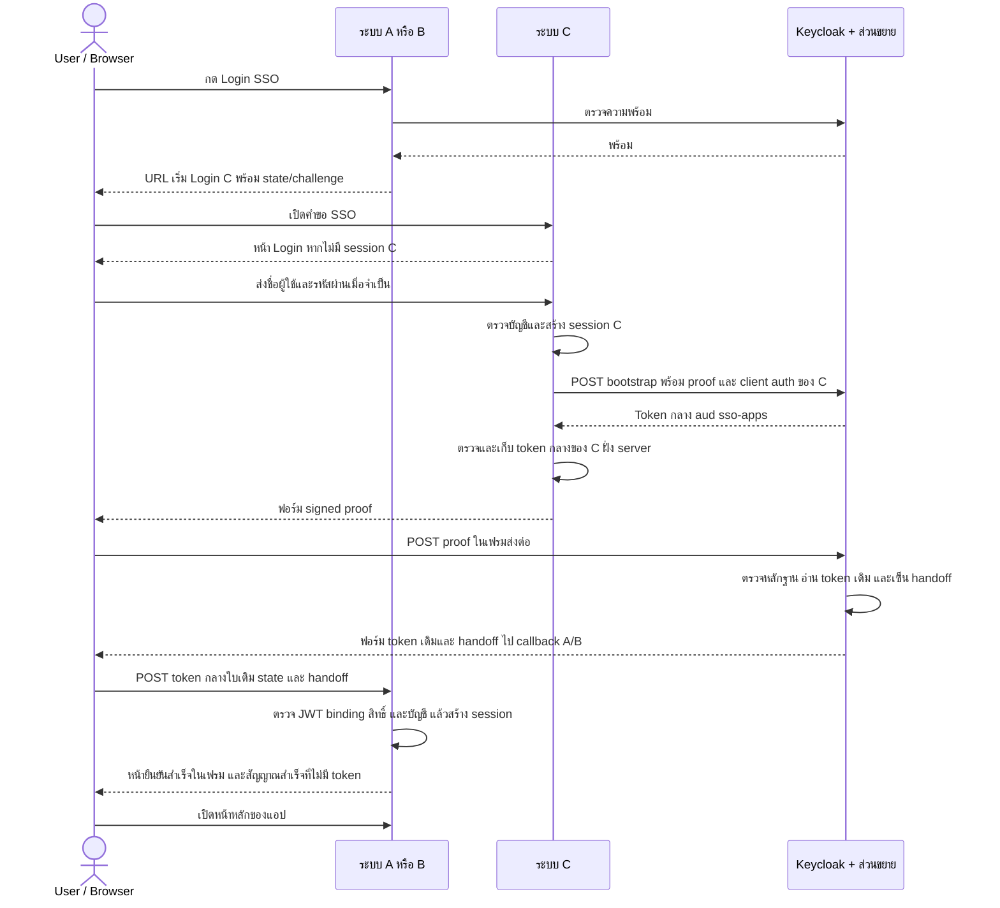

# SSO PoC — C ยืนยันตัวตน, Keycloak ออก token ชั่วคราว

A/B/C ใน Docker Compose ใช้ flow ตัวตนชั่วคราวแล้ว C เก็บบัญชีและสิทธิ์ Keycloak ตรวจหลักฐานที่ C ลงลายเซ็นและออก token กลาง ส่วน A/B ตรวจ token สิทธิ์ และบัญชีในฐานข้อมูลตัวเองก่อนสร้าง token/session แยกกัน

**ไม่ sync user หรือ role mapping เข้า Keycloak และ C server ไม่ได้รับ token กลางของ A/B** สถานะตัวตนและ token กลางเก็บใน cache TTL ของส่วนขยาย Java ไม่มี native Keycloak user session หรือ refresh token ใน PoC นี้

Login C สำเร็จแล้วจะเริ่มขอ token กลาง `aud=sso-apps` ทันที เก็บ C token ฝั่ง server และขึ้นสถานะสำเร็จหลังตรวจ JWT แล้ว ก่อนเปิด A/B จะเห็นรายการ app-control ในเมนู SSO Tokens

## เริ่มอ่าน

1. [รายการ flow F01–F10](docs/flows/README.md)
2. [Sequence diagram และ flowchart แยกแต่ละกรณี](docs/flows/LOGIN-AND-SESSION.md)
3. [API และจำนวน request](docs/flows/API-CATALOG.md)
4. [เข้าใจ feature และตั้งค่า Keycloak ทีละขั้น](docs/keycloak/SETUP-GUIDE.md)
5. [ผลทดสอบกับแอปจริง](docs/flows/TEST-RESULTS.json)

## แต่ละระบบทำอะไร

| ส่วน                | หน้าที่                                                                                                    |
| ------------------- | ---------------------------------------------------------------------------------------------------------- |
| A/B                 | Login local ด้วยฐานข้อมูลตัวเอง หรือรับ token กลาง ตรวจ read และ local account แล้วสร้าง app token/session |
| C                   | ตรวจรหัสผ่าน เก็บบัญชีและ read/write/delete ของแต่ละแอป ลงลายเซ็น proof และแจ้ง Logout                     |
| Keycloak + ส่วนขยาย | ตรวจ proof C เก็บตัวตน/สิทธิ์ชั่วคราวและออก token กลางใบเดียวรวมสิทธิ์ทุกแอป                               |
| Browser             | ถือ session cookie แยกแต่ละระบบ และส่ง proof/token ผ่าน form POST                                          |



เฟรมส่งต่อใช้เพื่อกู้คืนเมื่อ Keycloak ล่มหลังตรวจพร้อม ผ่านไป 12 วินาทีแล้วยังไม่สำเร็จจะกลับ Login A/B พร้อม modal C server เก็บ token กลางใบเดียวกับ A/B; สัญญาณที่ส่งให้หน้าส่งต่อมีเพียง `sso-complete` ไม่มี JWT

## เปิด PoC บนเครื่องใหม่

ต้องมี Docker, Node.js และ Google Chrome สำหรับ integration tests คำสั่งทั้งหมดรันที่ root ของ repo

```sh
cp .env.example .env
npm ci
npm --prefix app ci
npm --prefix app-control ci
npm run keys:generate
npm run lab:prepare
docker compose up -d --build
npm run lab:configure
```

ตั้งรหัสฐานข้อมูลและ session secrets ใน `.env` ก่อนเปิดแล็บ `lab:prepare` สร้าง Client Secrets A/B/C เมื่อยังว่างหรือเป็น placeholder โดยไม่พิมพ์ออกจอ `lab:configure` สร้าง/ปรับ realm, trust C และ clients A/B/C ในแล็บ ไม่สร้าง users/roles และไม่ใช่การ import ข้อมูลผู้ใช้

A/B ต้องมีบัญชี local ที่ email ตรง C จึงจะใช้ SSO ได้ C มี admin เริ่มต้น แต่ A/B ไม่ seed user อัตโนมัติ:

```sh
printf '%s' 'admin-a-demo' | docker compose exec -T app-a node src/create-user.js admin@example.com
printf '%s' 'admin-b-demo' | docker compose exec -T app-b node src/create-user.js admin@example.com
```

ตัวอย่างนี้เป็นบัญชีทดสอบ localhost เท่านั้น ถ้ามี email แล้ว CLI จะไม่เขียนทับรหัสผ่านเดิม

| ระบบ           | URL                         | บัญชีตัวอย่าง                                      |
| -------------- | --------------------------- | -------------------------------------------------- |
| A              | http://localhost:4001/login | admin@example.com / admin-a-demo เมื่อสร้างตาม CLI |
| B              | http://localhost:4002/login | admin@example.com / admin-b-demo เมื่อสร้างตาม CLI |
| C              | http://localhost:4003/login | admin / admin-c                                    |
| Keycloak Admin | http://localhost:8080/admin | admin / admin-local-demo                           |

## พฤติกรรมที่ใช้จริง

- กด SSO A/B เมื่อยังไม่มี session C: Login C ได้ token กลางก่อน แล้ว A/B รับ token ใบเดิม
- มี session C แล้วเปิดอีกแอป: ไม่ถามรหัสผ่านซ้ำ และใช้ token กลางใบเดียวกับ C
- Login C โดยตรง: สร้าง session C แล้วขอ token กลาง `aud=sso-apps` ทันที ตรวจ JWT ก่อนขึ้นสถานะสำเร็จ ไม่ต้องรอเปิด A/B
- Login local A/B: ไม่ออก token กลาง ไม่ทำให้ Login อีกแอปได้
- ไม่มี read หรือไม่มี local account: กลับ Login A/B และแสดง modal ครั้งเดียวเมื่อผู้ใช้กด SSO
- แก้สิทธิ์ใน C: บันทึกที่ C แล้ว revoke token เดิมและแจ้ง A/B ออก ผู้ใช้เริ่ม SSO ใหม่เพื่อรับสิทธิ์ล่าสุด
- Logout A/B: ออกเฉพาะแอป ไม่ Logout C หรืออีกแอป
- Logout C: signed proof ไป Keycloak ลบสถานะชั่วคราว แล้ว signed notification ไป A/B ล้างเฉพาะ SSO sessions; local sessions คงอยู่
- Access token ปกติ 15 นาที; heartbeat browser ทุก 1 ชั่วโมง และ protected requests ตรวจ expiry ด้วย ไม่มี auto-refresh
- Keycloak ล่ม: preflight สูงสุด 3 ครั้งสำหรับการกด SSO และแจ้ง modal; local Login ยังใช้ได้

การไม่ถามรหัสผ่านซ้ำอาศัย **session C** ไม่ใช่ token กลางร่วมใน localStorage Browser ถือ cookie อ้างอิง session เท่านั้น token ของแอปและ token กลางเก็บฝั่ง server ของแต่ละแอป

## ทดสอบ

```sh
npm run check
npm test
npm run test:integration
npm run test:token-menu
```

Integration tests ใช้ A/B/C, PostgreSQL และ Keycloak จริง ตรวจ Login local/SSO, user management, read/write/delete, modal, replay, Logout, expiry, heartbeat และ outage โดยหยุดเฉพาะ Keycloak ของแล็บชั่วคราว แล้วคืนสถานะและอายุ token เมื่อจบ รายงานอยู่ใน `docs/flows/TEST-RESULTS.json` ตั้ง `CHROME_PATH` ได้หาก Chrome อยู่ตำแหน่งอื่น

ทดสอบ heartbeat โดยเร่ง timer จากฝั่ง test เท่านั้น ไม่เปลี่ยนช่วง 1 ชั่วโมงของโค้ดแอป และไม่ได้รอหนึ่งชั่วโมงจริง ใช้บัญชี admin และบัญชีตัวอย่าง A/B ด้านบน จึงควรรันในแล็บนี้เท่านั้น

## โครงสร้าง

```text
app/                       # โค้ด A/B ร่วมกัน แยก env/DB/cookie/session
app-control/               # C: บัญชี สิทธิ์ signed proof และ Logout
keycloak/                  # Java extension + Dockerfile ที่ Compose ใช้จริง
postgres/                  # image และ initialization ของฐานข้อมูลแยก A/B/C
scripts/setup-temporary-sso.cjs # เตรียม config ของ realm และ client
scripts/test-temporary-sso.cjs  # integration tests กับแล็บจริง
docs/flows/                # flow, API และผลทดสอบ
docs/keycloak/             # feature/settings พร้อมเหตุผล
```

## ขอบเขต

นี่เป็น PoC localhost แบบ Keycloak node เดียว ใช้ HTTP ภายในแล็บ ส่วนขยายใช้ SPI ภายในของ Keycloak จึงผูกกับเวอร์ชัน 26.8.1 ยังไม่ทดสอบ HA, cache หลาย node หรือระบบส่ง notification ซ้ำแบบทนทาน หาก revoke/แจ้งแอปไม่สำเร็จ C ตอบ 503 เพื่อให้ retry ไม่ถือว่า Logout สำเร็จ

`.env`, private keys และข้อมูลจริงไม่ commit ไม่มีการนำ token หรือ Client Secret จริงลงในรายงาน

โค้ดที่เหลือยึด flow ปัจจุบัน: token กลางใบเดียวร่วม C/A/B, session ของแต่ละแอปแยกกัน และสถานะ C ใช้ idle/checking/success/failed เท่านั้น สคริปต์ตั้งค่า สร้างกุญแจ สร้างบัญชี และทดสอบยังใช้สำหรับเปิดและตรวจแล็บ

กรณีเริ่ม SSO ที่ A/B แล้ว Login C สำเร็จ C ส่งหน้าส่งต่อ proof จาก POST /login ได้ทันที ไม่ redirect กลับมาเรียก C เพิ่มอีกครั้ง คำขอ SSO ถูกใช้ได้ครั้งเดียวและยังผูกกับ session ก่อน Login แม้จะเปลี่ยน session ID แล้ว

อ่านโครงสร้างและหน้าที่คลาส Java ที่ [คู่มือส่วนขยาย Keycloak](keycloak/README.md)
