# Sequence diagram และ flowchart แยกตาม flow

[รายการ flow](README.md) · [API และวิธีนับ](API-CATALOG.md)

ทุก sequence แยก Browser ออกจาก backend; คำตอบ Redirect ไม่ใช่ server เรียก server ส่วนลูกศร backend ที่ระบุ POST/GET คือ HTTP จริง การตรวจ signature/permission ภายในแอปไม่ใช่ request ออกไปภายนอก

จำนวนด้านล่างไม่รวมไฟล์ static, Docker healthchecks, SSE ที่เปิดค้าง และการ refresh JWKS เว้นแต่ระบุไว้

## F01 — Login local ของ A/B

ตรวจบัญชีใน DB ของแอปเอง ไม่ต้องมีผู้ใช้ C และไม่สร้าง token กลาง

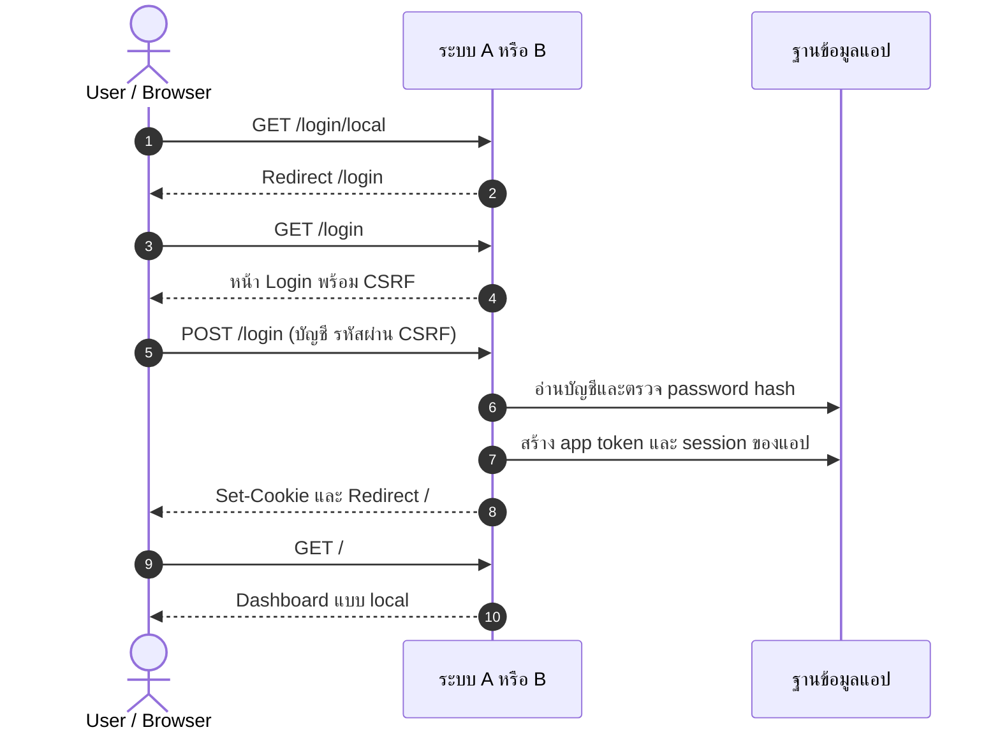

[เปิดภาพ PNG: F01 sequence](images/f01-sequence.png)

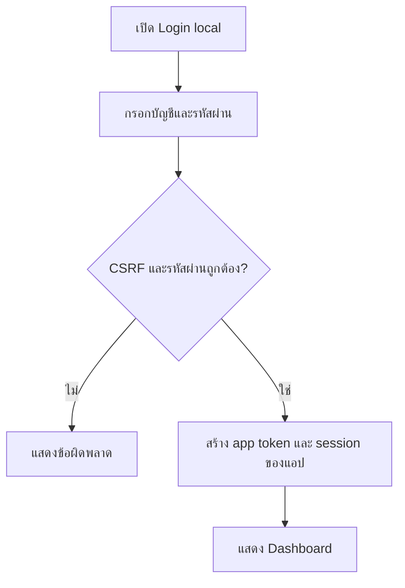

[เปิดภาพ PNG: F01 flowchart](images/f01-flowchart.png)

เส้นหลักที่ผู้ใช้ส่งข้อมูลคือ POST /login **1 ครั้ง**; เส้นทางตัวอย่างเต็มมี browser requests **4 ครั้ง** รวมหน้าเว็บและ redirects Keycloak **0 ครั้ง**

## F02 — Login C โดยตรงและขอ token ของ C

Login C สำเร็จก่อนเชื่อม SSO หาก Keycloak ล่ม C ยังมี local session หน้า dashboard ตรวจสถานะแบบ polling และ POST continue เมื่อพร้อม

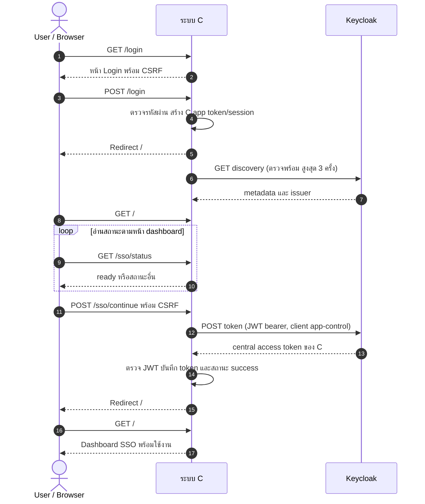

[เปิดภาพ PNG: F02 sequence](images/f02-sequence.png)

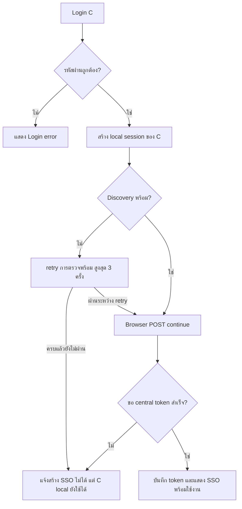

[เปิดภาพ PNG: F02 flowchart](images/f02-flowchart.png)

Keycloak กรณีสำเร็จปกติ: discovery **1** + token **1** = **2 requests** บวก certs เมื่อ cache ต้องโหลด จำนวน status polling ไม่คงที่ GET /sso/status ไม่ได้เรียก Keycloak ทุกครั้ง

## F03 — กด SSO A/B และยังไม่มี session C

ภาพเริ่มเมื่อมีหน้า Login A/B แล้ว ผู้ใช้กดปุ่มเอง; automatic silent check ที่อาจเกิดตอนเปิด /login ครั้งแรกแยกอยู่ F04

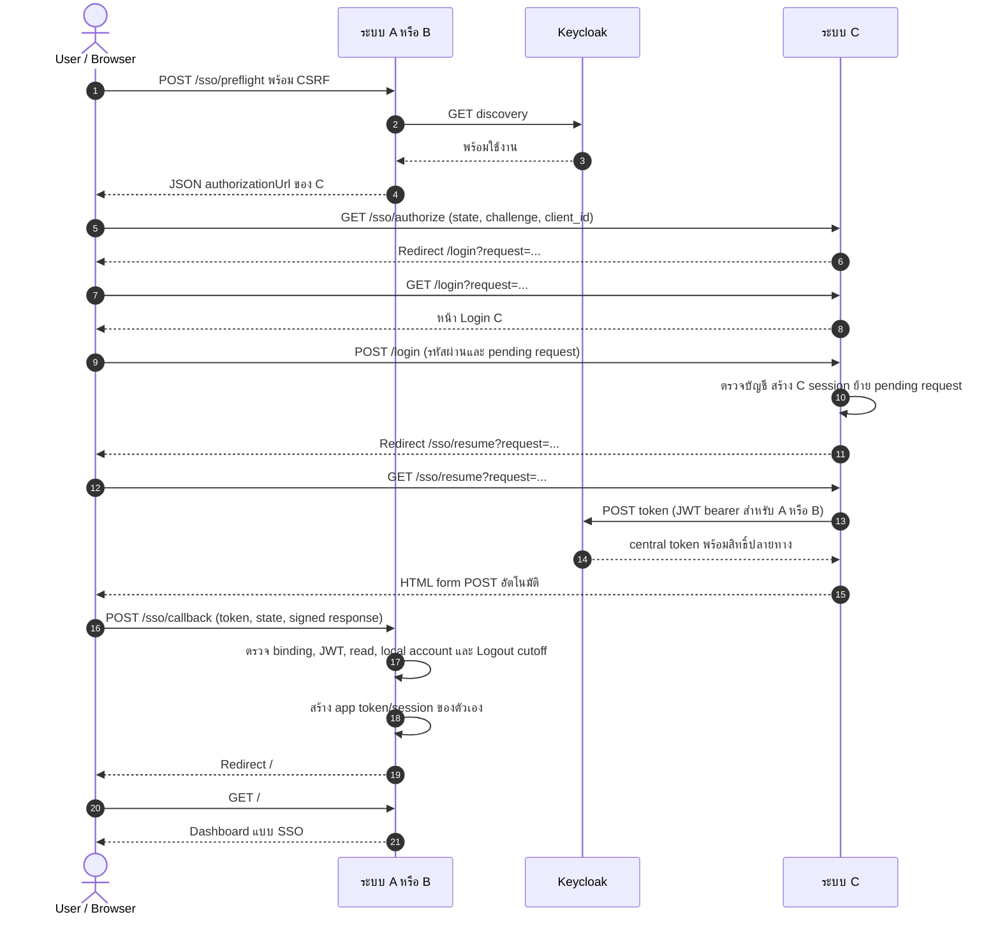

[เปิดภาพ PNG: F03 sequence](images/f03-sequence.png)

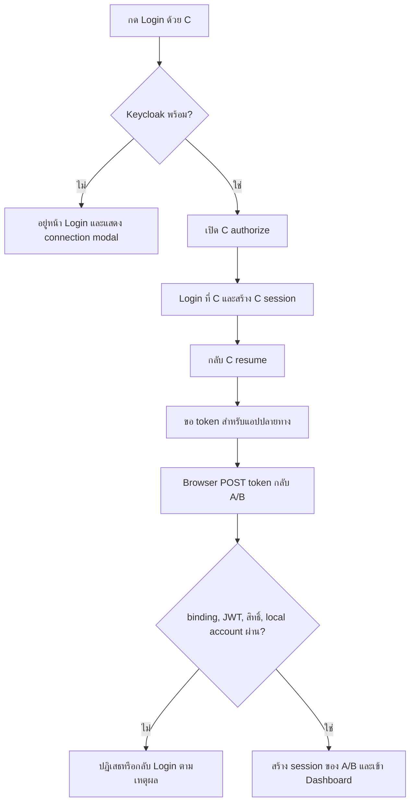

[เปิดภาพ PNG: F03 flowchart](images/f03-flowchart.png)

Token issuance มี **C→Keycloak 1 request**; preflight discovery อีก **1 request** ฝั่ง browser ตามภาพมี **7 requests** ไม่รวม progress polling `/sso/connectivity` และ assets ไม่มี `/sso/redeem` และไม่มี Login introspection

การ Login C ผ่าน relay นี้ไป `/sso/resume` โดยตรง **ไม่ได้ bootstrap token app-control เพิ่ม** เหมือน F02

## F04 — มี session C แล้ว เข้า A/B โดยไม่กรอกรหัสผ่านซ้ำ

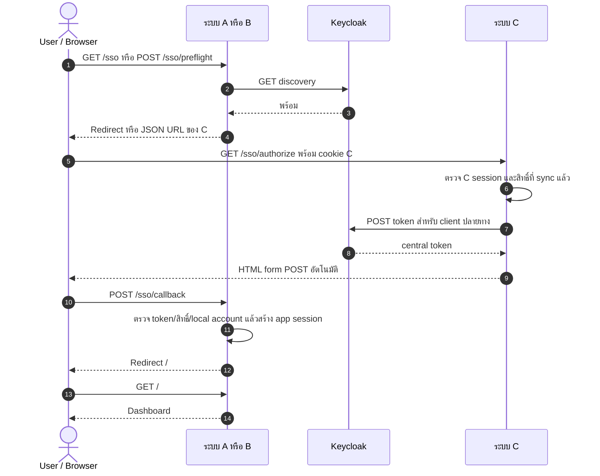

[เปิดภาพ PNG: F04 sequence](images/f04-sequence.png)

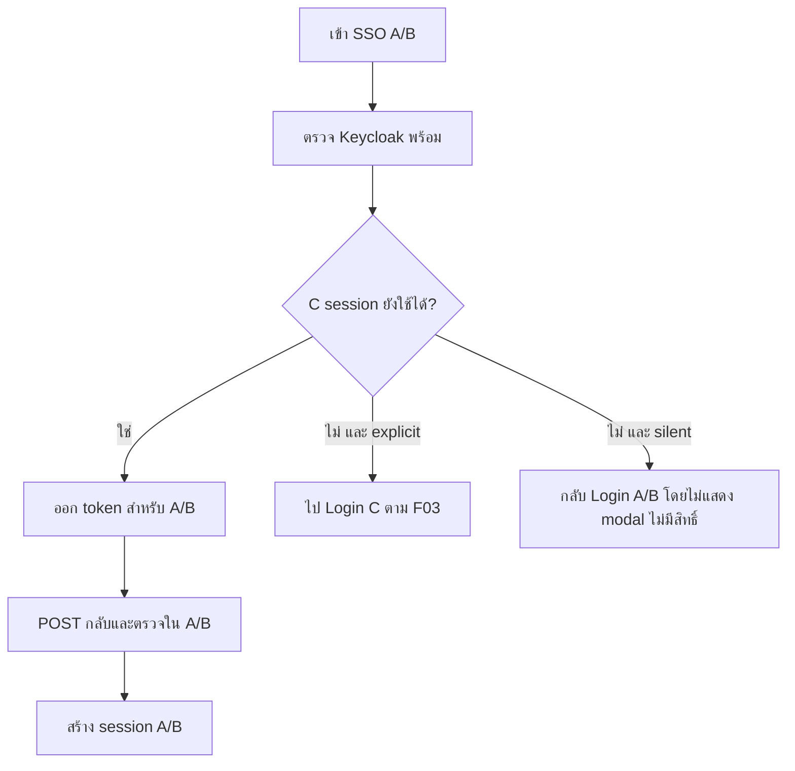

[เปิดภาพ PNG: F04 flowchart](images/f04-flowchart.png)

เส้นทางพื้นฐาน **browser 4 requests** + **Keycloak 2 requests** (discovery 1 + token 1) บวกกุญแจเมื่อจำเป็น

- กดลิงก์ใน C เพิ่ม browser GET `/connect/:system` **1** ก่อนมาถึง `/sso` และ UI เช็ค `/sso/status` ก่อนเดินทาง
- เปิด `/login` A/B ครั้งแรกอาจเริ่ม silent SSO ใน request นั้นเลย; mode silent ไม่บังคับไป Login C ถ้าไม่มี C session
- กดปุ่มบน A/B มี progress polling เพิ่ม ไม่ใช่ request ไป Keycloak
- token ของ A กับ B คนละใบ ส่วนการไม่ถามรหัสผ่านซ้ำอาศัย C session

## F05 — ไม่มีสิทธิ์หรือไม่มีผู้ใช้ใน A/B

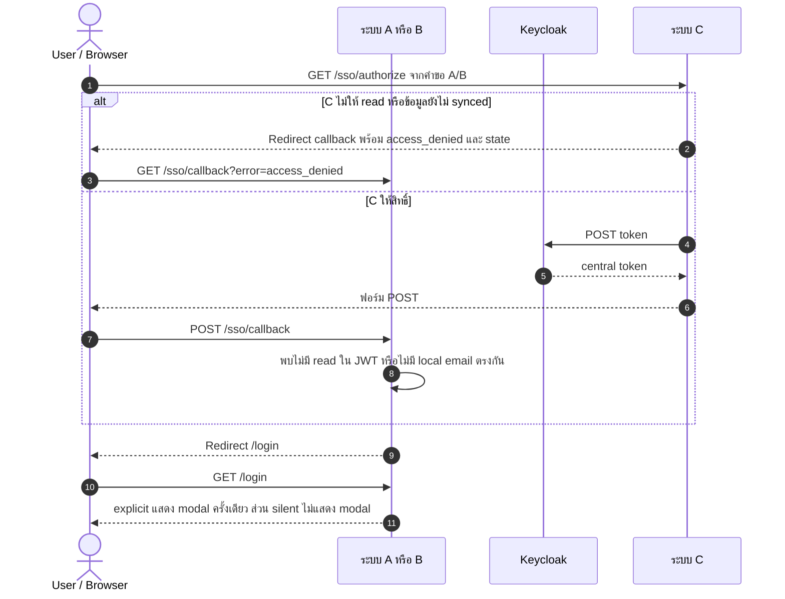

[เปิดภาพ PNG: F05 sequence](images/f05-sequence.png)

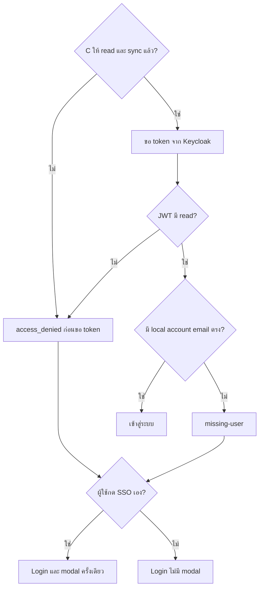

[เปิดภาพ PNG: F05 flowchart](images/f05-flowchart.png)

หลังผ่าน preflight แล้ว: C ปฏิเสธก่อน token → token **0**; A/B ปฏิเสธหลัง token → token **1** ไม่มี API ไปหาแอปอื่นเพื่อสร้าง local account ให้อัตโนมัติ

ลายเซ็น/state/token ปลอมแปลงเป็น **HTTP 400** ไม่ใช่ modal ไม่มีสิทธิ์ทุกกรณี

## F06 — Keycloak ติดต่อไม่ได้หรือออก token ไม่ได้

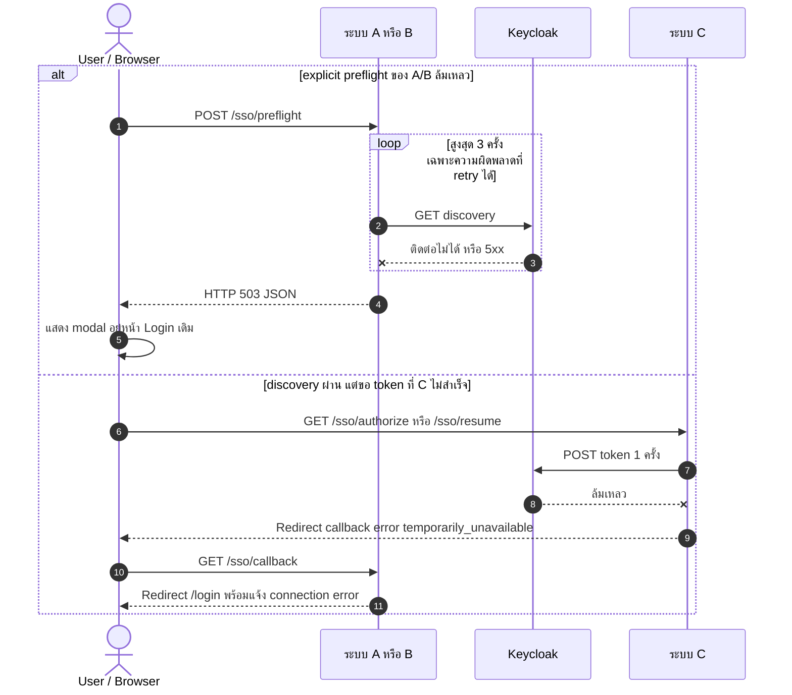

[เปิดภาพ PNG: F06 sequence](images/f06-sequence.png)

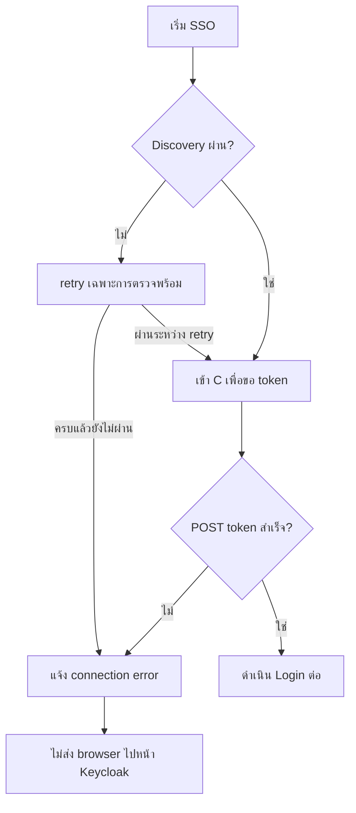

[เปิดภาพ PNG: F06 flowchart](images/f06-flowchart.png)

- explicit A/B และ direct bootstrap C: discovery สูงสุด **3** ครั้ง เว้นช่วง 2 และ 5 วินาที
- automatic silent A/B: discovery **1** ครั้ง
- issuer ผิดหรือ HTTP 4xx ที่ไม่ใช่ 429: หยุดทันที ไม่ retry จนครบ 3
- **POST token ไม่ได้ retry 3 ครั้งในโค้ดปัจจุบัน** หากล้มเหลวให้เริ่มใหม่จาก UI
- หากเป็น direct Login C: C session คงอยู่ สถานะ SSO failed และแสดง modal ใน C

## F07 — Heartbeat, token หมดอายุ หรือถูก revoke

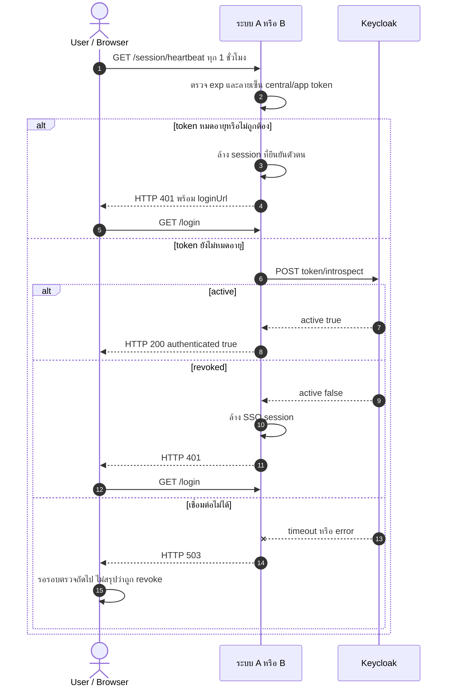

[เปิดภาพ PNG: F07 sequence](images/f07-sequence.png)

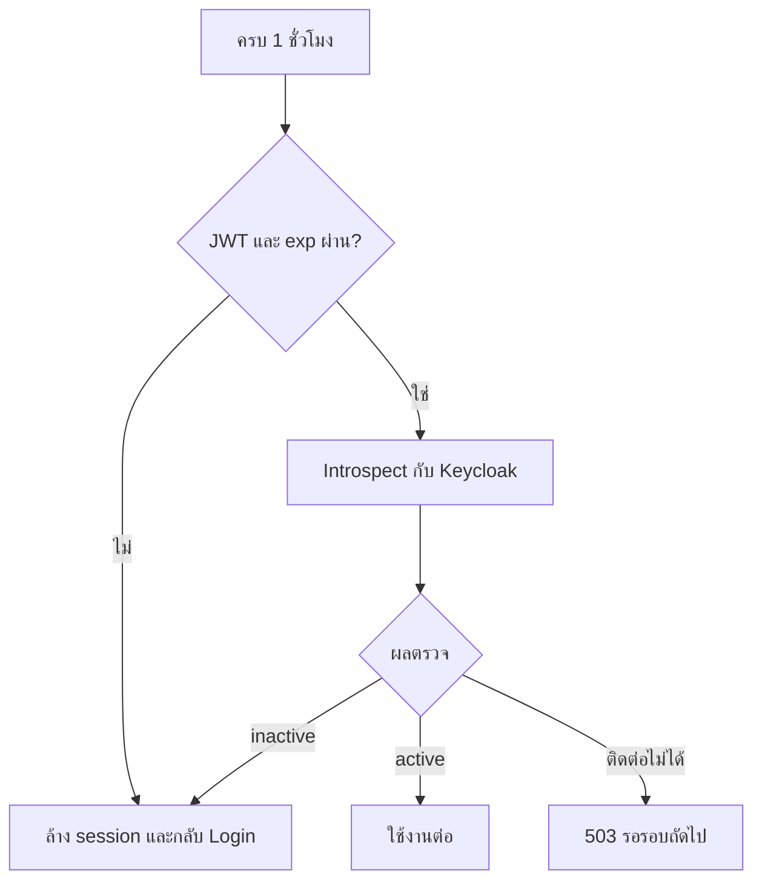

[เปิดภาพ PNG: F07 flowchart](images/f07-flowchart.png)

Browser heartbeat **1 request ต่อรอบ**; Keycloak introspection **0 หรือ 1** ตามว่า exp ผ่านหรือไม่ ไม่มี timer/focus check เพิ่ม Protected requests ก็ตรวจ exp และ introspect เมื่อเลยช่วงตรวจ 1 ชั่วโมง ส่วน local Login ไม่มี browser heartbeat script นี้

## F08 — Logout A/B เฉพาะแอป

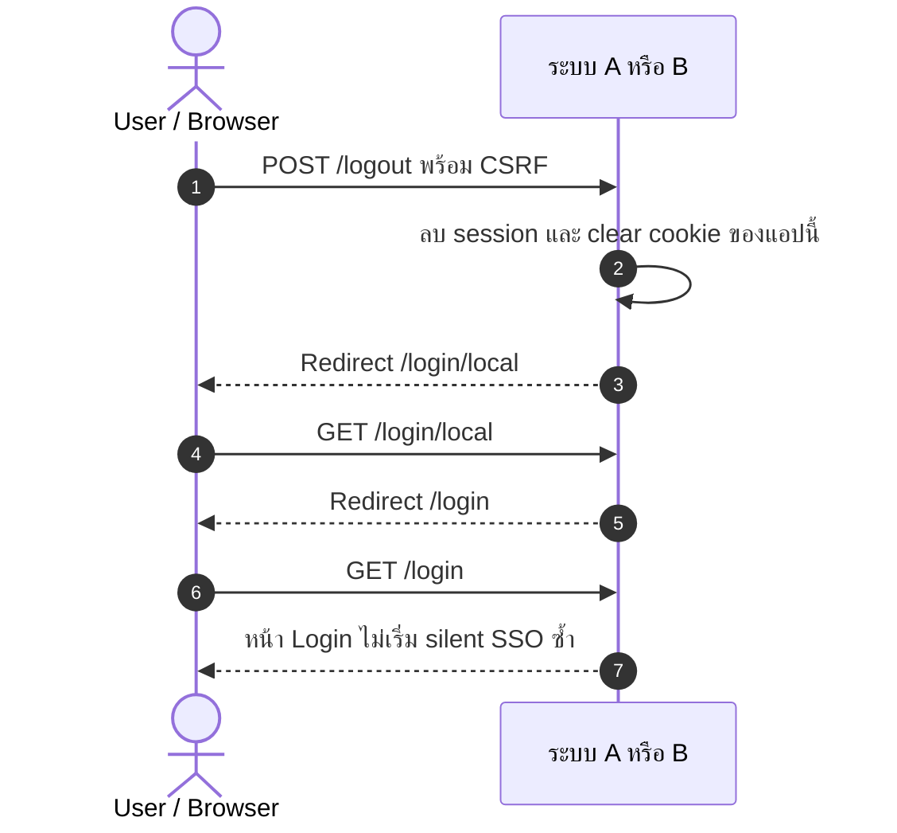

[เปิดภาพ PNG: F08 sequence](images/f08-sequence.png)

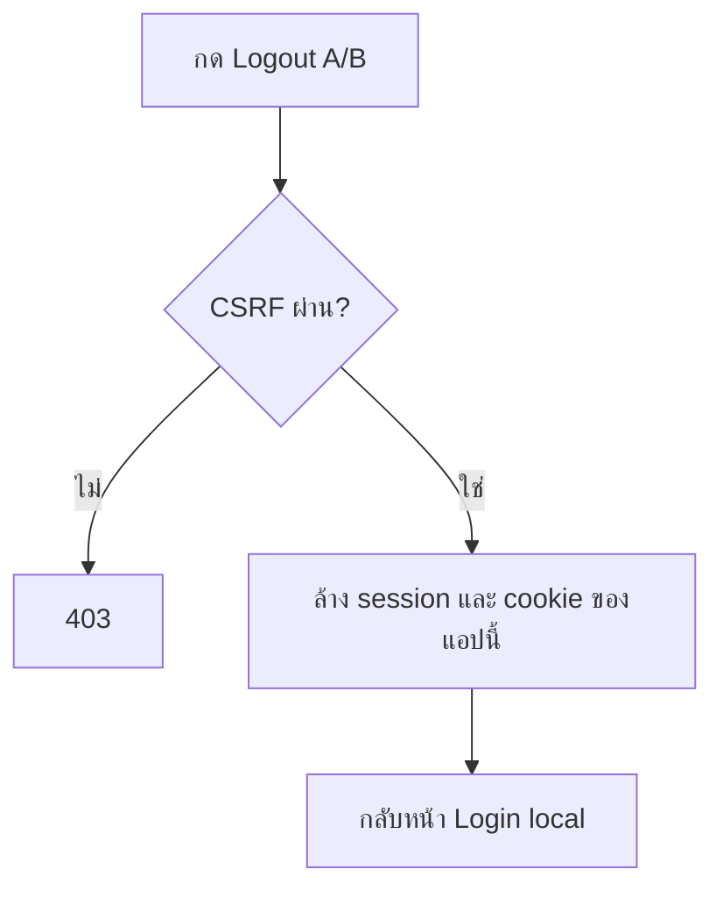

[เปิดภาพ PNG: F08 flowchart](images/f08-flowchart.png)

Browser **3 requests** ตามภาพ; Keycloak **0** C และแอปอื่นไม่ Logout ตามการกดนี้

## F09 — Logout C, revoke token กลาง และบังคับ A/B Logout

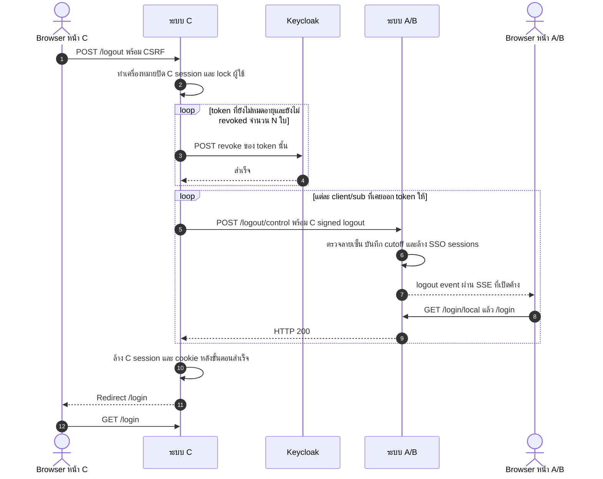

[เปิดภาพ PNG: F09 sequence](images/f09-sequence.png)

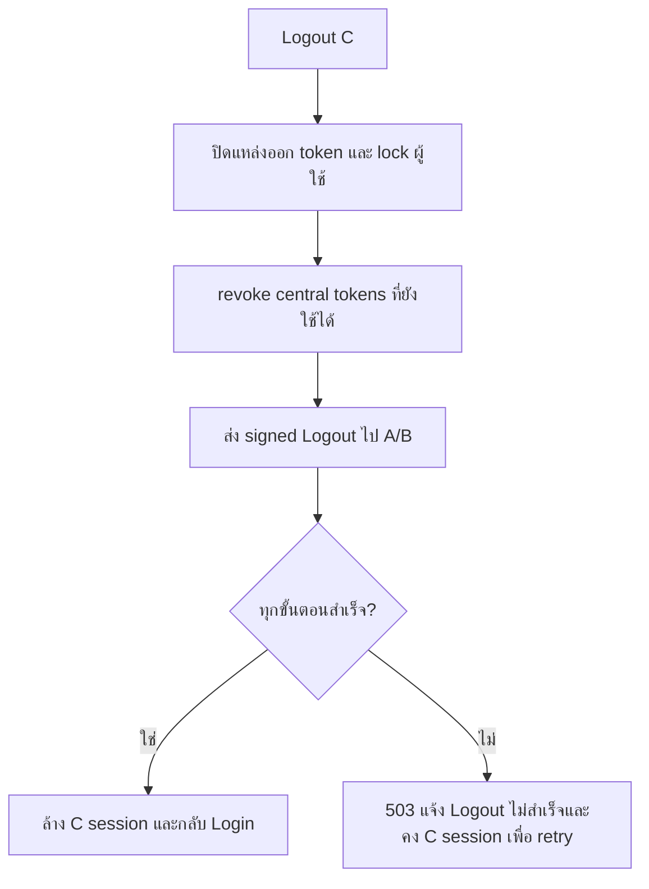

[เปิดภาพ PNG: F09 flowchart](images/f09-flowchart.png)

Keycloak revoke **N requests** ตาม token ที่ยังไม่หมดอายุ ไม่เรียก Admin logout หรือขอ service-account token ใน Logout flow แล้ว C→A/B notification **0–2** ตาม client/sub ที่บันทึกไว้ปกติ ถ้ามีหลาย central sub จำนวน notification อาจมากขึ้น

SSE event เป็นข้อมูลใน connection เดิม ไม่ใช่ HTTP request ใหม่ การตรวจ cutoff ทำให้ form token ที่ส่งช้าหลัง Logout ไม่สามารถเปิด session กลับมาได้ Local A/B sessions ไม่ถูกล้าง

การ rollback DB ไม่ย้อนคืน network revoke ที่สำเร็จไปแล้ว การ retry จึงอาจพบ token บางใบถูก revoke ไปก่อนแล้ว

## F10 — จัดการผู้ใช้และสิทธิ์ใน C

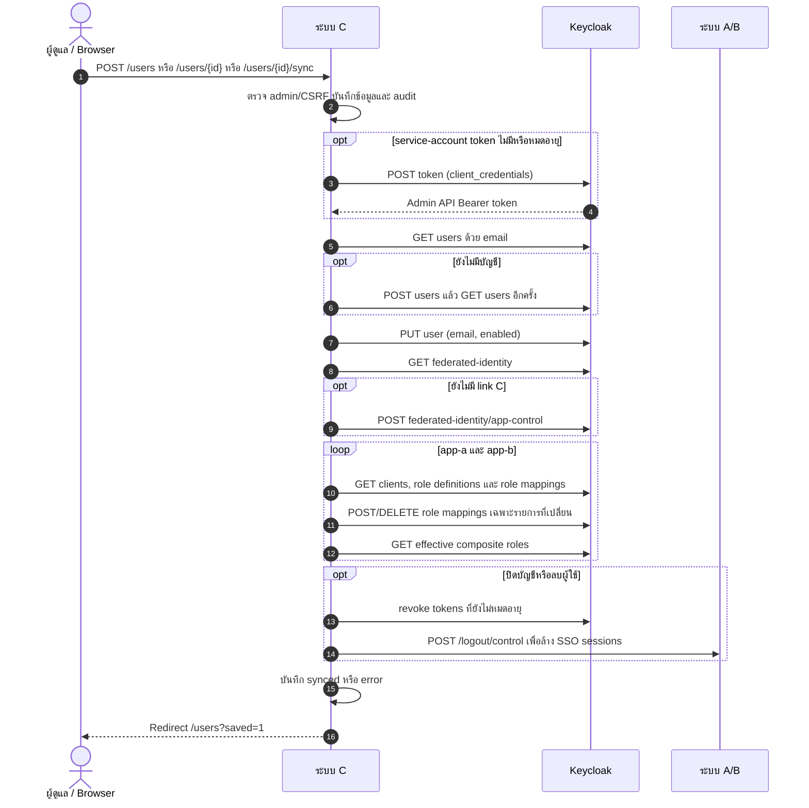

[เปิดภาพ PNG: F10 sequence](images/f10-sequence.png)

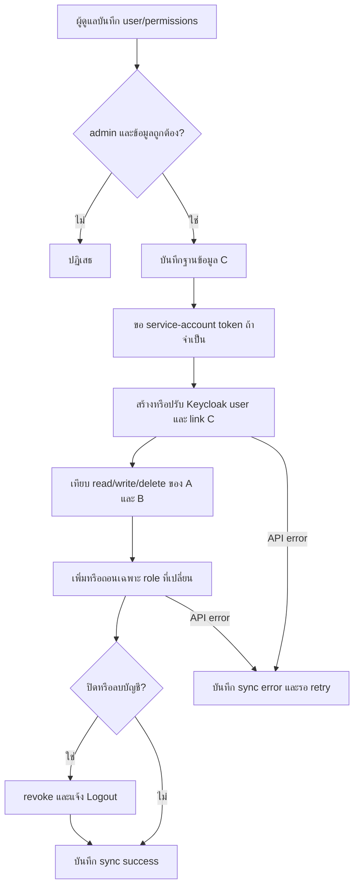

[เปิดภาพ PNG: F10 flowchart](images/f10-flowchart.png)

Sync enabled user ที่มีบัญชี/link/roles ตรงอยู่แล้วใช้ Admin API **11 requests** ไม่รวม service-account token ที่ cache ไว้ได้ หากสร้างบัญชีใหม่เพิ่ม POST user + GET lookup อีกครั้ง และเพิ่ม POST link เมื่อยังไม่มี การเปลี่ยนแต่ละ role เพิ่ม POST หรือ DELETE ต่อ role จริง

POST /users/{id}/delete มีขั้นตอนเพิ่ม: ปิดบัญชีและถอนสิทธิ์ให้ sync สำเร็จ → revoke/Logout → DELETE federated link → ลบผู้ใช้เฉพาะ DB ของ C ไม่ได้ DELETE Keycloak user
