# กระบวนการ Login และจัดการ Session

เอกสารนี้อธิบายขั้นตอนการใช้งานและการทำงานระหว่างระบบ A/B, ระบบ C และ Keycloak แต่ละกรณีมี Sequence diagram และ Flowchart อ่าน [รายการกระบวนการ](README.md) และ [รายละเอียด API](API-CATALOG.md) ประกอบ

## วิธีอ่านภาพ

- **Login** คือการใช้บัญชีและรหัสผ่านของระบบที่เปิดอยู่ ส่วน **Login SSO** ใช้การยืนยันตัวตนจาก C
- **Session** คือสถานะการเข้าสู่ระบบ แต่ละระบบเก็บ session ของตัวเอง
- **Token กลาง** คือหลักฐานที่ Keycloak ออกให้ พร้อมสิทธิ์ของผู้ใช้ C/A/B ใช้ token ใบเดียวกันในรอบ SSO นั้น
- **หลักฐานยืนยันตัวตน** คือข้อมูลที่ C ลงลายเซ็นให้ Keycloak ตรวจ ส่วน **หลักฐานส่งต่อ** ผูก token กับคำขอเข้าสู่แอปปลายทาง
- **ผู้ใช้ / Browser** หมายถึง browser ที่ผู้ใช้เปิดอยู่ การเปลี่ยนหน้าและส่งแบบฟอร์มข้ามระบบจึงมีลูกศรผ่านจุดนี้
- ตัวเลขใน Sequence diagram เป็นลำดับขั้นตอน ไม่ใช่จำนวน API requests ภาพแสดงขั้นตอนหลัก ส่วน URL, fields, HTTP status และจำนวนคำขออยู่ใน API catalog

## F01 — Login A/B

ผู้ใช้กรอกบัญชีและรหัสผ่านของ A หรือ B ระบบตรวจข้อมูลกับฐานข้อมูลของตัวเอง แล้วสร้าง session สำหรับใช้งานระบบนั้น

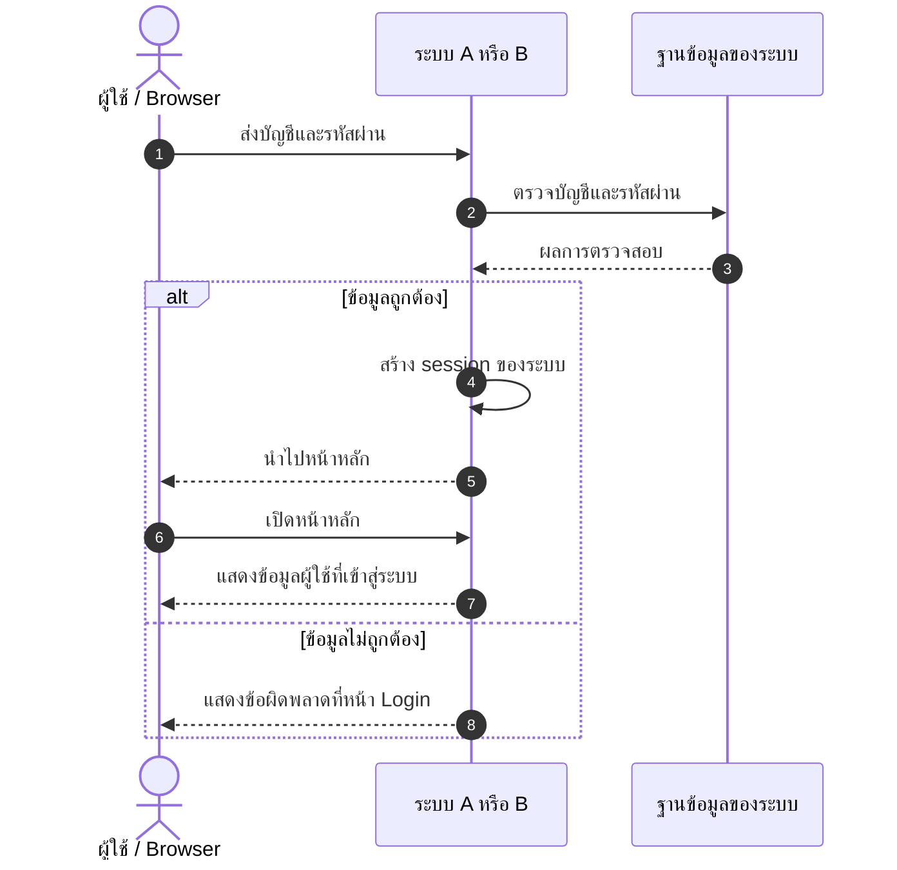

[เปิดภาพ PNG: F01 sequence](images/f01-sequence.png)

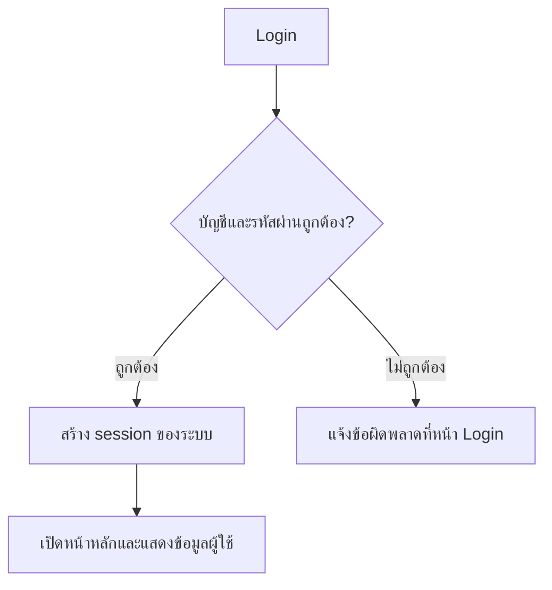

[เปิดภาพ PNG: F01 flowchart](images/f01-flowchart.png)

ช่องทางนี้ไม่ขอ token กลาง การ Login A จึงไม่ทำให้เข้า B หรือ C ได้โดยอัตโนมัติ หน้า Login ครั้งแรกอาจตรวจ SSO เบื้องหลัง แต่การตรวจรหัสผ่านของช่องทาง Login ใช้ฐานข้อมูลของระบบเท่านั้น

## F02 — Login C

เมื่อ C ยืนยันรหัสผ่านสำเร็จ ผู้ใช้ใช้งาน C ได้ทันที และ C เริ่มขอ token กลางเพื่อเตรียม SSO เมื่อได้รับและตรวจ token ผ่านแล้วจึงแสดงว่า SSO พร้อมใช้งาน

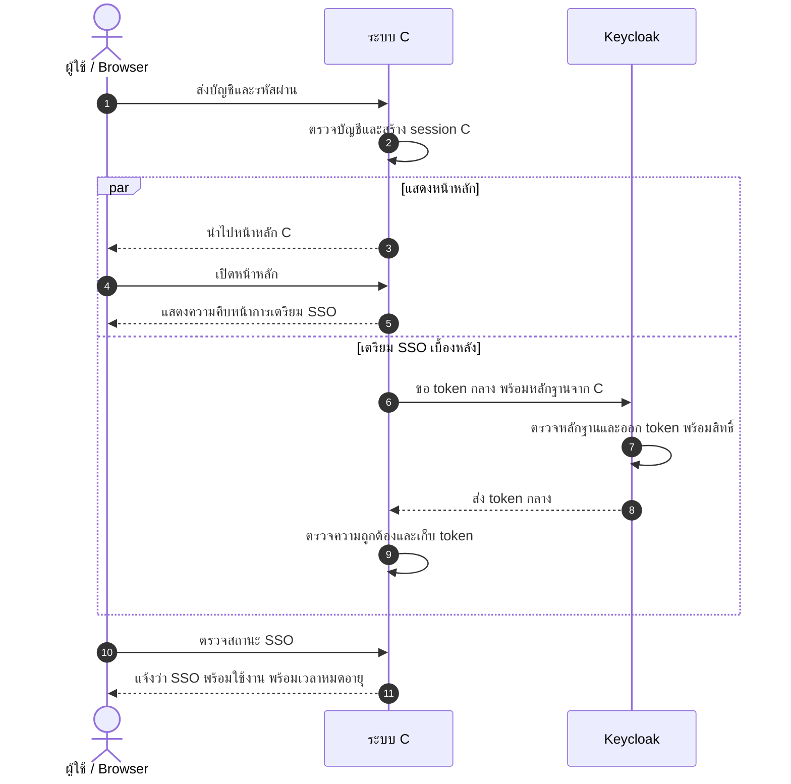

[เปิดภาพ PNG: F02 sequence](images/f02-sequence.png)

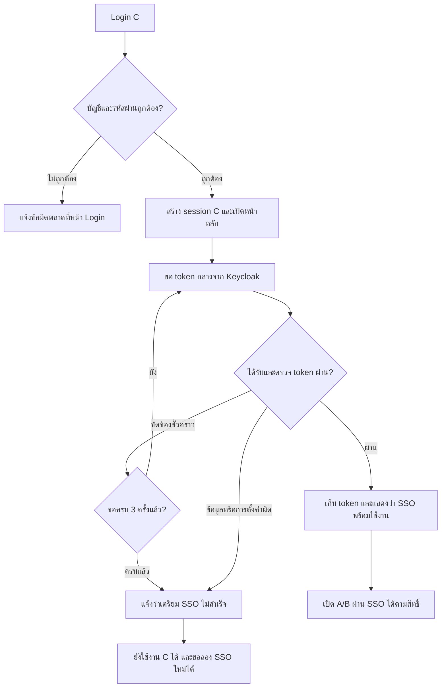

[เปิดภาพ PNG: F02 flowchart](images/f02-flowchart.png)

C เก็บ token ฝั่ง server หน้าเว็บได้รับเฉพาะสถานะและเวลาหมดอายุ รายการ token ดูได้ที่เมนู SSO Tokens ของ Keycloak การตรวจสถานะนี้ยืนยันว่าออก token สำเร็จแล้ว ไม่ใช่เพียงตรวจว่า Keycloak ตอบสนอง

## F03 — Login SSO A/B เมื่อยังไม่ได้เข้าสู่ระบบ C

A/B ตรวจความพร้อมของ Keycloak แล้วนำผู้ใช้ไป Login C หลังยืนยันตัวตนสำเร็จ C ขอ token กลาง จากนั้น Keycloak ส่ง token ใบเดิมผ่าน Browser ไปยัง A/B

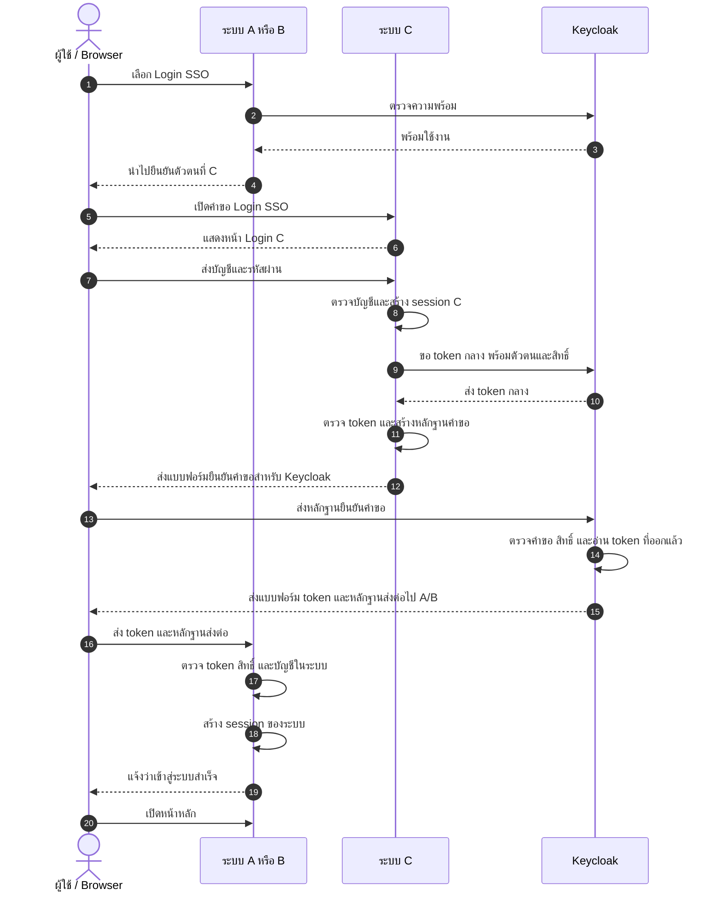

[เปิดภาพ PNG: F03 sequence](images/f03-sequence.png)

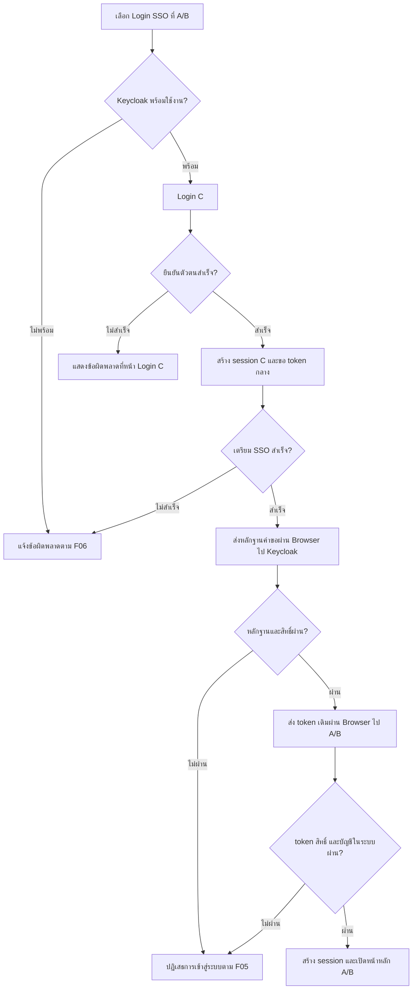

[เปิดภาพ PNG: F03 flowchart](images/f03-flowchart.png)

A/B ตรวจว่าลายเซ็นถูกต้อง ผู้ออก token และกลุ่มผู้รับตรงกับที่ตั้งค่า token ยังไม่หมดอายุ และหลักฐานส่งต่อผูกกับคำขอของ Browser นี้ จากนั้นตรวจสิทธิ์ read และบัญชีในฐานข้อมูลของแอปที่มี email ตรงกัน

การส่งแบบฟอร์มทำในเฟรมที่ซ่อนอยู่ หากสำเร็จ Browser เปิดหน้าหลัก A/B หากส่งต่อไม่สำเร็จภายใน 12 วินาทีจะกลับหน้า Login พร้อมแจ้งข้อผิดพลาด คำขอ Login C ถูกใช้ครั้งเดียวในคำขอเดิม ไม่เพิ่มหน้าสำหรับเริ่มกระบวนการซ้ำ

## F04 — Login SSO A/B เมื่อมี session C อยู่แล้ว

C ใช้ session ที่ยังใช้งานได้เพื่อยืนยันตัวตน ผู้ใช้จึงไม่ต้องกรอกรหัสผ่านซ้ำ หาก token กลางยังใช้ได้ Keycloak ส่งใบเดิมไปยังแอปปลายทาง

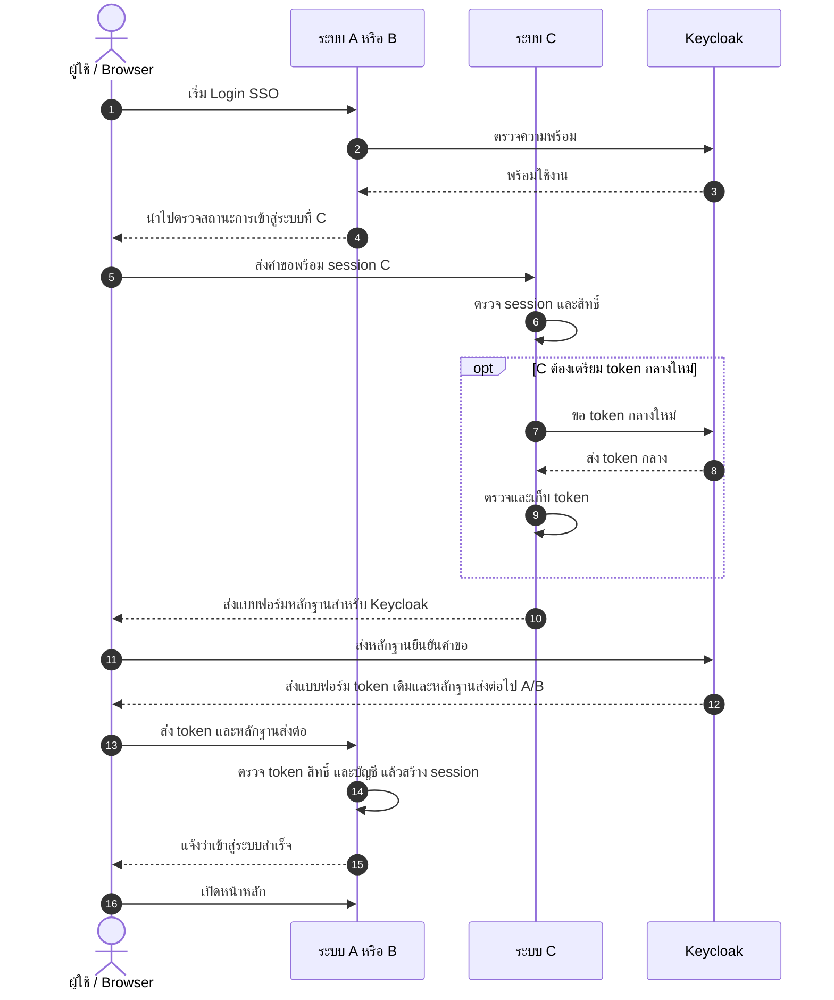

[เปิดภาพ PNG: F04 sequence](images/f04-sequence.png)

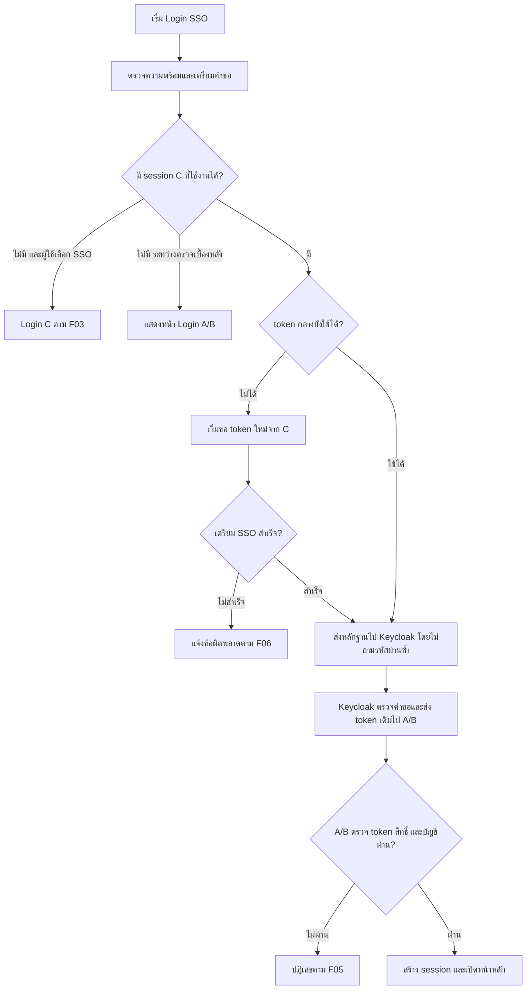

[เปิดภาพ PNG: F04 flowchart](images/f04-flowchart.png)

ลิงก์ A/B ในหน้าหลัก C เปิด `/sso` ของแอปปลายทางโดยตรง โดยไม่ผ่าน backend C เพื่อตรวจสิทธิ์หรือสถานะก่อนเปลี่ยนหน้า A/B เป็นผู้เริ่ม SSO และตรวจ token สิทธิ์ และบัญชีของตัวเองตามกระบวนการข้างต้น การเข้าแอปเพิ่มไม่ต่ออายุ token ใบเดิม หาก C เหลืออายุ token 3 นาที แอปที่เพิ่งเข้าก็ใช้ได้อีกไม่เกิน 3 นาทีเช่นกัน

## F05 — ปฏิเสธการเข้าสู่ระบบ

A/B อนุญาต SSO เมื่อ token ถูกต้อง มีสิทธิ์เข้าแอป และมีบัญชีที่ตรงกันในฐานข้อมูลของระบบ

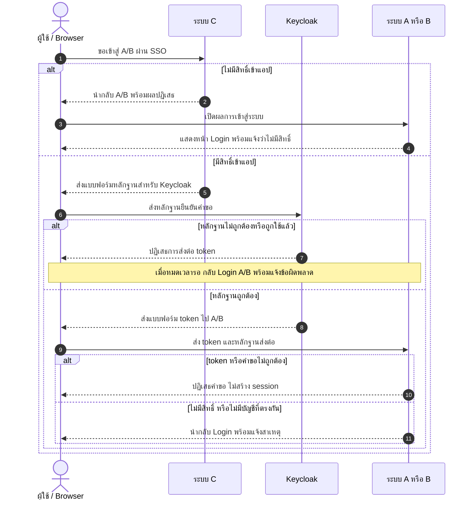

[เปิดภาพ PNG: F05 sequence](images/f05-sequence.png)

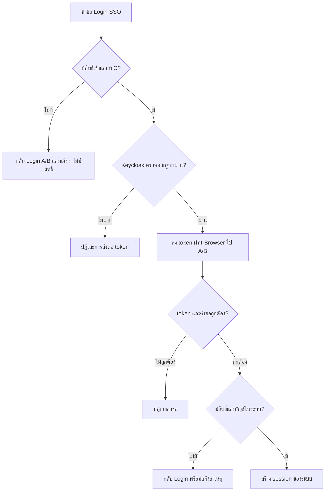

[เปิดภาพ PNG: F05 flowchart](images/f05-flowchart.png)

ข้อความไม่มีสิทธิ์หรือไม่มีบัญชีที่ตรงกันแสดงเป็น modal ครั้งเดียวจากการเลือก SSO ของผู้ใช้ การตรวจ SSO เบื้องหลังและการโหลดหน้าใหม่ไม่ทำให้ modal ไม่มีสิทธิ์เด้งซ้ำ ระบบไม่สร้างบัญชี A/B ให้อัตโนมัติ

คำขอที่ถูกปลอมหรือใช้ซ้ำอาจได้รับการปฏิเสธโดยตรง แทนการแสดง modal หากถูกปฏิเสธในเฟรม หน้าส่งต่อกลับ Login เมื่อหมดเวลารอ โดยไม่เปิดเผยรายละเอียดการตรวจหลักฐาน

## F06 — เตรียม SSO หรือส่งต่อ token ไม่สำเร็จ

การขัดข้องของ Keycloak แสดงผลที่หน้าแอป ผู้ใช้ยังเลือก Login ด้วยบัญชีของ A/B ได้

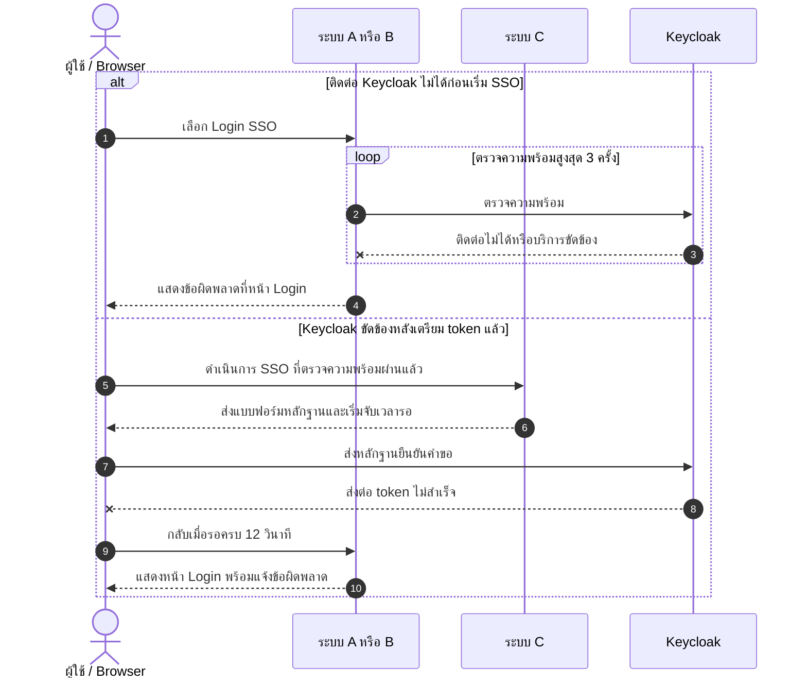

[เปิดภาพ PNG: F06 sequence](images/f06-sequence.png)

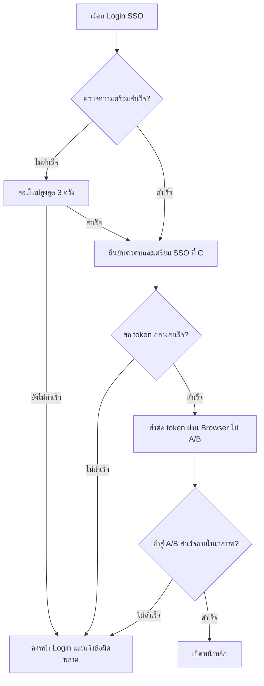

[เปิดภาพ PNG: F06 flowchart](images/f06-flowchart.png)

| จุดที่ขัดข้อง                   | การจัดการ                                                                                        |
| ------------------------------- | ------------------------------------------------------------------------------------------------ |
| A/B ตรวจความพร้อมไม่ได้         | ลองสูงสุด 3 ครั้ง แล้วแสดง modal ที่หน้า Login; การตรวจเบื้องหลังลอง 1 ครั้ง                     |
| C ขอ token ไม่สำเร็จ            | ลองสูงสุด 3 ครั้งเมื่อเป็นปัญหาชั่วคราว แจ้งว่าเตรียม SSO ไม่สำเร็จ แต่ session C ยังคงใช้งานได้ |
| ส่งต่อ token หรือรับผลไม่สำเร็จ | รอไม่เกิน 12 วินาที แล้วกลับ Login A/B พร้อม modal                                               |

การตรวจความพร้อมและการขอ token แต่ละครั้งรอการตอบกลับไม่เกิน 3 วินาที เว้นก่อนลองครั้งที่ 2 และ 3 เป็น 2 และ 5 วินาที ข้อผิดพลาดจาก credentials หรือข้อมูลหลักฐานจะหยุดให้แก้การตั้งค่า ไม่ส่งหลักฐานเดิมซ้ำโดยอัตโนมัติ

## F07 — ตรวจ Session และอายุ token

A/B ตรวจอายุ token เมื่อมีคำขอใช้งาน และ Browser ที่เปิดหน้า SSO อยู่จะตรวจ session ตาม `.env` ของแต่ละแอป ค่าเริ่มต้นทุก 2 นาที หาก token ยังไม่หมดอายุ การตรวจ heartbeat จะสอบถามสถานะ token กับ Keycloak เพิ่มเติม

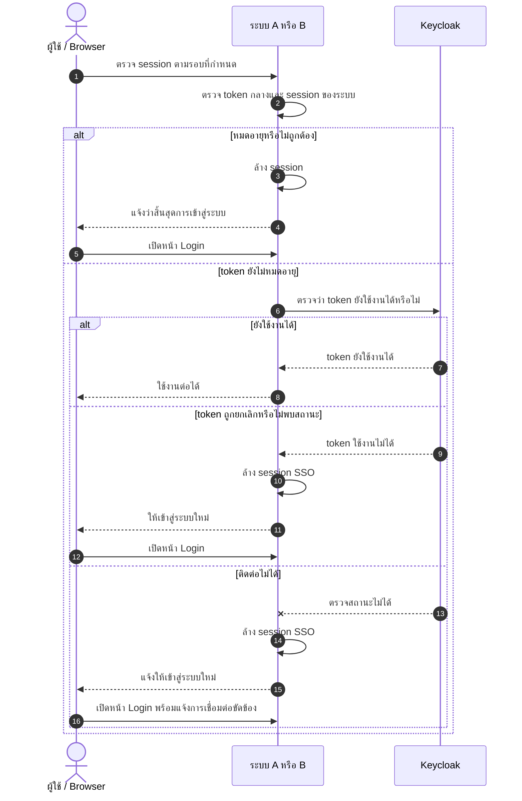

[เปิดภาพ PNG: F07 sequence](images/f07-sequence.png)

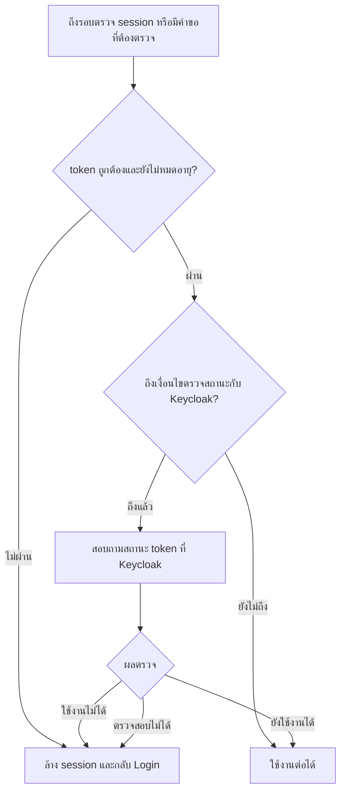

[เปิดภาพ PNG: F07 flowchart](images/f07-flowchart.png)

ถ้า token หมดอายุแล้ว A/B ล้าง session โดยไม่เรียก Keycloak หากถึงรอบตรวจแล้วติดต่อ Keycloak ไม่ได้ รอเกิน 5 วินาที หรือได้รับ HTTP error ระบบล้าง session SSO ของแอปนั้นและกลับ Login พร้อมแจ้งการเชื่อมต่อขัดข้อง การตรวจพบเกิดตามรอบ heartbeat หรือคำขอที่ถึงเงื่อนไขตรวจ ไม่รอให้ Keycloak กลับมาและไม่เก็บ session SSO ไว้ใช้ต่อ ส่วน Login ด้วยบัญชีของแอปเองคงอยู่

อายุ token ปกติ 15 นาที ส่วน heartbeat ค่าเริ่มต้นทุก 2 นาที ปรับแยก A/B ผ่าน `.env` ได้ หากเปิดหน้าค้างโดยไม่ส่งคำขอ หน้าเดิมอาจยังแสดงอยู่จนตรวจครั้งถัดไป คำขอใช้งานหลังหมดอายุจะถูกปฏิเสธ ดู [การตั้งอายุ token และรอบตรวจ](../keycloak/SETUP-GUIDE.md#อายุ-token-กับ-heartbeat-เป็นคนละค่า)

## F08 — Logout A/B

ผู้ใช้ออกจากระบบที่เปิดอยู่ โดย session C, token กลาง และ session ของแอปอื่นยังคงเป็นไปตามอายุและสถานะเดิม

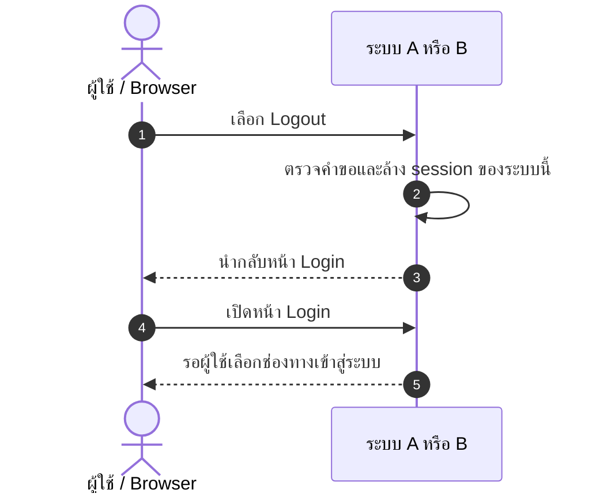

[เปิดภาพ PNG: F08 sequence](images/f08-sequence.png)

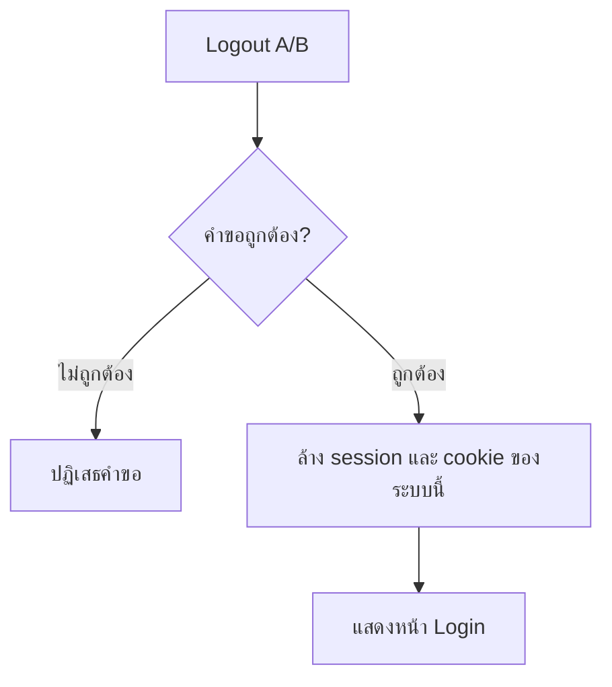

[เปิดภาพ PNG: F08 flowchart](images/f08-flowchart.png)

หลัง Logout ไม่เริ่ม SSO ซ้ำอัตโนมัติ หากผู้ใช้เลือก SSO ใหม่และ session C ยังใช้ได้ จะเข้าสู่ระบบได้ตามสิทธิ์โดยไม่ต้องกรอกรหัสผ่านซ้ำ

## F09 — Logout C และยกเลิก SSO

เมื่อผู้ใช้ Logout C ระบบยกเลิก token กลางของผู้ใช้นั้น และแจ้งปลายทางที่บันทึกใน Realm settings → Sessions → Logout ให้ล้าง session ที่เข้าสู่ระบบผ่าน SSO การ Login ด้วยบัญชีของ A/B เองยังคงใช้งานได้

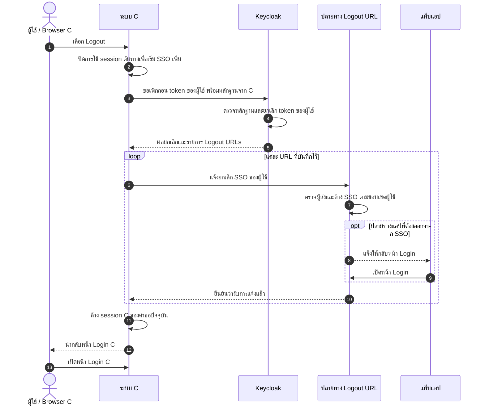

[เปิดภาพ PNG: F09 sequence](images/f09-sequence.png)

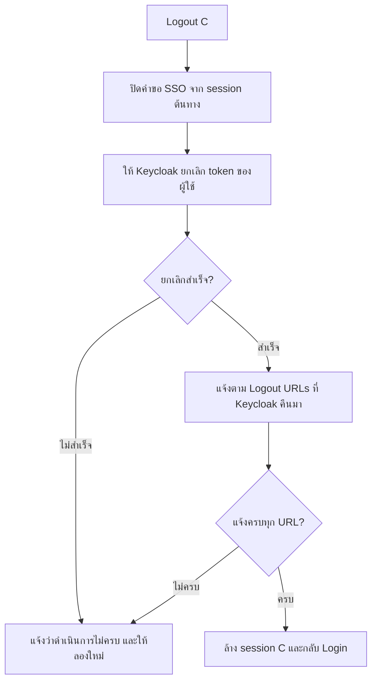

[เปิดภาพ PNG: F09 flowchart](images/f09-flowchart.png)

การยกเลิกครอบคลุม token กลางของผู้ใช้นั้นทุก session C ส่วน session Login C ที่ถูกล้างคือ session ของคำขอ Logout ปัจจุบัน การแจ้งแท็บ A/B ใช้การเชื่อมต่อ SSE ที่เปิดอยู่

การลบ URL แล้วกด Save หยุดการแจ้งทันทีไปปลายทางนั้น แต่ไม่ได้ยกเว้นการ revoke token แอปที่ไม่ได้รับแจ้งยังตรวจพบผ่าน heartbeat ตาม F07

หากขั้นตอนใดไม่สำเร็จ C แจ้งให้ลองใหม่ การเพิกถอนที่สำเร็จแล้วไม่ถูกย้อนกลับ จึงอาจมีบางระบบออกก่อนระบบอื่น และต้องลองอีกครั้งเพื่อดำเนินการให้ครบ

## F10 — จัดการบัญชีและสิทธิ์ที่ C

ผู้ดูแลจัดการบัญชีและสิทธิ์ read/write/delete ของแต่ละแอปที่ C การแก้ผู้ใช้เดิมจะยกเลิก SSO เดิม เพื่อให้การเข้าสู่ระบบครั้งถัดไปใช้ข้อมูลล่าสุด

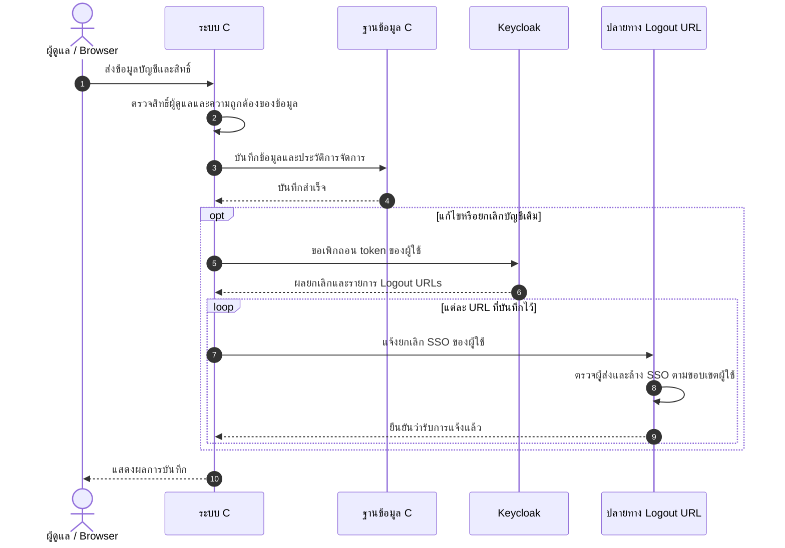

[เปิดภาพ PNG: F10 sequence](images/f10-sequence.png)

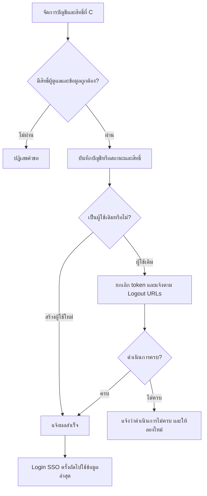

[เปิดภาพ PNG: F10 flowchart](images/f10-flowchart.png)

ข้อมูลบัญชีและรหัสผ่านเก็บใน C ระบบไม่สร้าง user หรือ role mapping ของผู้ใช้ใน Keycloak สิทธิ์ที่ออกไปกับ token แล้วเปลี่ยนย้อนหลังไม่ได้ จึงต้องยกเลิก token เดิม หากการยกเลิกหรือแจ้งแอปล้มเหลว ข้อมูลที่บันทึกใน C ไม่ถูกย้อนกลับ

## F11 — ตรวจความพร้อม C และออกจาก SSO เมื่อ C ขัดข้อง

Keycloak ตรวจความพร้อมของ C ตามรอบที่กำหนด เมื่อไม่ผ่านติดต่อกันครบเกณฑ์ จะยกเลิก token กลางและแจ้งแอปโดยตรง กระบวนการนี้ทำงานได้แม้ไม่มีผู้ใช้เปิด Browser

```mermaid
sequenceDiagram
    autonumber
    participant K as Keycloak
    participant C as IdP C
    participant A as ปลายทาง Logout URL
    participant B as Browser ของแอป
    loop รอบปกติ หรือรอยืนยันซ้ำหลังพบปัญหา
        K->>C: ตรวจ Health Check URL
        alt C พร้อมใช้งาน
            C-->>K: HTTP 2xx
            K->>K: ล้างตัวนับ
        else C ไม่พร้อมใช้งาน
            C--xK: ติดต่อไม่ได้หรือตอบข้อผิดพลาด
            K->>K: เพิ่มตัวนับ
            opt ครบเกณฑ์ที่กำหนด
                K->>K: ระงับ SSO และยกเลิก token กลาง
                K->>K: บันทึก cutoff และ Logout URLs
            end
        end
        loop แต่ละ URL ที่ยังส่งไม่สำเร็จ
            K->>A: POST Logout URL พร้อม signed idp_logout
            A->>A: ตรวจลายเซ็นและข้อมูลแจ้งเตือน
            A->>A: ล้างสถานะ SSO ก่อน cutoff
            opt ต้องยุติ session SSO
                A-->>B: แจ้งให้กลับหน้า Login ผ่าน SSE
            end
            A-->>K: ผลการรับแจ้ง
            Note over K,A: ปลายทางที่ติดต่อไม่ได้จะได้รับการแจ้งซ้ำด้วย cutoff เดิม
        end
        K->>K: อนุญาต SSO ใหม่เมื่อ C พร้อม
    end
```

[เปิดภาพ PNG: F11 sequence](images/f11-sequence.png)

```mermaid
flowchart TD
    T[ถึงรอบตรวจบริการ C] --> H{C พร้อมใช้งาน?}
    H -->|พร้อม| U[ล้างจำนวนครั้งที่ตรวจไม่ผ่าน]
    H -->|ไม่พร้อม| F[เพิ่มจำนวนครั้งที่ตรวจไม่ผ่าน]
    F --> N{ครบเกณฑ์ที่กำหนด?}
    N -->|ยังไม่ครบ| P{มีระบบที่ยังต้องแจ้ง?}
    N -->|ครบ| D[ระงับ SSO และยกเลิก token กลาง]
    D --> P
    U --> P
    P -->|มี| L[ส่งแจ้งตาม Logout URLs ที่ตั้งไว้]
    L --> E[เก็บปลายทางที่ติดต่อไม่ได้ไว้ลองรอบถัดไป]
    E --> G{C พร้อมใช้งานแล้ว?}
    P -->|ไม่มี| G
    G -->|พร้อม| O[เปิดรับ SSO ใหม่]
    G -->|ไม่พร้อม| Y{ยังยืนยันปัญหาไม่ครบเกณฑ์?}
    Y -->|ใช่| C[รอตามระยะห่างการยิงยืนยันซ้ำ]
    Y -->|ยืนยันว่าล่มแล้ว| W[รอตามรอบตรวจปกติ]
    O --> W
    W --> T
    C --> T
```

[เปิดภาพ PNG: F11 flowchart](images/f11-flowchart.png)

ปลายทางแจ้งอ่านจาก **Realm settings → Sessions → Logout** เป็นรายการ URL ที่ Add/Remove ได้ ไม่ต้องระบุ Client ID และไม่จำกัดจำนวนไว้ที่ A/B/C ผู้รับตรวจ audience กลุ่ม SSO พร้อม purpose `idp_logout` และ cutoff ส่วน Logout C ตาม F09 อ่านรายการ URL เดียวกันจาก Keycloak แล้วให้ C ส่ง `control_logout` รายผู้ใช้

ตั้งได้ 4 ค่าที่ **Realm settings → Heartbeat**: จำนวนครั้งที่ไม่ผ่าน, ระยะห่างยืนยันซ้ำ, รอบตรวจปกติ และ IdP ปลายทางที่เลือกจากรายการ Health Check URL ตั้งที่ Identity providers → เลือก IdP → Settings จากนั้น Keycloak อ่าน URL ของ IdP นั้นไปตรวจ เช่น ตรวจปกติทุก 1 นาที หากไม่ผ่านให้ยืนยันซ้ำทุก 5 วินาที จนไม่ผ่านครบ 3 ครั้งโดยนับรวมครั้งแรก หากตรวจผ่านก่อนครบเกณฑ์ให้กลับรอบปกติ หลังยืนยันว่าล่มแล้วตรวจการฟื้นตัวและลองส่งแจ้งเตือนที่ค้างตามรอบปกติ เมื่อ C กลับมา token ที่ถูกยกเลิกจะไม่กลับมาใช้ได้ ผู้ใช้ต้องเริ่ม SSO ใหม่ การแจ้งซ้ำยึดเวลาเกิดเหตุเดิม เพื่อไม่ล้าง session ใหม่ที่สร้างภายหลัง

การ Login ด้วยบัญชีของ A/B เองและ session Login C ยังคงแยกจาก SSO หาก A/B พลาดการแจ้ง จะตรวจพบ token ใช้งานไม่ได้จาก heartbeat ของตัวเองตาม F07 การตรวจบริการ C นี้ไม่ใช่การตรวจ session ผู้ใช้รายคนที่ C

ดู [วิธีตั้งค่า](../keycloak/SETUP-GUIDE.md) และ [ผลทดสอบ](../keycloak/IDP-HEARTBEAT-TEST-RESULTS.json)
