# Login และ Session ของ PoC จริง

ยึดโค้ด `app/`, `app-control/` และ `keycloak/` ใน Compose ทุก flow มี sequence diagram และ flowchart อ่าน [ภาพรวม](README.md) และ [API catalog](API-CATALOG.md) ประกอบ

ภาพเป็น Mermaid ฉบับใหม่ ไม่อ้าง PNG เดิมที่เป็นวิธี sync ผู้ใช้ C server เก็บ token กลางที่ได้จาก bootstrap และ Keycloak ไม่มี user row ของผู้ใช้ ตัวตนใน token อ้าง stable sub ที่คำนวณจาก issuer/subject C

## F01 — Login local A/B

ผู้ใช้เลือกช่องทางปกติ ตรวจบัญชีในฐานข้อมูลแอปนั้น ไม่สร้าง token กลาง

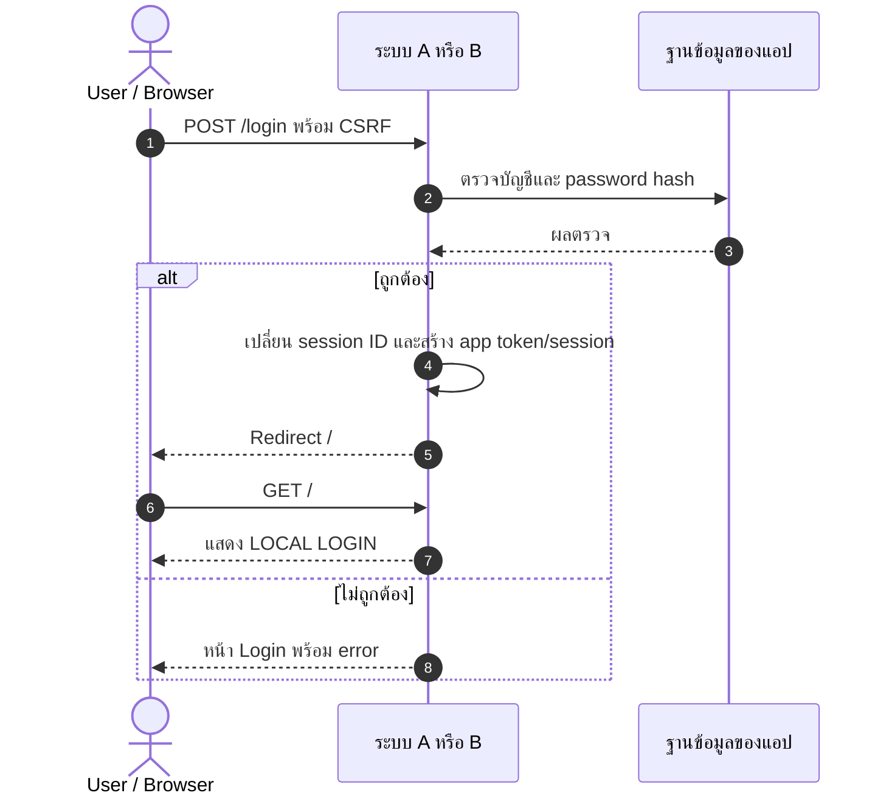

[เปิดภาพ PNG: F01 sequence](images/f01-sequence.png)

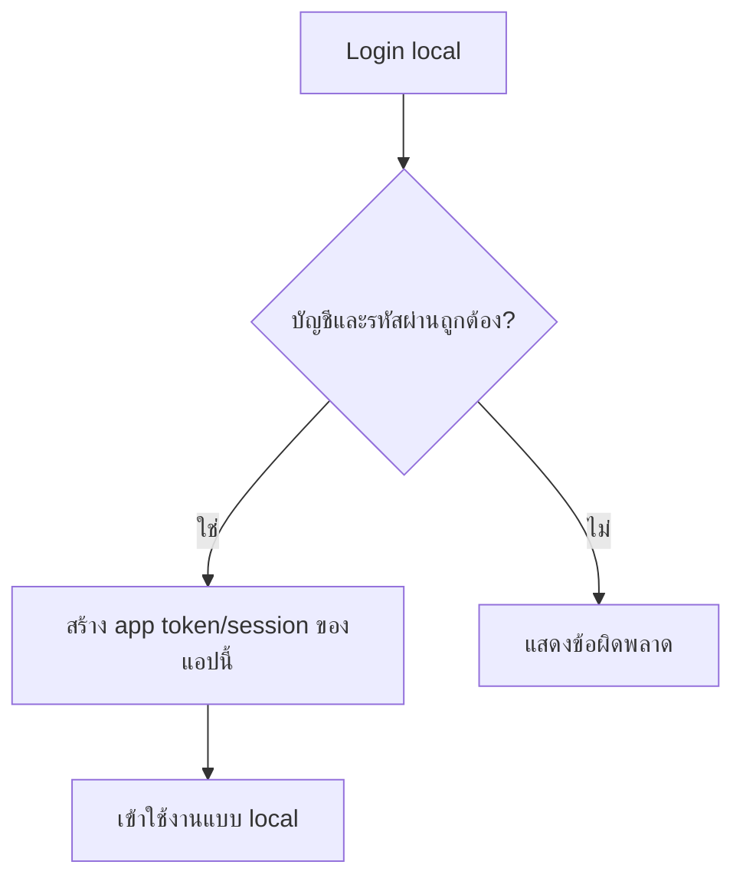

[เปิดภาพ PNG: F01 flowchart](images/f01-flowchart.png)

Keycloak **0 requests ในการตรวจ local Login** หน้า Login ครั้งแรกอาจตรวจ silent SSO ก่อนแสดงฟอร์ม แต่ไม่ได้เปลี่ยนให้ local Login ใช้ token กลาง Login local A ไม่ทำให้ Login B หรือ C อัตโนมัติ

## F02 — Login C โดยตรง

ยืนยันรหัสผ่าน C สำเร็จแล้วเริ่มขอ token กลางทันที ไม่รอเข้า A/B สถานะ success ต้องได้รับและตรวจ JWT แล้ว ไม่ใช่ผล healthcheck

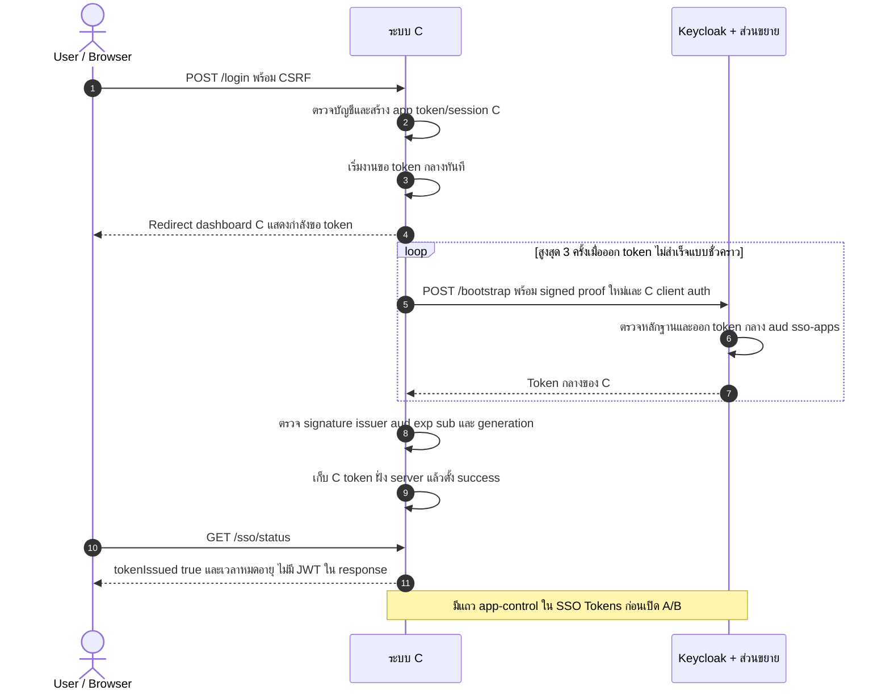

[เปิดภาพ PNG: F02 sequence](images/f02-sequence.png)

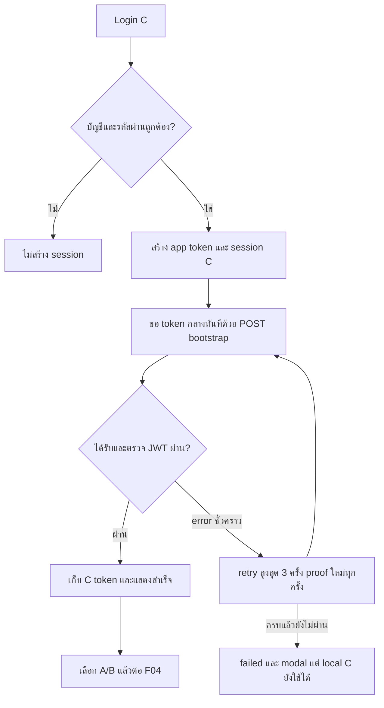

[เปิดภาพ PNG: F02 flowchart](images/f02-flowchart.png)

ปกติ C→Keycloak bootstrap **1 request**; หากติดต่อไม่ได้สูงสุด 3 พร้อมรอ 2 และ 5 วินาที ไม่ retry client/proof configuration errors แบบเดิมซ้ำ ทุกครั้งใช้ jti ของ proof ใหม่

Token กลางมี aud sso-apps และ app_permissions รวมสิทธิ์ของผู้ใช้ เมื่อเข้า A/B จะรับ JWT ใบเดิมทุกตัวอักษร โดย Keycloak ส่งตรงผ่าน browser POST พร้อมหลักฐาน handoff อายุไม่เกิน 60 วินาทีซึ่งผูก state/challenge และ hash ของ token ไม่ได้ออก access token ใหม่

## F03 — กด SSO A/B เมื่อยังไม่มี session C

Login C ครั้งเดียวได้ token กลางหนึ่งใบ จากนั้น Keycloak ส่งใบเดิมกลับ A/B ผ่าน browser POST พร้อมหลักฐาน handoff แยกจาก access token

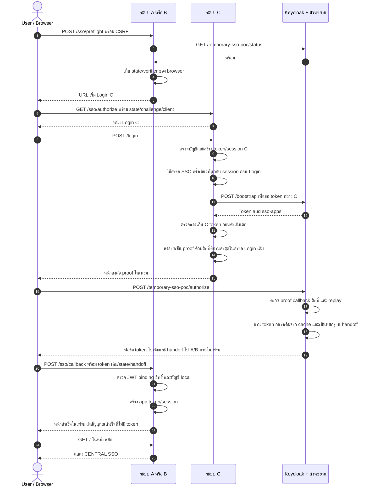

[เปิดภาพ PNG: F03 sequence](images/f03-sequence.png)

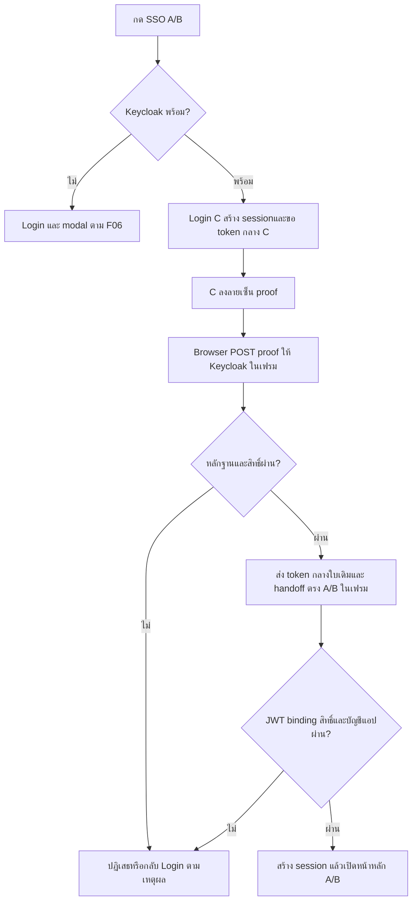

[เปิดภาพ PNG: F03 flowchart](images/f03-flowchart.png)

A/B ตรวจ RS256, issuer, audience, exp, required claims, `idp`, `temporary_identity`, state/challenge, read และ email ที่ตรงบัญชี local

Login C ใน flow นี้เพิ่ม backend bootstrap C 1 request ปกติ และตรวจ C JWT ด้วย Keycloak JWKS เมื่อ cache ว่าง จากนั้นส่ง token ใบเดิมไป A/B ตามภาพ

Browser มี **6 คำขอหลัก** ตาม [API catalog](API-CATALOG.md) และโหลด script ส่งต่อ 3 เส้นแยกต่างหาก A/B backend ตรวจพร้อม 1 ครั้งเมื่อปกติ ส่วน Keycloak โหลด C JWKS เพื่อยืนยัน proof และ A/B โหลด Keycloak JWKS เมื่อ cache ว่าง ไม่มี code exchange, redeem หรือ introspection ตอน Login

สัญญาณจาก callback ให้หน้าส่งต่อ C มีเพียง `sso-complete` ไม่มี token C script ตรวจทั้ง origin และหน้าต่างต้นทางก่อนเปิดหน้าหลัก A/B เฟรมนี้ทำให้ timeout กลับ Login ได้เมื่อ Keycloak ล่ม

## F04 — มี session C แล้วเข้าอีกแอป

ใช้ session C และ token กลางใบเดิม ไม่ถามรหัสผ่านซ้ำ สร้างเพียง proof/handoff ใหม่ผูกกับคำขอ Login ไม่สร้าง access token เพิ่ม

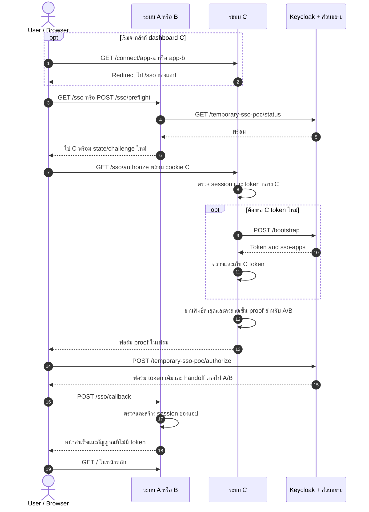

[เปิดภาพ PNG: F04 sequence](images/f04-sequence.png)

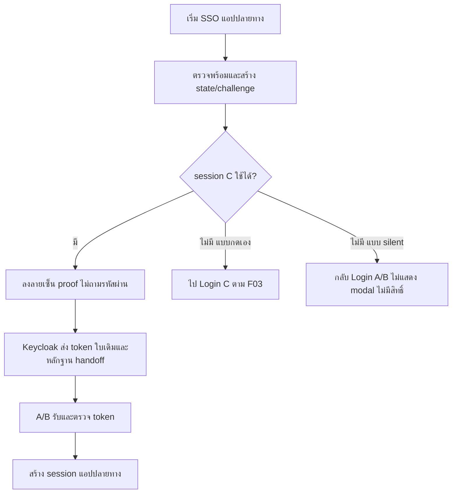

[เปิดภาพ PNG: F04 flowchart](images/f04-flowchart.png)

Browser **5 คำขอหลัก** และ script ส่งต่อ 3 เส้น กดลิงก์จาก C เพิ่ม `/connect/:system` อีก 1 ครั้ง ไม่รวม polling/status การไม่ถามรหัสผ่านซ้ำอาศัย session C ไม่ใช่ native Keycloak cookie ไม่มี token ร่วมใน localStorage

## F05 — ไม่มีสิทธิ์ ไม่มีบัญชี หรือข้อมูลไม่ถูกต้อง

Modal ไม่มีสิทธิ์แสดงจากคำขอที่ผู้ใช้กด SSO เองเท่านั้น ไม่เด้งซ้ำหลัง reload หรือ silent check

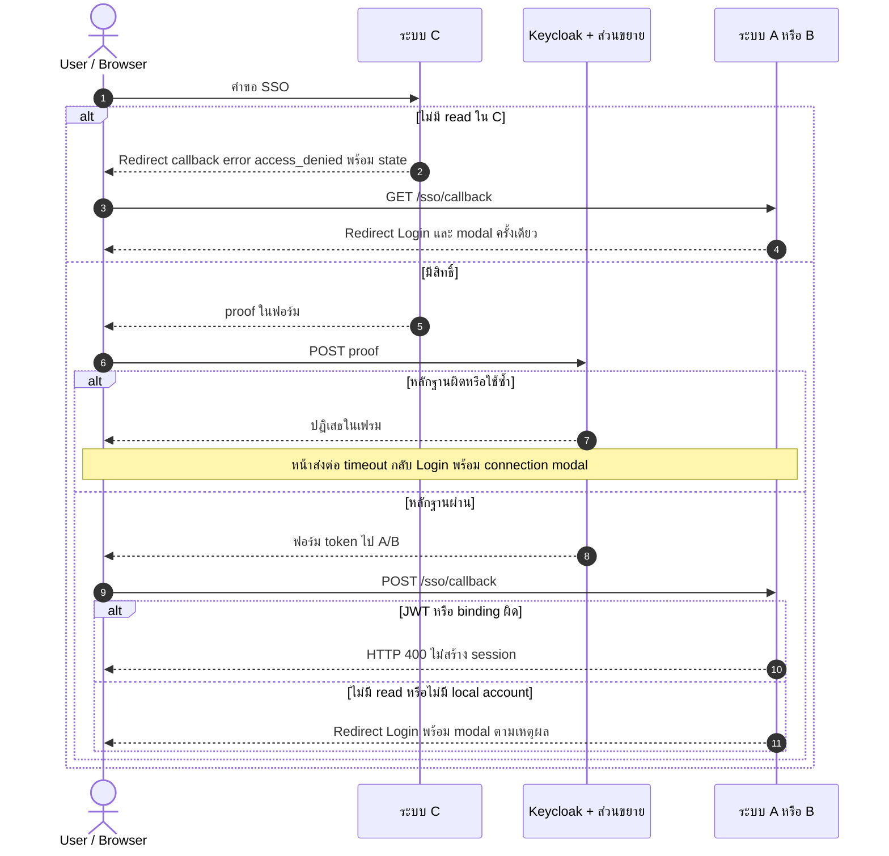

[เปิดภาพ PNG: F05 sequence](images/f05-sequence.png)

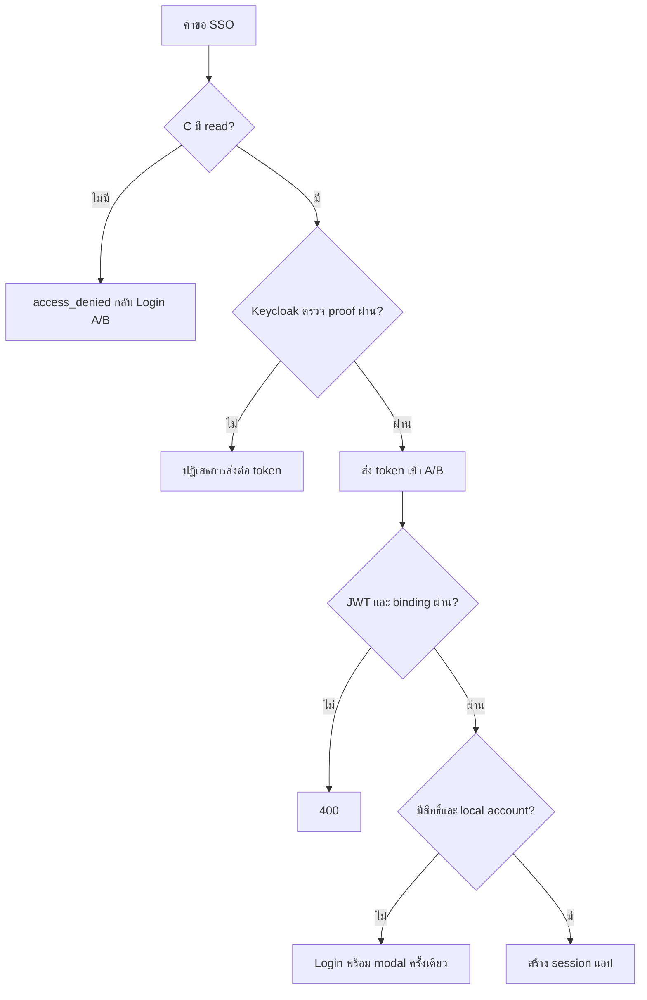

[เปิดภาพ PNG: F05 flowchart](images/f05-flowchart.png)

C ไม่ให้ read จึงไม่ส่ง proof ไปขอส่งต่อ token; A/B ตรวจซ้ำจาก JWT ก่อนสร้าง session ไม่มีบัญชีใน A/B จะไม่สร้างให้อัตโนมัติ หากข้อมูลปลอมถูกปฏิเสธในเฟรม หน้าส่งต่อจะแสดง connection error แบบทั่วไปหลัง timeout ไม่เปิดเผยรายละเอียดตรวจลายเซ็นให้ผู้ใช้

## F06 — Keycloak ติดต่อไม่ได้หรือออก token ไม่ได้

รองรับทั้งล่มก่อนเริ่ม SSO และล่มหลัง preflight ผ่าน ไม่ปล่อยหน้าหลัก browser ไปค้างที่หน้า Keycloak

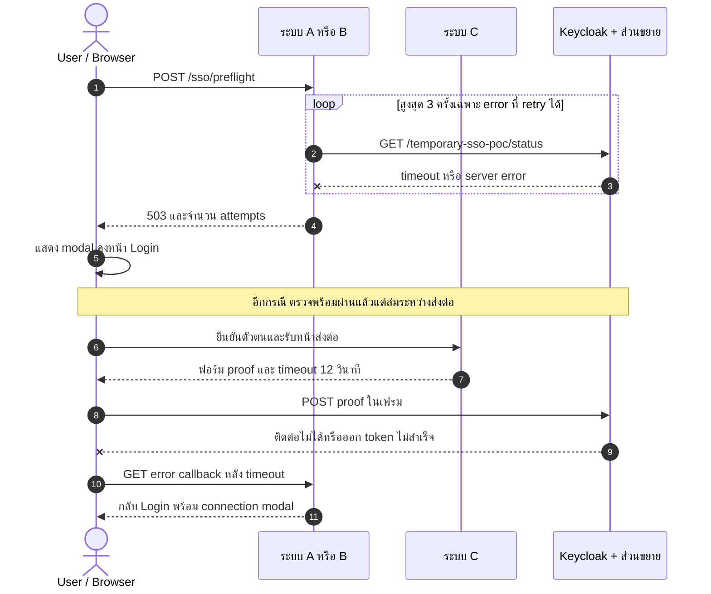

[เปิดภาพ PNG: F06 sequence](images/f06-sequence.png)

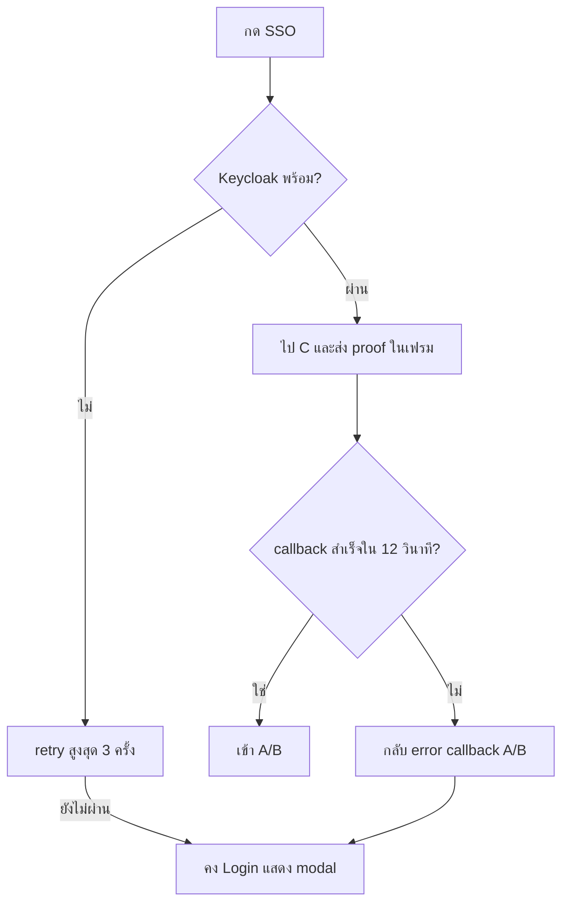

[เปิดภาพ PNG: F06 flowchart](images/f06-flowchart.png)

Retry ตรวจพร้อมเว้น 2 และ 5 วินาที แต่ละคำขอ timeout 3 วินาที Silent check ตรวจเพียง 1 ครั้ง HTTP 4xx ที่ไม่ใช่ 429 หรือ issuer ผิดหยุดทันที ไม่ retry การส่ง proof โดยอัตโนมัติ ผู้ใช้เริ่มใหม่เพื่อรับ state/proof ใหม่ Login local ยังใช้ได้ หาก Login C โดยตรงแล้วเชื่อมต่อไม่ได้ C session คงอยู่และมีสถานะแจ้งบน dashboard

Login C โดยตรงใช้ POST bootstrap สูงสุด 3 ครั้งเพื่อออก token จริง ไม่ใช้ GET status มาตัดสินว่าสำเร็จ หากออกไม่ได้ C local session ยังใช้ได้ แต่ tokenIssued เป็น false และมี modal แจ้ง failed

## F07 — Heartbeat ตรวจ expiry หรือ revoke

Browser ตั้งรอบ 1 ชั่วโมง Protected requests ตรวจ JWT expiry ด้วย เมื่อพบ inactive จะล้าง session และกลับหน้า Login

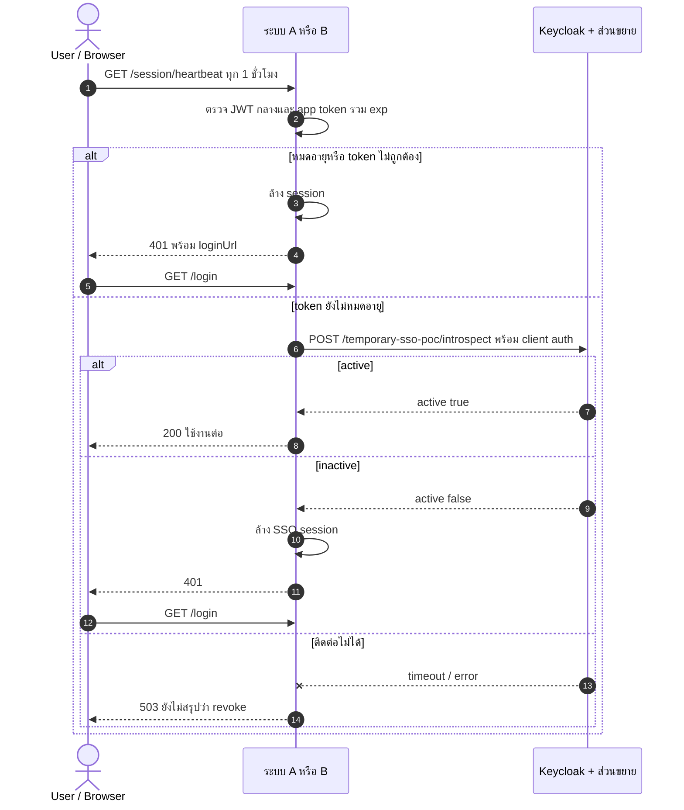

[เปิดภาพ PNG: F07 sequence](images/f07-sequence.png)

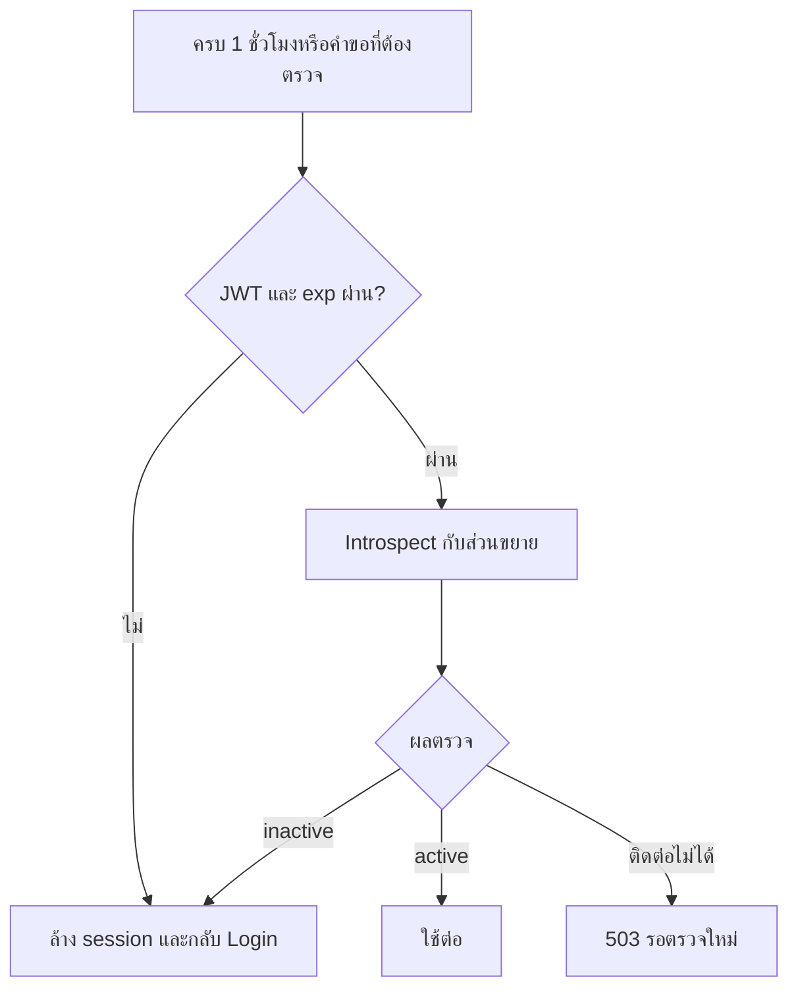

[เปิดภาพ PNG: F07 flowchart](images/f07-flowchart.png)

Browser heartbeat 1 request; Keycloak introspection **0–1** ตามว่า token ยังผ่าน exp หรือไม่ Protected requests ตรวจ introspection เมื่อเกินรอบ 1 ชั่วโมง ส่วน local sessions ไม่ขึ้นกับ Keycloak การทดสอบเร่ง timer จากภายนอกและตั้ง token 3 วินาทีชั่วคราว ไม่เปลี่ยนรอบจริงของ source และคืนอายุ 15 นาทีเมื่อจบ หากไม่เปิดหน้าใช้งาน token หมดอายุอาจรอถึง heartbeat ถัดไปจึงเปลี่ยนหน้า

## F08 — Logout A/B เฉพาะระบบ

Logout นี้ไม่ revoke token กลางหรือ Logout C และอีกแอป

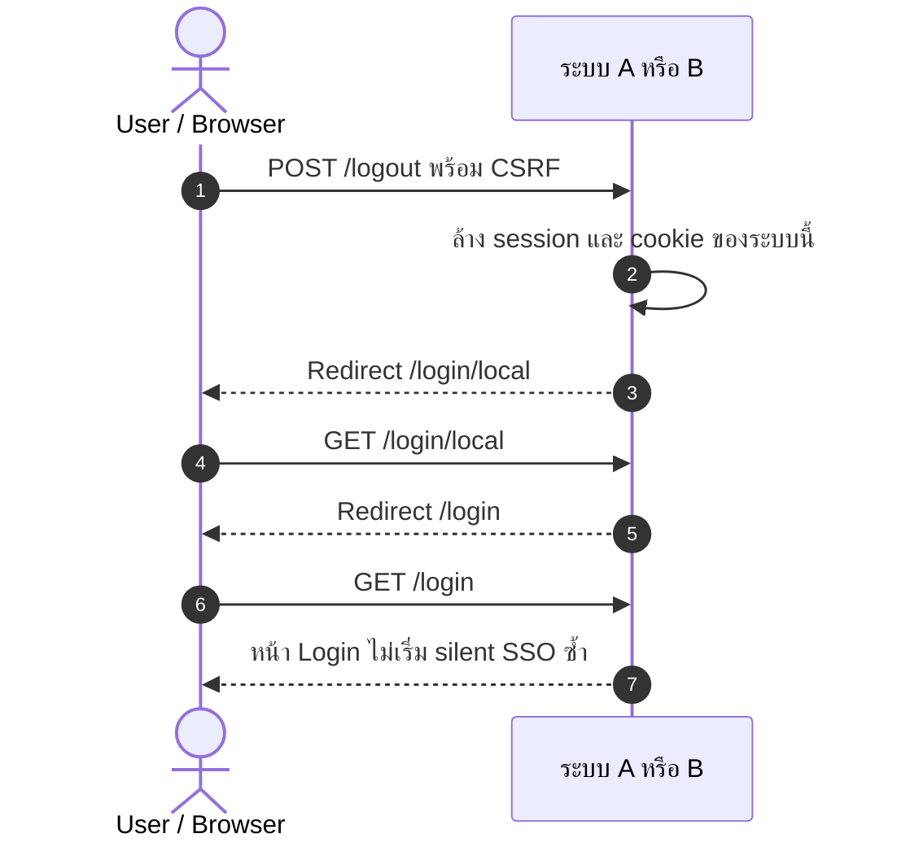

[เปิดภาพ PNG: F08 sequence](images/f08-sequence.png)

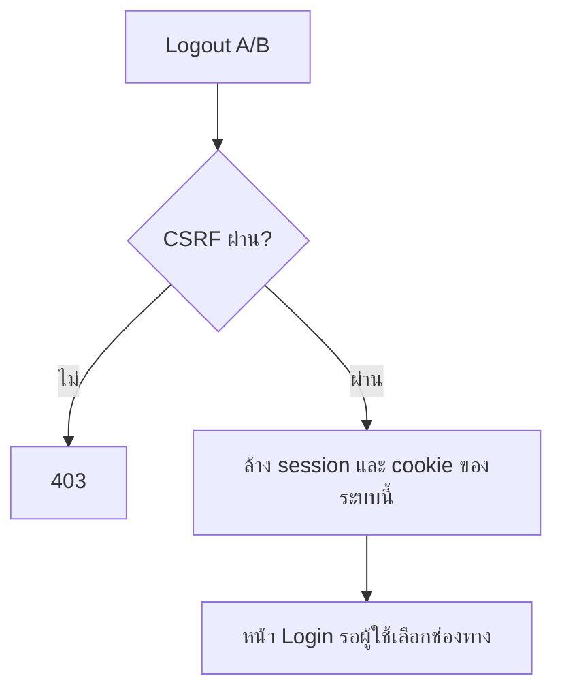

[เปิดภาพ PNG: F08 flowchart](images/f08-flowchart.png)

Browser 3 requests ตามภาพ Keycloak **0** หากผู้ใช้กด SSO ใหม่และ C session ยังอยู่จะเข้าได้โดยไม่ถามรหัสผ่าน API revoke รายใบมีให้ทดสอบแยก แต่ไม่ได้ผูกกับปุ่ม Logout นี้

## F09 — Logout C ยกเลิก token กลางและบังคับ SSO A/B ออก

C ลงลายเซ็น logout proof โดยไม่ถือ token กลางของ A/B แล้วส่ง notification ให้แอปหลัง Keycloak ยกเลิกสถานะ

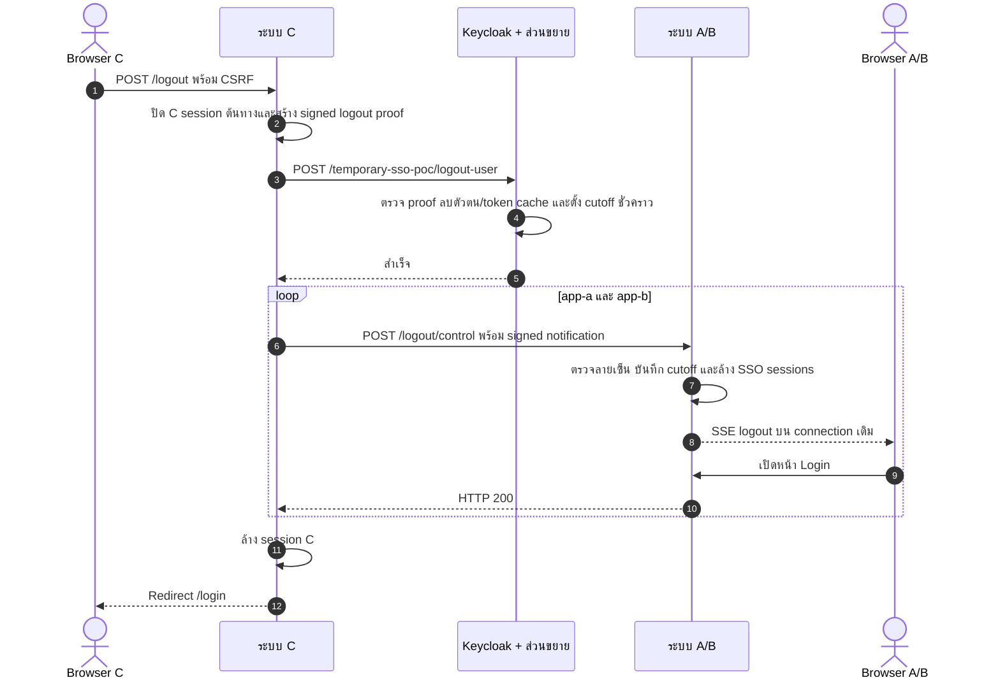

[เปิดภาพ PNG: F09 sequence](images/f09-sequence.png)

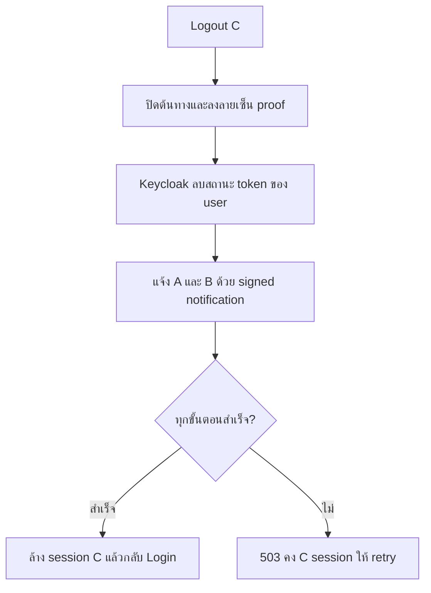

[เปิดภาพ PNG: F09 flowchart](images/f09-flowchart.png)

Backend **C→Keycloak 1 + C→A/B 2 requests** ไม่วน revoke ทีละใบ และไม่ใช้ native End Session หรือ native back-channel logout A/B ล้างเฉพาะ SSO sessions ส่วน local sessions คงอยู่ SSE เป็นข้อมูลใน connection เดิมไม่ใช่ request ใหม่ ไม่มีการ rollback การ revoke ที่สำเร็จแล้วหาก notification ถัดไปล้มเหลว จึงอาจเกิด logout บางส่วนและต้อง retry

การ revoke นี้รวม token กลางของ C และ token ของ A/B ด้วย C ล้าง access_token ของตัวเองจาก central_sso_status และไม่รับ token A/B มาส่งต่อ

## F10 — จัดการบัญชีและสิทธิ์ที่ C

หน้า user management ใช้งานกับฐานข้อมูล C จริง ไม่มี sync button หรือการสร้าง Keycloak user/roles

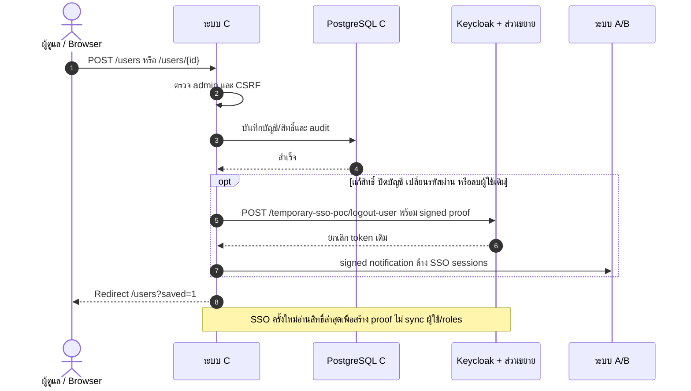

[เปิดภาพ PNG: F10 sequence](images/f10-sequence.png)

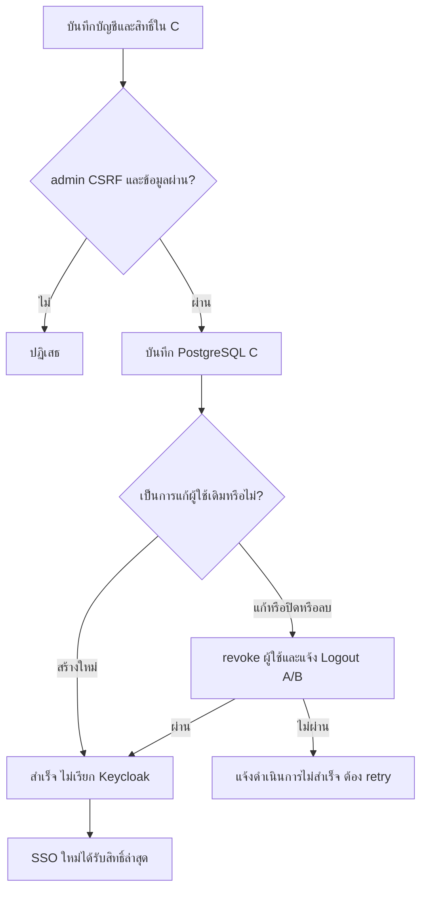

[เปิดภาพ PNG: F10 flowchart](images/f10-flowchart.png)

สร้างผู้ใช้ใหม่ **Keycloak 0 requests** แก้ผู้ใช้เดิมใช้ logout-user 1 และ notification 2 ไม่ใช่ sync ผู้ใช้ Token payload ที่ออกแล้วเปลี่ยนไม่ได้จึง revoke และให้เริ่ม SSO ใหม่ หาก network revoke ล้มเหลว ข้อมูลที่บันทึกใน C ไม่ rollback ต้อง retry เพื่อยกเลิก token เดิมให้ครบ การปิด/ลบ/เปลี่ยนรหัสผ่านมีในโค้ด; integration suite ทดสอบหน้าเพิ่มผู้ใช้และแก้สิทธิ์ ไม่ได้ทดสอบทุกกรณีของการลบบัญชี
