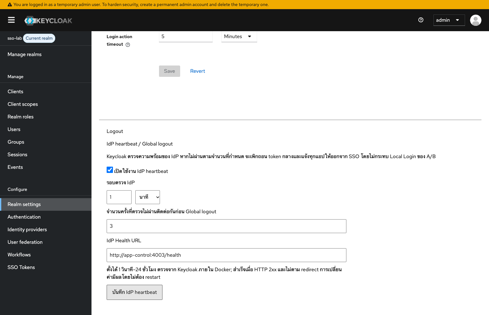

# คู่มือตั้งค่า Keycloak สำหรับระบบ SSO

ระบบ C ยืนยันตัวตนและขอ token กลางจาก Keycloak ส่วน A/B รับ token ใบเดียวกันแล้วตรวจสิทธิ์ก่อนสร้าง session คู่มือนี้อธิบาย feature และค่าที่ต้องกำหนดให้แต่ละระบบเชื่อมต่อกัน อ่าน [ภาพรวม](../../README.md) และ [flow ทั้ง 11 กรณี](../flows/LOGIN-AND-SESSION.md) ประกอบ

## 1. รู้จักส่วนที่ใช้ก่อนตั้งค่า

| Feature                 | คืออะไร                                                  | หน้าที่ในระบบ                                                                                   |
| ----------------------- | -------------------------------------------------------- | ----------------------------------------------------------------------------------------------- |
| Realm                   | ขอบเขต config กุญแจ client และ issuer ของระบบยืนยันตัวตน | ใช้ `sso-lab` แยกจาก master ที่ใช้บริหาร Keycloak                                               |
| Client                  | ตัวตนของแอปปลายทางที่ขอใช้บริการ Keycloak                | `app-a`, `app-b` และ `app-control`; aud กลางระบุกลุ่ม SSO ส่วน app_permissions ระบุสิทธิ์แยกแอป |
| Identity Provider / IdP | แหล่งที่ยืนยันว่าผู้ใช้เป็นใคร                           | C ตรวจรหัสผ่านเอง แล้วลงลายเซ็น proof                                                           |
| IdP trust config        | issuer และ public key ที่ยอมรับ                          | เก็บใน IdP alias `app-control` ให้ extension อ่าน ไม่ได้เรียก native broker Login               |
| JWT / RS256             | token ที่มีข้อมูลและลายเซ็น RSA                          | Keycloak เซ็น token กลาง A/B ตรวจด้วย public key                                                |
| JWKS / kid              | ชุด public keys และรหัสระบุกุญแจ                         | Keycloak โหลด public key C; A/B โหลด public key Keycloak                                        |
| Issuer / Audience       | ใครออก token และออกให้ใคร                                | A/B ตรวจ iss ตรง realm และ aud ตรงกลุ่ม SSO ที่กำหนดใน KC_AUDIENCE                              |
| Realm Resource SPI      | จุดเพิ่ม REST endpoints ด้วย Java ใน Keycloak            | ส่วนขยายตรวจ proof ออก token และจัดการสถานะชั่วคราว                                             |
| SingleUseObjectProvider | cache มี TTL ที่ extension ใช้เก็บค่า/กัน replay         | เก็บตัวตน email สิทธิ์ และ index token ชั่วคราว ไม่สร้าง Users                                  |
| CSP / frame policy      | กำหนดว่าเปิดเฟรมและส่งฟอร์มไปไหนได้                      | อนุญาตเฉพาะ C และ callback A/B ในแล็บ                                                           |

ส่วนขยายเพิ่ม feature อีกสามส่วนคือ **SSO Tokens** (UiPageProvider และ Admin REST สำหรับดู metadata), **IdP heartbeat** (TimerProvider เรียก health URL เบื้องหลัง) และ **signed logout notification** (แจ้ง A/B/C ด้วย protocol ของแล็บ) ทั้งสามส่วนติดตั้งมากับ Java extension และ theme ของระบบ

**ไม่ใช้** protocol mapper, client role mapping, service-account sync หรือ native JWT grant เพื่อออก token ใน flow นี้ สิทธิ์มากับ proof ที่ C เซ็น และ extension ใส่ `app_permissions` ลง token โดยตรง

Session C, token กลาง และ session A/B เป็นคนละส่วน การใช้ SSO เข้าอีกแอปโดยไม่ถามรหัสผ่านอาศัย session C; Keycloak ในวิธีนี้ไม่มี native browser session หรือ refresh token

## 2. สิ่งที่ต้องติดตั้งก่อนเปิด UI

ติดตั้งตาม [ขั้นตอนเริ่มใช้งาน](../../README.md#ติดตั้งและเริ่มใช้งาน) ให้ A/B/C, PostgreSQL และ Keycloak ทำงานก่อนเปิด Admin Console

Compose build ส่วนขยายด้วย Java 21 และติดตั้ง JAR ที่ `/opt/keycloak/providers/` ใน image Keycloak 26.8.1 จึงไม่ต้องติดตั้ง Java บนเครื่อง host กุญแจ C สร้างด้วย `npm run keys:generate` เฉพาะครั้งแรก คำสั่งจะหยุดหากมีไฟล์เดิมเพื่อป้องกันการเขียนทับ

ต้องใช้ image ที่ติดตั้งส่วนขยายก่อน จึงจะมี endpoints ของระบบนี้ Private key ของ C อยู่ในไฟล์ local ที่ mount read-only; ไม่เอาไปกรอกใน Keycloak ใช้เฉพาะ public JWKS

## 3. สร้าง Realm และกำหนดค่าพื้นฐาน

```sh
npm run lab:configure
```

ใช้คำสั่งด้านบนเมื่อต้องการตั้งค่าตามสคริปต์ หากต้องการตั้งเอง ให้สร้าง realm ผ่าน UI แล้วทำตามหัวข้อถัดไป สคริปต์สร้าง/ปรับค่าตามตารางด้านล่าง ไม่สร้างผู้ใช้หรือสิทธิ์ถาวร ค่า secrets อ่าน `.env` และไม่พิมพ์ออกจอ หากเปลี่ยน client secret ให้ recreate แอปเจ้าของ secret รวมถึง C เมื่อเปลี่ยน CONTROL_KC_CLIENT_SECRET เช่น `docker compose up -d --no-deps app-a app-b app-control`

**การรันซ้ำจะเขียนค่าทดลองทับตามสคริปต์** ได้แก่ realm enabled/SSL/admin theme, อายุ token, realm attributes ทั้งชุด, heartbeat เปิด/60 วินาที/3 ครั้ง, security headers, trust C และ clients A/B/C ทั้ง secret, capabilities, redirect URIs, scopes และ custom attributes ไม่ใช่คำสั่งบันทึก settings จาก UI ให้แก้ไข/ทดลอง UI หลังรัน configure และอย่ารันซ้ำจนกว่าจะต้องการคืนค่าแล็บ

เข้าสู่ http://localhost:8080/admin ด้วย admin / admin-local-demo ซึ่งเป็นบัญชีตัวอย่าง localhost ของแล็บ จากนั้นเลือก realm `sso-lab`

| จุด                   | ค่า                      | เหตุผล                                                        |
| --------------------- | ------------------------ | ------------------------------------------------------------- |
| Realm name            | sso-lab                  | ใช้สร้าง issuer ที่ทุกแอปต้องตรวจตรงกัน                       |
| Realm enabled         | On                       | เปิดรับคำขอของ realm                                          |
| Require SSL           | None เฉพาะ localhost PoC | browser และ Docker ภายในแล็บใช้ HTTP; ไม่ใช่ค่าแนะนำระบบจริง  |
| Access Token Lifespan | 15 minutes               | token กลางมีอายุ 900 วินาที; extension จำกัดสูงสุด 900 วินาที |
| Realm key             | RSA / RS256              | extension ใช้กุญแจ realm เซ็น token; A/B ตรวจผ่าน JWKS        |

### ตำแหน่ง UI ของ Realm

มุมซ้ายบน **Manage realms** → เลือกหรือ Create realm `sso-lab`; **Realm settings → Tokens** ดู Access Token Lifespan; **Realm settings → Keys** ดูกุญแจและ kid


ภาพหน้าจอใช้แสดงตำแหน่งเมนูและช่องตั้งค่า ให้ใช้ค่าตามตารางในคู่มือ โดยภาพ Credentials ไม่แสดง secret จริง

### ตั้งอายุ token: ค่าบน UI กับอายุที่ extension ใช้จริง

1. เลือก realm **sso-lab** ก่อน เพื่อไม่ให้แก้ค่าใน master ซึ่งใช้บริหาร Keycloak
2. เปิด **Realm settings → Tokens → Access Token Lifespan**
3. ระบุจำนวนและหน่วย เช่น **5 Minutes** หรือ **15 Minutes** แล้วกด **Save**
4. Logout C แล้ว Login C ใหม่ จากนั้นเข้า A/B ผ่าน SSO เพื่อทดสอบ token ที่ออกใหม่

[เปิดหน้า Tokens ของ sso-lab](http://localhost:8080/admin/master/console/#/sso-lab/realm-settings/tokens) หากยังไม่ได้เข้า Admin ระบบจะแสดงหน้า Login ก่อน ตำแหน่ง field ดูภาพอายุ access token ด้านบน

อายุที่ใช้จริงมาจาก [CentralTokenService](../../keycloak/src/main/java/lab/sso/service/CentralTokenService.java) ซึ่งอ่านค่าของ realm แล้วจำกัดระหว่าง 1–900 วินาที:

```java
int lifetimeSeconds = Math.max(1, Math.min(900, realm.getAccessTokenLifespan()));
```

| ค่าที่ตั้งใน Access Token Lifespan | อายุ token กลางที่ออกใหม่ | เหตุผล                        |
| ---------------------------------- | ------------------------- | ----------------------------- |
| 5 Minutes                          | 300 วินาที                | ต่ำกว่าเพดาน จึงใช้ค่าที่ตั้ง |
| 15 Minutes                         | 900 วินาที                | เท่ากับเพดานของโค้ด           |
| 30 Minutes                         | 900 วินาที                | โค้ดจำกัดสูงสุด 15 นาที       |

เพดานนี้เป็นกติกา custom ของ PoC การตั้งเกิน 15 นาทีใน UI อย่างเดียวไม่เพิ่มอายุ ต้องแก้เพดานใน Java และ build/recreate Keycloak ด้วย ค่า 0 ก็ไม่ได้แปลว่าไม่มีวันหมดอายุใน extension นี้ เพราะโค้ดบังคับอย่างน้อย 1 วินาที

[CentralTokenCodec](../../keycloak/src/main/java/lab/sso/security/CentralTokenCodec.java) กำหนดเวลาเป็น Unix timestamp หน่วยวินาที:

```java
long now = System.currentTimeMillis() / 1000;
token.iat(now);
token.exp(now + lifetimeSeconds);
```

ดังนั้น `exp - iat` คืออายุ token เป็นวินาที และ token หมดอายุเมื่อเวลาปัจจุบันถึง `exp` เมื่อต้องแสดงวันเวลาใน JavaScript ใช้ `new Date(exp * 1000)` เพราะ Date รับหน่วยมิลลิวินาที ตัว timestamp ไม่ผูก timezone แต่การแสดงผลขึ้นกับ timezone ของเครื่อง

ผลของการเปลี่ยนค่าและข้อจำกัดที่ต้องรู้:

- **Save มีผลต่อ token ที่ออกหลังจากนั้น** ไม่แก้ `exp` ของ JWT ใบเดิม และไม่ได้ revoke ใบเดิมเพียงเพราะเปลี่ยนค่า ไม่ต้อง restart เพื่อเปลี่ยนค่าภายในช่วงที่โค้ดยอมรับ
- **เข้า A/B ไม่เริ่มนับอายุใหม่** เพราะรับ JWT ใบเดียวกับ C เช่น C เหลือ 3 นาที แอป B ที่เพิ่งเข้าก็เหลือ 3 นาทีเช่นกัน
- **ไม่มี auto-refresh หรือ refresh token** ใน flow นี้ ต้องเริ่มกระบวนการขอ token กลางใหม่เมื่อหมดอายุ
- **ใช้ค่าของ realm เท่านั้น** โค้ดนี้ไม่ได้อ่าน Client-level Access Token Lifespan override และไม่ได้ใช้ SSO Session Idle/Max เป็นอายุ token หรืออายุ session ของแอป
- **`npm run lab:configure` ตั้ง Access Token Lifespan กลับเป็น 900 วินาที** ตาม [สคริปต์ตั้งค่า](../../scripts/setup-temporary-sso.cjs) หากแก้ UI เพื่อทดลองแล้วรันสคริปต์นี้ซ้ำ ต้องตรวจค่าอีกครั้ง

### อายุ token กับ heartbeat เป็นคนละค่า

| รายการ                          | กำหนดที่ไหน                                              | ผล                                                                                   |
| ------------------------------- | -------------------------------------------------------- | ------------------------------------------------------------------------------------ |
| อายุ token กลาง                 | UI Access Token Lifespan และเพดานใน Java                 | กำหนด exp ของ token                                                                  |
| รอบ heartbeat A/B               | [app/public/heartbeat.js](../../app/public/heartbeat.js) | Browser เรียกแอปทุก 1 ชั่วโมง เฉพาะหน้าที่ใช้งาน SSO                                 |
| การตรวจ token ก่อนเข้า resource | [app/src/sso/keycloak.js](../../app/src/sso/keycloak.js) | ตรวจหมดอายุทุกครั้งที่ผ่าน requireSso และเรียก custom introspection เมื่อถึงเงื่อนไข |

Heartbeat ไม่ได้ทำให้ token อายุ 15 นาทีอยู่ได้นาน 1 ชั่วโมง เมื่อหมดอายุแล้ว แอปจะล้าง SSO session ในการตรวจครั้งถัดไป หากเปิดหน้าค้างโดยไม่ส่งคำขอ อาจยังเห็นหน้าเดิมจน heartbeat ทำงาน ไม่ได้แปลว่า token ยัง valid หรือมี timer สั่งเปลี่ยนหน้าทันทีเมื่อครบ 15 นาที

**ถ้า token หมดอายุแล้ว A/B จะปฏิเสธและล้าง session โดยไม่เรียก Keycloak introspection** ดังนั้นเมื่อ token อายุ 15 นาทีและ heartbeat ครั้งแรกอยู่ที่ 1 ชั่วโมง รอบนั้นจะตรวจพบหมดอายุก่อนถึงขั้นเรียก Keycloak ส่วน Logout C ใช้การแจ้ง logout แยกจาก heartbeat

Heartbeat ของ A/B ตรวจ token กลางกับ Keycloak ผ่าน custom `/temporary-sso-poc/introspect` เมื่อ token ยังไม่หมดอายุ ส่วนการตรวจว่า IdP C online เป็น background task ของ Keycloak อีกชุด ตั้งค่าได้ตามหัวข้อถัดไป ไม่ใช่การตรวจ session/บัญชีรายผู้ใช้ที่ C

### อายุ session, cookies และแหล่งเก็บข้อมูล

| ข้อมูล                         | อายุ/ตำแหน่ง                                                        | สิ่งที่มีผลจริง                                                                |
| ------------------------------ | ------------------------------------------------------------------- | ------------------------------------------------------------------------------ |
| JWT ของระบบจาก Login ของ A/B/C | 1 ชั่วโมงจาก Login ใน code ของแต่ละแอป                              | เปลี่ยน Access Token Lifespan ของ realm ไม่เปลี่ยนค่านี้                       |
| SSO app JWT/session ของ A/B    | ไม่เกิน exp ของ JWT กลาง                                            | เข้า B ภายหลังไม่เริ่มอายุใหม่                                                 |
| Token กลางร่วม                 | ปกติ 900 วินาที; Keycloak TTL cache และ server-side state ของ C/A/B | ไม่มี refresh token และไม่เก็บใน localStorage                                  |
| Cookies ของ A/B                | app_a_session / app_b_session ตาม .env; maxAge 1 ชั่วโมง            | เป็น reference ของ session ใน PostgreSQL ไม่ใช่ JWT เต็มใบ                     |
| Cookie ของ C                   | app_control_session; maxAge 1 ชั่วโมง                               | JWT ของระบบจาก Login ยังมีเวลาสิ้นสุดแน่นอน แม้ cookie/session store ถูกอัปเดต |
| Cookie ผูกคำขอ SSO ของ A/B     | app-a_request_browser / app-b_request_browser; 30 วัน               | ผูกคำขอกับ browser ไม่ใช่หลักฐาน Login                                         |
| หลักฐาน C และ handoff          | ใช้ได้ครั้งเดียว ไม่เกิน 60 วินาที                                  | ไม่เพิ่มจำนวน access token กลาง                                                |

Cookies ใน HTTP lab ใช้ **HttpOnly, SameSite=Lax, Secure=false** ไม่ใช่ Secure=true เพราะ localhost ใน Compose นี้ไม่ได้เปิด HTTPS ไม่ตั้ง Domain และใช้ Path=/ แต่ละ port บน localhost ไม่ได้แยก cookie namespace จึงต้องใช้ชื่อต่างกันตามระบบ Browser เห็น JWT กลางชั่วคราวขณะส่ง POST callback แต่หลัง Login จะถือ cookie อ้างอิง session ไม่ใช่เก็บ JWT ใน cookie/localStorage

Keycloak ใช้ H2 ของ `start-dev` เก็บ realm/clients/trust/keys ใน `keycloak_data` ส่วน users ของ C และ บัญชีและ sessions ของแอป ของ A/B อยู่ PostgreSQL คนละฐานข้อมูล ค่าเริ่มต้นจาก `postgres/init/` คือ app_a/app_a_user, app_b/app_b_user และ app_control/app_control_user; init ทำงานครั้งแรกของ volume เท่านั้น การเปลี่ยนรหัสผ่านใน .env หลังมี volume ไม่ได้แก้รหัส DB role เดิม และการเปลี่ยน DB_NAME/DB_USER ไม่ได้สร้างฐานข้อมูลหรือ role ใหม่

**session Login C หมดอายุไม่เท่ากับกด Logout C** ไม่มีการส่ง global logout เพียงเพราะ local session หมดอายุ token กลางยังเป็นไปตาม exp ของ JWT จนหมดอายุหรือถูก revoke และ IdP heartbeat เช็คความพร้อมของบริการ ไม่ใช่ว่า session ผู้ใช้แต่ละคนยังอยู่หรือไม่ การกด Logout C และแก้สิทธิ์เป็นเหตุการณ์ที่สั่ง revoke ตาม F09/F10

### ตั้ง IdP heartbeat และ Auto global logout

เปิด **Realm settings → Sessions** เลื่อนลงไปที่หัวข้อ **Logout → IdP heartbeat / Global logout** ส่วนนี้เพิ่มโดย theme ของแล็บ ไม่ใช่ field มาตรฐานของ Keycloak และไม่แก้ค่าของ SSO Session Idle/Max ด้านบน

[เปิด Sessions ของ sso-lab](http://localhost:8080/admin/master/console/#/sso-lab/realm-settings/sessions)



| ช่องบน UI                                           | ค่าเริ่มต้น                    | ความหมาย                                                     |
| --------------------------------------------------- | ------------------------------ | ------------------------------------------------------------ |
| เปิดใช้งาน IdP heartbeat                            | เปิด                           | ให้ Keycloak ตรวจ C ต่อเนื่อง แม้ผู้ใช้ไม่เปิด browser       |
| รอบตรวจ IdP และหน่วยเวลา                            | 1 นาที                         | กำหนดได้ 1 วินาที–24 ชั่วโมง เลือกวินาที/นาที/ชั่วโมง        |
| จำนวนครั้งที่ตรวจไม่ผ่านติดต่อกันก่อน Global logout | 3                              | กำหนดได้ 1–100 ครั้ง ถ้าตรวจผ่านจะเริ่มนับใหม่               |
| IdP Health URL                                      | http://app-control:4003/health | URL ที่ Keycloak container เข้าถึง C ได้ ต้องเป็น HTTP/HTTPS |

กด **บันทึก IdP heartbeat** หน้าจะ reload และค่ามีผลโดยไม่ต้อง restart ค่าเก็บใน realm attributes แยกตาม realm และใช้ native Admin API ซึ่งตรวจสิทธิ์จัดการ realm เดิม การบันทึก merge attributes ปัจจุบันเพื่อรักษา settings อื่นไว้

**อย่าใช้ localhost:4003 เป็น Health URL ภายใน Docker** เพราะ localhost จาก Keycloak หมายถึง container Keycloak เอง ส่วน port 4002 ของ B เป็น port ที่เปิดบนเครื่อง host; ปลายทาง logout ภายใน Docker ใช้ app-b:4001

ตรวจสำเร็จเมื่อ HTTP เป็น 2xx ไม่ตาม redirect แต่ละครั้ง timeout 3 วินาที DNS error, connect ไม่ได้, timeout, TLS error หรือ HTTP นอก 2xx ถือว่าไม่ผ่าน เมื่อเปิดหรือเปลี่ยน config จะเริ่มตรวจใน tick ถัดไป (ประมาณ 1 วินาที) จากนั้นตรวจตามช่วงที่กำหนด ดังนั้น 1 นาที/3 ครั้งไม่ได้หมายถึงออกทันทีที่ C หยุด ต้องรอตรวจไม่ผ่านครบเกณฑ์ และมีเวลารอ HTTP ด้วย

เมื่อพบว่า IdP down:

1. Keycloak ทำเครื่องหมาย down และ revoke token กลางของ realm ที่มาจาก IdP เดียวนี้ ไม่เพิ่ม token ใหม่
2. Keycloak ส่ง signed `idp_logout` ไป A/B โดยตรง ไม่พึ่ง C ที่ปิดอยู่
3. A/B ตรวจ issuer/JWKS/audience/purpose/idp/expiry และกัน replay จากนั้นล้างเฉพาะ SSO session และแจ้ง browser ผ่าน SSE ให้กลับ Login; Login ด้วยบัญชีของระบบ A/B คงอยู่
4. ถ้าแจ้งแอปไม่สำเร็จ Keycloak จะลองใหม่ในรอบตรวจถัดไป Heartbeat A/B เป็นการตรวจสำรองเมื่อพลาดการแจ้ง โดยถาม token กลางกับ Keycloak ตามเงื่อนไขเดิม
5. คำขอ SSO เก่าที่ค้างก่อน global logout ถูกกั้นด้วย cutoff และระหว่าง down จะไม่รับการออก/ส่งต่อ token แม้มี proof ค้างอยู่

เมื่อ C กลับมาและตรวจผ่าน Keycloak ยกเลิกสถานะ down แต่ token เก่าไม่กลับมา active ต้องเริ่ม SSO ใหม่ การแจ้งที่ส่งให้ C ค้างไว้จะถูกลองใหม่เพื่อล้างสถานะ token กลางเก่าของ C โดยยังคง session Login ของ C การแจ้งย้อนหลังใช้ cutoff เดิมเพื่อไม่ล้าง session ใหม่ที่สร้างภายหลัง

ปลายทาง logout ลงทะเบียนใน client attribute `temporary.sso.logout-url`:

| Client ตัวอย่าง | ปลายทางจาก Keycloak                     |
| --------------- | --------------------------------------- |
| app-a           | http://app-a:4001/logout/control        |
| app-b           | http://app-b:4001/logout/control        |
| app-control     | http://app-control:4003/logout/keycloak |

Keycloak เป็นผู้ลงลายเซ็น notification และใช้ audience ของ client ผู้รับ ไม่ส่ง Client Secret หรือรหัสผ่านใน notification เป็น protocol custom ของ PoC ไม่ใช่ native OIDC back-channel logout token

Realm attributes ของฟอร์มคือ `temporary.sso.idp-heartbeat.enabled`, `temporary.sso.idp-heartbeat.interval-seconds`, `temporary.sso.idp-heartbeat.failure-threshold`, `temporary.sso.idp-heartbeat.health-url` ส่วน `temporary.sso.issuer` เป็น public issuer สำหรับลงลายเซ็นจาก background task ซึ่งไม่มี browser request context ต้องตรงกับ KC_ISSUER ของแอป

`lab:configure` ตั้ง heartbeat กลับเป็นเปิด/60 วินาที/3 ครั้งและ URL ตัวอย่างตามสคริปต์ หากตั้งเองผ่าน UI แล้วรันสคริปต์นี้ซ้ำ ต้องตรวจค่าอีกครั้ง การปิด heartbeat หยุดการตรวจและไม่คืน token ที่ revoke ไปแล้ว

นี่เป็น scheduler ของ Keycloak extension สำหรับ PoC node เดียว ไม่เพิ่ม Docker service และไม่ตรวจว่าผู้ใช้แต่ละคนยังมี session ที่ IdP หรือไม่ อ่าน [F11](../flows/LOGIN-AND-SESSION.md#f11--ตรวจความพร้อม-c-และออกจาก-sso-เมื่อ-c-ขัดข้อง) และรันทดสอบด้วย `npm run test:idp-heartbeat` ซึ่งหยุด/เปิด C จริง ใช้เวลาเร่งเฉพาะการทดสอบ แล้วคืนค่าเดิม

## 4. Trust C — แหล่งตัวตนเดียว

ไป **Identity providers** → ถ้ายังไม่มีให้เลือก **Add provider → JWT Authorization Grant** ตั้ง Alias เป็น `app-control` แล้วกรอกค่าตามตารางและ Save ถ้ามีแล้วให้เปิด provider `app-control` เพื่อตรวจค่า

| ค่า           | ค่าของแล็บ                        |
| ------------- | --------------------------------- |
| Alias         | app-control                       |
| Provider type | JWT Authorization Grant           |
| Enabled       | On                                |
| Issuer        | http://localhost:4003/oidc        |
| JWKS URL      | http://app-control:4003/oidc/jwks |

Provider type นี้ใช้เป็นที่เก็บ config trust ที่ extension อ่าน **ไม่ได้ใช้ native JWT grant หรือสร้าง federated user link** ตรวจ source `IdentityAssertionVerifier` ใน extension จะเห็นการโหลด JWKS ตรวจ RS256, issuer, audience, exp, jti และ token_use

ช่อง assertion algorithm/expiration อื่นในหน้า provider เป็นค่าของ native grant ที่ extension ไม่ใช้ ส่วนขยายบังคับ RS256, อายุ proof ไม่เกิน 60 วินาที และการกันใช้ซ้ำใน Java โดยตรง

`localhost:4003` คือ issuer ที่ใช้ระบุ C ส่วน `app-control:4003` เป็น DNS ของ container ที่ Keycloak ใช้เรียก JWKS ภายใน Docker ไม่ควรเปลี่ยน issuer เป็น internal URL เพราะจะตรวจลายเซ็น/issuer ไม่ตรงกัน


## 5. Client A/B

ไป **Clients → app-a หรือ app-b**

| ค่า                             | app-a                              | app-b                              | เหตุผล                                                  |
| ------------------------------- | ---------------------------------- | ---------------------------------- | ------------------------------------------------------- |
| Client authentication           | On                                 | On                                 | ใช้ secret ตอน introspect จาก backend; revoke สงวนให้ C |
| Standard flow                   | Off                                | Off                                | ไม่มี OIDC authorization code exchange ในวิธีนี้        |
| Direct access grants            | Off                                | Off                                | A/B ไม่ส่ง password ให้ Keycloak                        |
| Service accounts                | Off                                | Off                                | ไม่ sync user ผ่าน Admin API                            |
| Full scope allowed              | Off                                | Off                                | ไม่อาศัย realm/client roles เพื่อกระจายสิทธิ์           |
| Valid redirect URIs             | http://localhost:4001/sso/callback | http://localhost:4002/sso/callback | exact match ไม่ใช้ wildcard                             |
| Attribute temporary.sso.enabled | true                               | true                               | extension อนุญาตออก token เฉพาะ client ที่เปิดใช้งานนี้ |
| Default/optional client scopes  | ว่าง                               | ว่าง                               | custom token ไม่ใช้ mappers/scopes เดิม                 |

`temporary.sso.enabled` เป็น custom attribute สคริปต์ตั้งผ่าน Admin API หน้าจอ Admin Console อาจไม่มีช่องแก้ attribute นี้โดยตรง จึงไม่ควรหาปุ่มที่ไม่มีใน UI ใช้ `lab:configure` หรือ Admin API ตรวจ/ตั้งค่า

Client Secret อยู่ที่ **Clients → เลือก client → Credentials** ต้องตรงกับ `.env` ของแอปเจ้าของ client นั้น C ใช้ CONTROL_KC_CLIENT_SECRET ของตัวเอง ไม่ใช้ secrets ของ A/B และไม่ส่ง secret เข้า browser


ต้องมี client app-control สำหรับ token กลาง C แต่ไม่ต้องสร้าง app-control-sync ไม่ต้องสร้าง role read/write/delete ใน Keycloak และไม่ต้องตั้ง audience/idp/permission mapper ส่วนขยายสร้าง claims เหล่านี้จากข้อมูลที่ตรวจแล้ว

### Client app-control สำหรับ Login C

สร้าง client `app-control` เพิ่มใน realm sso-lab โดยเปิด Client authentication และ attribute `temporary.sso.enabled=true` เช่น A/B แต่ปิด Standard flow, Direct grants, Service accounts และไม่ต้องกำหนด redirect URI เพราะ C ขอ token ผ่าน backend `POST /temporary-sso-poc/bootstrap` ไม่ใช่ browser callback

`CONTROL_KC_CLIENT_SECRET` ใน .env ต้องตรง Credentials ของ client นี้ Compose ส่งเข้า C เป็น KC_CLIENT_SECRET ส่วน A/B ใช้ secret ของตัวเองเช่นเดิม

IdP alias app-control และ Client ID app-control เป็นคนละรายการ: IdP ใช้เชื่อถือ issuer/JWKS ของ C ส่วน Client ระบุ authority ผู้มีสิทธิ์ขอออก/ยกเลิก token กลาง ไม่มีการสร้าง user/role ถาวร

Token กลางมี `aud=sso-apps` และ app_permissions รวมตามข้อมูล C เมื่อเข้า A/B ใช้ JWT ใบเดิม โดย Keycloak แนบ handoff ผูกคำขอส่งตรงถึงแอป ไม่ mint access token เพิ่ม

### ตั้ง clients ด้วย UI ก่อนเติม custom attributes

1. เปิด **Clients → Create client** เลือก **OpenID Connect** แล้วใส่ Client ID `app-a`; กด Next
2. เปิด **Client authentication** ปิด Standard flow, Direct access grants และ Service accounts แล้วกด Next
3. ใส่ **Valid redirect URIs** เป็น `http://localhost:4001/sso/callback` แบบตรงตัว แล้ว Save
4. เปิด **Client scopes** นำ default/optional scopes ที่ติดมาจาก template ออกทั้งหมด และปิด **Full scope allowed** ในส่วน scope ของ client นี้
5. เปิด **Credentials** นำ secret ไปตั้ง APP_A_KC_CLIENT_SECRET ใน `.env`; ทำซ้ำกับ B โดยใช้ port 4002 และ APP_B_KC_CLIENT_SECRET
6. สร้าง `app-control` ด้วย capabilities แบบเดียวกัน แต่ไม่กำหนด redirect URI และตั้ง CONTROL_KC_CLIENT_SECRET
7. เติม attributes ผ่าน Admin API ตามด้านล่าง แล้ว recreate A/B/C หลังแก้ `.env` ไม่ต้องสร้าง read/write/delete เป็น Keycloak Roles

ชื่อ UI บางส่วนอยู่ใน Settings/Client scopes ของ client ที่เลือก ค่า custom attributes ต่อไปนี้ไม่ได้มีช่องให้กรอกครบใน Console มาตรฐานของเวอร์ชันนี้ การเปิด Client authentication อย่างเดียวจึงยังไม่พอ

### Realm และ client attributes ที่ต้องมีครบ

ค่าที่ใช้ระบุผู้รับ token, ผู้ขอออก token และ IdP ต้องตรงกันระหว่างแอปกับ Keycloak:

| ค่าใน .env          | Realm attribute                | ความหมาย                                             |
| ------------------- | ------------------------------ | ---------------------------------------------------- |
| KC_AUDIENCE         | temporary.sso.audience         | กลุ่มระบบที่รับ token กลาง                           |
| KC_AUTHORITY_CLIENT | temporary.sso.authority-client | Client ของ C ที่ขอออกและเพิกถอน token                |
| KC_IDP_ALIAS        | temporary.sso.idp              | แหล่งยืนยันตัวตนที่ Keycloak เชื่อถือ                |
| KC_ISSUER           | temporary.sso.issuer           | ผู้ออก token กลาง รวมถึงการลงลายเซ็นจากงานเบื้องหลัง |

| Attribute ของ client     | A                                | B                                | C                                       | ทำไมต้องมี                                    |
| ------------------------ | -------------------------------- | -------------------------------- | --------------------------------------- | --------------------------------------------- |
| temporary.sso.enabled    | true                             | true                             | true                                    | ให้ extension ยอมรับ client นี้               |
| temporary.sso.role       | application                      | application                      | authority                               | แยกแอปผู้รับจากผู้ขอออก/ยกเลิก token          |
| temporary.sso.system-id  | app-a                            | app-b                            | ไม่ต้องตั้ง                             | ใช้หา read ใน app_permissions                 |
| temporary.sso.logout-url | http://app-a:4001/logout/control | http://app-b:4001/logout/control | http://app-control:4003/logout/keycloak | ปลายทาง notification จาก background heartbeat |

`system-id` ต้องตรง SYSTEM_ID ของแอปและ key ที่ C ใช้ใน app_permissions ไม่ใช่ชื่อแสดงผล และ client ID ใน Admin API path ใช้ **UUID ภายใน** ที่อ่านจาก GET client ไม่ใช่ข้อความ app-a

ถ้าต้องการตั้งด้วยตัวเองโดยไม่รัน `lab:configure` ให้ใช้ REST client ส่งคำขอดังนี้ ตัวอย่างทั้งหมดเป็นค่าของ localhost lab:

1. ขอ native Admin access token ที่ `POST http://localhost:8080/realms/master/protocol/openid-connect/token` โดย Body เป็น form-urlencoded: `grant_type=password`, `client_id=admin-cli`, `username=admin`, `password=admin-local-demo` จากนั้นใช้ `Authorization: Bearer <access_token>` กับ Admin API เท่านั้น token นี้เป็นของผู้ดูแล ไม่ใช่ token กลางของ C/A/B
2. `GET http://localhost:8080/admin/realms/sso-lab` อ่าน representation และ attributes ปัจจุบัน แล้ว `PUT` URL เดิมด้วย JSON representation ที่รักษาค่าอื่นไว้ เติม attributes ต่อไปนี้:

```json
{
  "temporary.sso.audience": "sso-apps",
  "temporary.sso.authority-client": "app-control",
  "temporary.sso.idp": "app-control",
  "temporary.sso.issuer": "http://localhost:8080/realms/sso-lab",
  "temporary.sso.idp-heartbeat.enabled": "true",
  "temporary.sso.idp-heartbeat.interval-seconds": "60",
  "temporary.sso.idp-heartbeat.failure-threshold": "3",
  "temporary.sso.idp-heartbeat.health-url": "http://app-control:4003/health"
}
```

JSON ด้านบนเป็น **ค่าภายใน field `attributes`** ไม่ใช่ request body ทั้งก้อน ให้รวมกับ attributes เดิมก่อน PUT เพราะการส่ง attributes บาง key อาจแทนที่ map เดิม เช่น `{ "attributes": { ...ค่าปัจจุบัน, ...ค่าที่เพิ่ม } }` โดยเครื่องหมาย ... เป็นคำอธิบายการ merge ไม่ใช่ JSON ที่ส่งได้จริง ส่วน heartbeat 4 ค่ามี UI ใน Sessions → Logout แล้ว เมื่อ realm ถูกเตรียมค่าที่เหลือครบ

3. `GET http://localhost:8080/admin/realms/sso-lab/clients?clientId=app-a` อ่าน `id` แล้ว GET `.../clients/{id}` และ PUT URL หลังนี้ด้วย representation ที่รักษาค่าเดิม โดยรวม field `attributes` ของ A ดังนี้:

```json
{
  "temporary.sso.enabled": "true",
  "temporary.sso.role": "application",
  "temporary.sso.system-id": "app-a",
  "temporary.sso.logout-url": "http://app-a:4001/logout/control"
}
```

4. ทำซ้ำกับ B โดยเปลี่ยน system-id เป็น app-b และ logout URL เป็น http://app-b:4001/logout/control ส่วน C ใช้ attributes:

```json
{
  "temporary.sso.enabled": "true",
  "temporary.sso.role": "authority",
  "temporary.sso.logout-url": "http://app-control:4003/logout/keycloak"
}
```

5. การเพิ่มเมนูและฟอร์ม custom ให้ตั้ง **Realm settings → Themes → Admin theme = sso-admin** ทั้ง master ที่ใช้เปิด Admin Console และ sso-lab แล้ว Save จากนั้น reload Console ถ้ายังไม่เห็นเมนูใหม่
6. ตรวจ `GET /realms/sso-lab/temporary-sso-poc/status` ต้องได้ issuer ตรง KC_ISSUER และ temporary_sso=true จากนั้น Login C และใช้ SSO เข้า A/B การตรวจ status อย่างเดียวไม่ยืนยันว่า proof/สิทธิ์/credentials ครบ

Admin API ชุดนี้ใช้ตั้งค่า ไม่อยู่ใน Bruno runtime collection 7 เส้น และไม่ใช่ API ที่แอป C เรียกในทุก Login ข้อมูลเพิ่มเติมอ้างอิง [Admin REST API 26.8.1](https://www.keycloak.org/docs-api/26.8.1/rest-api/index.html)

## 6. Headers และเฟรมส่งต่อ

ที่ **Realm settings → Security defenses → Headers** realm ต้องอนุญาตหน้าส่งต่อ C เปิด Keycloak ในเฟรม และ Keycloak ส่งฟอร์มไป A/B ได้ `lab:configure` ตั้งค่าไว้ดังนี้:

```text
Content-Security-Policy:
frame-src 'self';
frame-ancestors 'self' http://localhost:4003;
object-src 'none';
script-src 'self';
form-action http://localhost:4001 http://localhost:4002

X-Frame-Options: ว่าง (ใช้ CSP frame-ancestors เป็นตัวกำหนด)
Referrer-Policy: origin
```

หาก X-Frame-Options ยังเป็น SAMEORIGIN browser บางตัวอาจไม่ยอมเปิดเฟรม ขณะที่ `Referrer-Policy: no-referrer` อาจทำให้ form POST มี Origin เป็น null; callback ของ A/B ต้องตรวจ Origin เป็น http://localhost:8080 จึงตั้ง origin และไม่มี token ใน URL

ฝั่ง C ตั้ง `frame-src` เฉพาะ C/Keycloak/A/B และ form-action ที่จำเป็น ฝั่ง A/B อนุญาต frame-ancestors เฉพาะตัวเองกับ C ผ่าน Helmet ของแอป ไม่ใช่ settings Keycloak

เมื่อ callback สำเร็จ A/B สร้าง session แล้วส่ง postMessage มีเพียง `{ type: "sso-complete" }` ไม่มี token กลับ C หน้าส่งต่อเช็ค origin และ source ก่อนเปิด A/B หากไม่สำเร็จใน 12 วินาทีจะแจ้ง connection modal ที่ Login A/B

## 7. จัดการผู้ใช้และสิทธิ์

เปิด C `/users` ด้วย admin บันทึก email และติ๊ก read/write/delete แยก A/B

- read คือสิทธิ์เข้าใช้แอป ต้องมีบัญชีในฐานข้อมูลแอปนั้นด้วย
- write/delete เป็น claims ที่หน้าแอปแสดงเพื่อทดสอบ ยังไม่มีธุรกิจ CRUD ให้ใช้งานแต่ละสิทธิ์
- สร้างใหม่บันทึกใน C เท่านั้น ไม่สร้าง user ใน Keycloak
- แก้ user เดิมจะยกเลิก token เก่าและแจ้ง A/B ให้เริ่ม SSO ใหม่
- ถ้าเพิกถอน/แจ้งแอปไม่สำเร็จจะตอบ error แม้บันทึกข้อมูล C ไปแล้ว ต้อง retry

ใน Keycloak **Users ต้องยังไม่มี user ของ C** และ **Clients → app-a หรือ app-b → Roles** ไม่มี read/write/delete ที่โปรแกรมสร้าง บัญชี admin ของ master realm เป็นข้อมูลบริหารแยกจาก users ของ sso-lab


### เมนู SSO Tokens ใน Admin Console

เปิด Keycloak Admin Console → เลือก realm `sso-lab` → เมนู **SSO Tokens** ใต้ Configure หากเปิด Console ค้างไว้ก่อนติดตั้ง ให้รีโหลดหน้าใหม่ด้วย Cmd/Ctrl + Shift + R เพื่อโหลด theme ใหม่


หน้านี้แสดง Token ID (jti), email/subject, ผู้ขอออก token, สิทธิ์ app:action, เวลาออก, เวลาหมดอายุ และสถานะ Active มีตัวกรองระบบที่อ่านจาก Keycloak clients ปัจจุบัน ช่องค้นหาและปุ่มรีเฟรช ใช้ข้อมูลเมื่อโหลดล่าสุด ไม่ polling อัตโนมัติ หากตารางกว้างกว่าจอสามารถเลื่อนแนวนอนได้

**คอลัมน์ผู้ขอออก token ปกติเป็น app-control** ไม่ใช่ชื่อแอปที่ผู้ใช้เปิดล่าสุด ตัวกรอง A/B เลือกจากสิทธิ์ read ใน token ไม่ใช่ประวัติเข้าใช้งาน A/B หนึ่ง token ต่อ C session; เปิด A/B ไม่เพิ่มแถว แต่ Login C อีก browser/session อาจมีอีก token ได้

แสดงเฉพาะ token ที่ยัง active ใน cache ชั่วคราว เมื่อหมดอายุหรือ revoke จะไม่แสดงหลังรีเฟรช ไม่เก็บประวัติถาวร และไม่ส่ง JWT เต็มใบหรือ Client Secret ให้หน้าเมนู ต้องเป็น master admin หรือ realm-admin ของ realm นั้นจึงจะอ่านข้อมูลได้

การตั้งค่าเพิ่มเติมที่ใช้:

| ส่วน                               | ค่า                                              | เหตุผล                                                               |
| ---------------------------------- | ------------------------------------------------ | -------------------------------------------------------------------- |
| Keycloak feature                   | `declarative-ui`                                 | เปิด native UiPageProvider สำหรับเมนูใหม่                            |
| Admin theme ของ master และ sso-lab | `sso-admin`                                      | โหลดตาราง token ใน Admin Console เดิม; ไม่เปลี่ยน login theme ของแอป |
| Native UI page provider            | `SSO Tokens`                                     | ลงทะเบียนเมนู ไม่สร้าง component/user ถาวรตาม token                  |
| Admin REST endpoint                | `GET /admin/realms/{realm}/temporary-sso-tokens` | ตรวจ native Admin bearer และบังคับ realm-admin ก่อนคืน metadata      |

Compose เปิด feature และ image ติดตั้ง theme ไว้แล้ว `npm run lab:configure` ตั้ง adminTheme ให้ทั้งสอง realm API รายการ token เป็น read-only ไม่เพิ่มปุ่ม revoke หรือเปลี่ยน session ของแอป การยกเลิก token ใช้กระบวนการ Logout

Theme แสดงเมนู SSO Tokens และฟอร์ม IdP heartbeat ในแท็บ Sessions ส่วน Logout โดยใช้ context/auth ของ Admin Console เดิม ฟอร์มและแท็บ native ยังส่งต่อให้ component เดิม ไม่มีการดัก Authorization header หรือสร้าง OAuth client เพิ่ม

ส่วน UI ผูกกับ assets ของ Keycloak **26.8.1** ใน Dockerfile หากเปลี่ยนเวอร์ชันต้องตรวจ module และทดสอบ theme ใหม่ ไม่ใช่ปลั๊กอิน UI ที่รับประกันใช้ได้ทุกเวอร์ชัน

ทดสอบเมนูด้วย `npm run test:token-menu` ใช้ browser กับ A/B/C จริง ตรวจสิทธิ์, ค้นหา/กรอง, ไม่มี JWT เต็มใบ, Logout และ expiry โดยคืนอายุ token เมื่อจบ ผลอยู่ใน [TOKEN-MENU-TEST-RESULTS.json](TOKEN-MENU-TEST-RESULTS.json)

### สถานะ Login C

หลัง Login C หน้าหลักแสดงความคืบหน้าการเตรียม SSO:

| สถานะ          | ความหมาย                                               |
| -------------- | ------------------------------------------------------ |
| ยังไม่ได้เริ่ม | ยังไม่มีผลการเตรียม SSO ที่ใช้ได้                      |
| กำลังเตรียม    | กำลังขอ token จาก Keycloak                             |
| พร้อมใช้งาน    | ได้รับและตรวจ token ผ่านแล้ว แสดงเวลาที่ใช้งานได้ถึง   |
| ไม่สำเร็จ      | เตรียม SSO ไม่ได้ ผู้ใช้ยังใช้งาน C และเลือกลองใหม่ได้ |

Token เก็บฝั่ง server หน้าเว็บได้รับเฉพาะสถานะและเวลาหมดอายุ หาก token หมดอายุจะไม่แสดงว่าพร้อมใช้งานต่อ การ Login จาก A/B ต้องรอเตรียม SSO สำเร็จก่อนส่งต่อ token ดู [กรณีขัดข้องและการลองใหม่](../flows/LOGIN-AND-SESSION.md#f06--เตรียม-sso-หรือส่งต่อ-token-ไม่สำเร็จ)


## 8. ตรวจสอบการใช้งาน

1. เปิด C `/login` แล้วดูสถานะ token สำเร็จและแถว app-control ในเมนู SSO Tokens ก่อนเลือก A/B
2. เปิด A `/login` กดเข้าสู่ระบบด้วย App C → Login C → เข้า A
3. เปิด B `/sso` ใน browser เดียวกัน → เข้า B ไม่ถาม password C ซ้ำ
4. เปิด C dashboard → Login C ยังอยู่ และกดลิงก์ A/B ได้
5. Logout C → แท็บ SSO ของ A/B กลับ Login; Login ด้วยบัญชีของระบบ ของอีก browser คงอยู่
6. สร้าง user C ที่ไม่มี read A → กด SSO A ได้ modal ไม่มีสิทธิ์
7. ให้ read แต่ไม่มีบัญชีในระบบ A → ได้ modal ไม่มีผู้ใช้ตรงกัน
8. หยุดเฉพาะ Keycloak แล้วกดปุ่ม SSO A/B → ตรวจพร้อม 3 ครั้งและ modal อยู่หน้าเดิม
9. กลับมา start Keycloak; ถ้า cache หาย token เดิมอาจใช้งานไม่ได้ ต้องเริ่ม SSO ใหม่

```sh
docker compose stop keycloak
docker compose start keycloak
npm run test:integration
```

Integration test ตั้ง token 3 วินาทีและเร่ง heartbeat ด้วยการแทรก script จาก test เท่านั้น เมื่อจบคืน lifespan เดิม/เริ่ม Keycloak กลับและลบบัญชี fixture สองบัญชีที่สร้างขึ้น ไม่รอหนึ่งชั่วโมงจริง รายละเอียดผลอยู่ใน [TEST-RESULTS.json](../flows/TEST-RESULTS.json)

### ตรวจข้อมูล token ผ่าน Browser

เปิด DevTools → Network ก่อนกด SSO แล้วหา POST `/sso/callback` ของ A/B ดู Form Data ช่อง `access_token` เพื่อ decode payload ในเครื่อง ในขั้นส่งต่อ C ส่ง `assertion` ซึ่งเป็น signed proof ไม่ใช่ token กลาง; ส่วน bootstrap C รับ JWT กลางผ่าน backend จึงไม่เห็น response นั้นใน Browser Network ไม่ควรนำ token จริงไปวางในเว็บอื่น

## 9. แก้ปัญหาตามอาการ

| อาการ                                | จุดตรวจ                                                                                          |
| ------------------------------------ | ------------------------------------------------------------------------------------------------ |
| Invalid SSO origin                   | Referrer-Policy ของ realm/response และ issuer origin; ไม่ควรเปิดรับ Origin ทุกค่า                |
| กลับ connection modal หลัง 12 วินาที | ดู frame CSP, extension, callback และ Keycloak/C JWKS; token ไม่ถูกสร้างหรือ callback ไม่ผ่าน    |
| มีบัญชี C แต่เข้า A ไม่ได้           | read ของ A และ บัญชี A ที่ email ตรงกัน                                                          |
| introspect invalid_client            | secret ของ A/B ใน .env ตรงกับ Credentials; recreate container หลังแก้ env                        |
| JWT ไม่ผ่านหลัง restart              | cache/กุญแจอาจเปลี่ยน; เริ่ม SSO ใหม่ ตรวจ issuer/JWKS                                           |
| PostgreSQL ใหม่ไม่มีฐานข้อมูล A/B/C  | init scripts ทำงานเฉพาะ volume ใหม่; image postgres ของแล็บ COPY ไฟล์และตั้งสิทธิ์ให้ source ได้ |

## 10. ข้อกำหนดและข้อจำกัด

รัน Keycloak node เดียวและ HTTP localhost ไม่รับรอง HA, concurrent logout/issuance ข้ามหลาย node หรือ durable notification retry Native Keycloak sessions, token refresh, OIDC End Session และ native back-channel logout ไม่ได้ใช้ custom cache ไม่ใช่ user database และ native introspection ไม่รู้จัก lifecycle ที่ extension สร้าง

อ่าน source [extension](../../keycloak/src/main/java/lab/sso/web/CentralSsoResource.java), [C](../../app-control/src/sso/api-sso.js), [A/B](../../app/src/sso/keycloak.js) และ [จำนวน API](../flows/API-CATALOG.md)

### การเพิ่มแอปและค่าที่อ่านจากการตั้งค่า

เมนู SSO Tokens และรายการตัวกรองอ่าน registered clients จาก Keycloak ส่วน extension อ่าน audience, authority, IdP, system-id และ logout URL จาก attributes ไม่ฝังชื่อ A/B/C ในตาราง

อย่างไรก็ตาม **PoC ทั้งชุดยังรองรับปลายทาง A/B ที่กำหนดไว้** เช่น `targets` ใน C, permission columns ของฐานข้อมูล C, Compose และสคริปต์ configure การเพิ่ม client ใหม่ใน Keycloak เพียงอย่างเดียวจึงยังไม่ทำให้มีแอปใหม่ที่ Login ได้อัตโนมัติ ต้องปรับส่วนแอปและการตั้งค่าที่เกี่ยวข้องด้วย

### เปลี่ยนขั้นตอนผ่าน Authentication Flows ได้หรือไม่

ช่องทาง SSO นี้ทำงานผ่าน custom REST endpoints จึงไม่ผ่าน Authentication → Flows การเปลี่ยนลำดับในเมนูนั้นไม่เปลี่ยนกระบวนการนี้ ส่วนโครงสร้างและจุดทำงานของส่วนขยายอ่านได้ที่ [คู่มือ Java](../../keycloak/README.md)
