# ตั้งค่า Keycloak 26.8.1 สำหรับ SSO PoC — พร้อมภาพและเหตุผล

[README หลัก](../../README.md) · [อธิบาย feature แบบละเอียด](FEATURES.md) · [Flow และ API](../flows/README.md)

คู่มือนี้ใช้กับโค้ดหลัง cleanup: C เป็น IdP ตัวเดียว ลงลายเซ็น assertion ให้ Keycloak ออก token กลาง ส่วน A/B มี local Login และ session ของตัวเอง ไม่มี OIDC consent หรือ authorization-code endpoint ใน C แล้ว

**ภาพเป็น Admin Console จริงของ Keycloak 26.8.1 จาก instance ชั่วคราวที่ port 18080 ใช้บัญชีสมมติ และปิดบัง secret** ค่าที่ใช้กับแล็บจริงในตารางยังเป็น port 8080 ไม่ใช่ 18080 ภาพไม่ได้หมายความว่า realm ของคุณถูกตั้งค่าให้แล้ว คู่มือนี้ไม่ import ค่าให้อัตโนมัติ

## ลำดับที่ต้องทำ

1. เตรียม C signing key และตรวจ public JWKS
2. เลือก realm sso-lab และตรวจ token policy
3. สร้าง IdP แบบ JWT Authorization Grant
4. สร้าง confidential clients ของ A/B/C
5. สร้าง roles, ตั้ง role scopes และ mappers
6. สร้าง sync service account และจำกัดสิทธิ์
7. ใส่ Client Secrets ใน .env แล้ว recreate แอป
8. Sync ผู้ใช้จาก C และตรวจ identity link/roles
9. ทดสอบ Login, claims, denial, Logout และ heartbeat

## 0. เตรียมข้อมูลและแยก URL ให้ถูก

เปิด [Keycloak Admin](http://localhost:8080/admin/) และ Login ด้วยบัญชี admin ของแล็บ ปัจจุบันค่าเริ่มต้นใน Compose คือ admin / admin-local-demo

| รายการ                   | ค่าของแล็บจริง                              | ใครใช้                                 |
| ------------------------ | ------------------------------------------- | -------------------------------------- |
| Realm                    | sso-lab                                     | ทุกส่วนของ SSO                         |
| Keycloak issuer          | http://localhost:8080/realms/sso-lab        | ค่า iss ที่ A/B/C ตรวจ                 |
| Keycloak internal URL    | http://keycloak:8080/realms/sso-lab         | backend ใน Docker                      |
| C assertion issuer       | http://localhost:4003/oidc                  | Keycloak ตรวจ iss จาก assertion        |
| C JWKS ภายใน Docker      | http://app-control:4003/oidc/jwks           | Keycloak และ A/B อ่าน public key ของ C |
| C JWKS ที่เปิดจากเครื่อง | http://localhost:4003/oidc/jwks             | ผู้พัฒนาตรวจผ่าน browser               |
| Client IDs               | app-a, app-b, app-control, app-control-sync | ต้องตรงกับโค้ด/Compose                 |

**ทำไม localhost กับชื่อ service ต่างกัน:** localhost ภายใน container หมายถึง container นั้น ไม่ใช่เครื่องของคุณ Keycloak จึงต้องอ่าน C ผ่านชื่อ app-control ส่วน issuer เป็นตัวระบุที่ต้องตรงกับ JWT แม้ไม่ได้เรียก URL นั้นทาง HTTP

ถ้ายังไม่มี key ของ C ให้ทำจาก root โปรเจกต์:

```sh
npm ci
npm run keys:generate
docker compose up -d --build
```

คำสั่งสร้าง key ปฏิเสธการเขียนทับไฟล์เดิม หาก C มี key อยู่แล้วให้ใช้ไฟล์นั้น เปิด C /oidc/jwks แล้วต้องเห็น keys array ที่มี kty, n, e, kid, alg, use แต่ไม่มี d/p/q/private key fields

## 1. เลือกหรือสร้าง realm sso-lab

**UI:** realm selector มุมซ้ายบน → Manage realms → Create realm


- หากมี sso-lab จากการ reset แล้ว ให้เลือก realm นี้ ไม่ต้องสร้างซ้ำ
- หากยังไม่มี: Realm name = sso-lab, Enabled = On แล้ว Create
- ดู realm selector ก่อนทำทุกขั้นตอน: ต้องเป็น sso-lab ไม่ใช่ master

**เหตุผล:** realm กำหนด issuer, users, clients และ keys คนละชุดกัน ชื่อ client ถูกต้องแต่อยู่ผิด realm ก็ใช้ไม่ได้ เก็บ master ไว้สำหรับดูแล Keycloak

**UI:** Realm settings → Login

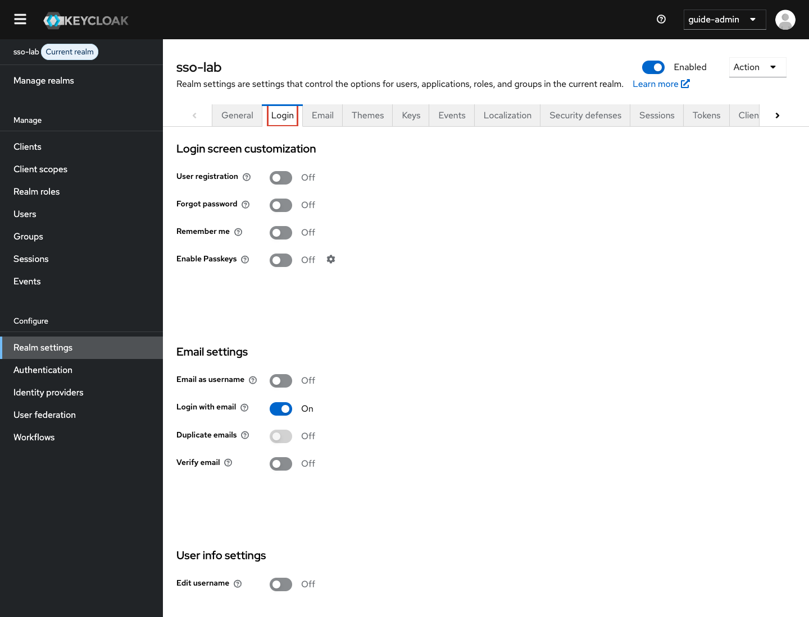

| ตัวเลือก          | ค่า                  | เหตุผล                                                       |
| ----------------- | -------------------- | ------------------------------------------------------------ |
| User registration | Off                  | จัดการบัญชีต้นทางที่ C ไม่เปิดสมัครบัญชีผ่าน Keycloak        |
| Duplicate emails  | Off                  | โค้ด C ค้นหา email แบบ exact และปฏิเสธเมื่อพบมากกว่า 1 บัญชี |
| Login with email  | On ได้ตามค่าเริ่มต้น | เป็นการ Login ของ Keycloak เอง ไม่ใช่ตัวควบคุม Login C       |
| Email as username | ไม่จำเป็นต้องเปิด    | C sync ตั้ง username=email ให้เองตอนสร้าง Keycloak user      |

ไม่ต้องปรับ browser authentication flow หรือสร้าง IdP redirector สำหรับ JWT grant นี้

## 2. ตั้งอายุ central access token และตรวจ realm key

**UI:** Realm settings → Tokens → Access Token Lifespan

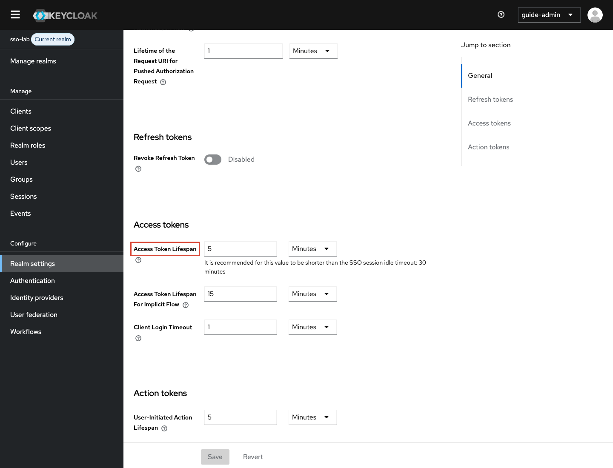

| ค่า                         | ตั้งเป็น                | ทำไม                                             |
| --------------------------- | ----------------------- | ------------------------------------------------ |
| Default Signature Algorithm | RS256                   | โค้ดตรวจรับเฉพาะ RS256                           |
| Access Token Lifespan       | 5 Minutes / 300 seconds | ให้ตรงค่าตั้งต้น PoC ปัจจุบันและทดสอบ expiry ได้ |

กด Save หลังแก้ค่า หาก client มี override อายุ token ใน Advanced ให้ล้าง override เพื่อรับค่าจาก realm

**5 นาทีไม่ใช่ 1 ชั่วโมง:** heartbeat 1 ชั่วโมงอยู่ใน JavaScript ของแอป ไม่ใช่ Keycloak และไม่ได้ต่ออายุ JWT สำหรับ token หมดอายุแอปจะ Logout เมื่อมี protected request หรือถึงรอบ heartbeat ถ้า requirement จะใช้ 15 นาที ให้ตั้ง 900 วินาทีโดยรู้ว่าเปลี่ยนจากค่าคู่มือนี้

**UI:** Realm settings → Keys → Keys list

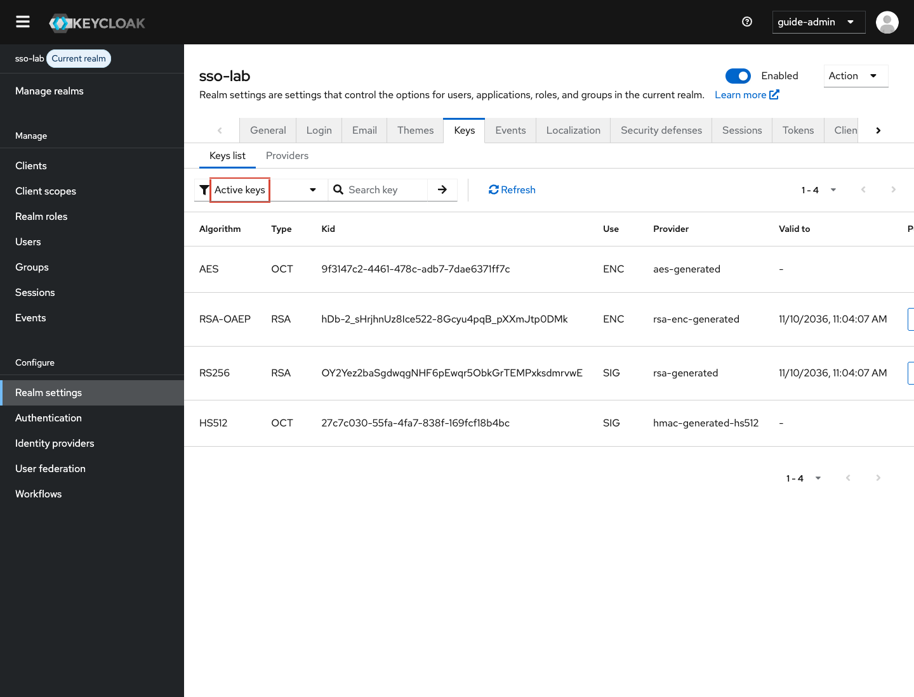

ตรวจว่ามี active RS256/SIG ของ rsa-generated ใช้กุญแจที่ Keycloak สร้างให้ได้ ไม่ต้อง upload private key ของ C เข้า realm นี้ เพราะ C key ใช้ตรวจ assertion ส่วน realm key ใช้เซ็น central token เป็นคนละหน้าที่

## 3. สร้าง IdP ตัวเดียว: app-control

**UI:** Identity providers → Add provider → JWT Authorization Grant


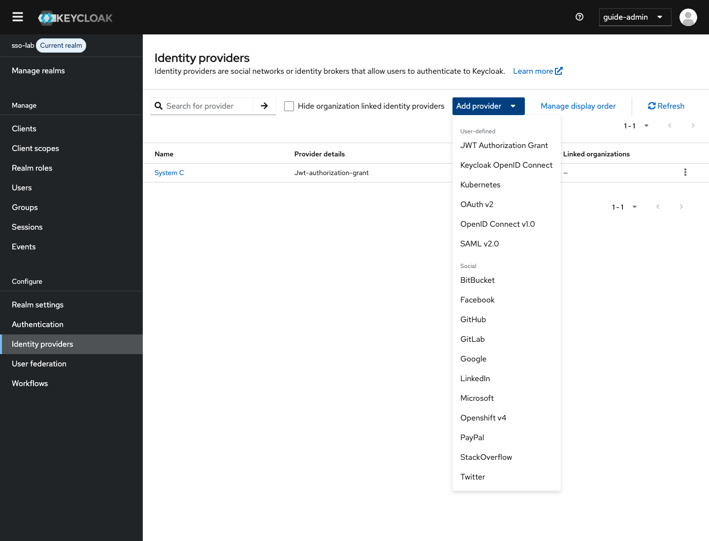

เลือกชนิด **JWT Authorization Grant** ไม่ใช่ OpenID Connect v1.0 สำหรับคู่มือใหม่ เพราะ C ไม่มี /oidc/auth หรือ /oidc/token ให้ Keycloak เรียกแล้ว และไม่ต้องตั้ง URL ที่ไม่ได้ใช้

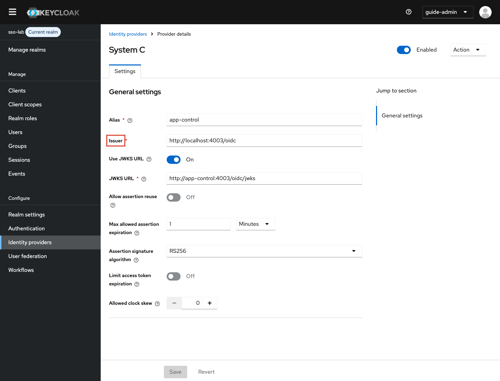

| Field                            | ค่า                               | เหตุผล/ผลเมื่อผิด                                                                       |
| -------------------------------- | --------------------------------- | --------------------------------------------------------------------------------------- |
| Alias                            | app-control                       | โค้ด sync federated identity และ client allowlist ใช้ชื่อนี้; เปลี่ยนเองจะหา link ไม่พบ |
| Enabled                          | On                                | อนุญาตให้ใช้ trust relationship นี้                                                     |
| Issuer                           | http://localhost:4003/oidc        | ต้องตรง assertion iss ที่ C ลงลายเซ็น                                                   |
| Use JWKS URL                     | On                                | อ่าน public key จาก C อัตโนมัติ ไม่ต้อง copy key ด้วยมือ                                |
| JWKS URL                         | http://app-control:4003/oidc/jwks | Keycloak ใน Docker เชื่อมต่อถึง C ได้                                                   |
| Allow assertion reuse            | Off                               | assertion มี jti และใช้ได้ครั้งเดียว                                                    |
| Max allowed assertion expiration | 1 Minute หรือ 60 Seconds          | C สร้าง assertion อายุ 60 วินาที; UI อาจแสดงเป็น 1 Minutes                              |
| Assertion signature algorithm    | RS256                             | ตรงกับ private key และ signing code ของ C                                               |
| Limit access token expiration    | Off                               | ไม่บีบอายุ central token 5 นาทีให้เหลือไม่เกิน assertion 60 วินาที                      |
| Allowed clock skew               | 0                                 | ค่าแล็บใช้เวลาเครื่องเดียวกัน ไม่เพิ่มช่วงยอมรับโดยไม่จำเป็น                            |

กด Add/Save ตามสถานะหน้าจอ

**Provider ชนิดนี้เปิด JWT grant ในตัว:** ไม่ต้องหา JWT Authorization Grant On/Off ในหน้า IdP เหมือน OIDC provider อีก แต่ client ในขั้นถัดไปยังต้องเปิด JWT Authorization Grant และเลือก IdP ให้ถูก

## 4. สร้าง clients ของ A/B/C

**UI:** Clients → Create client

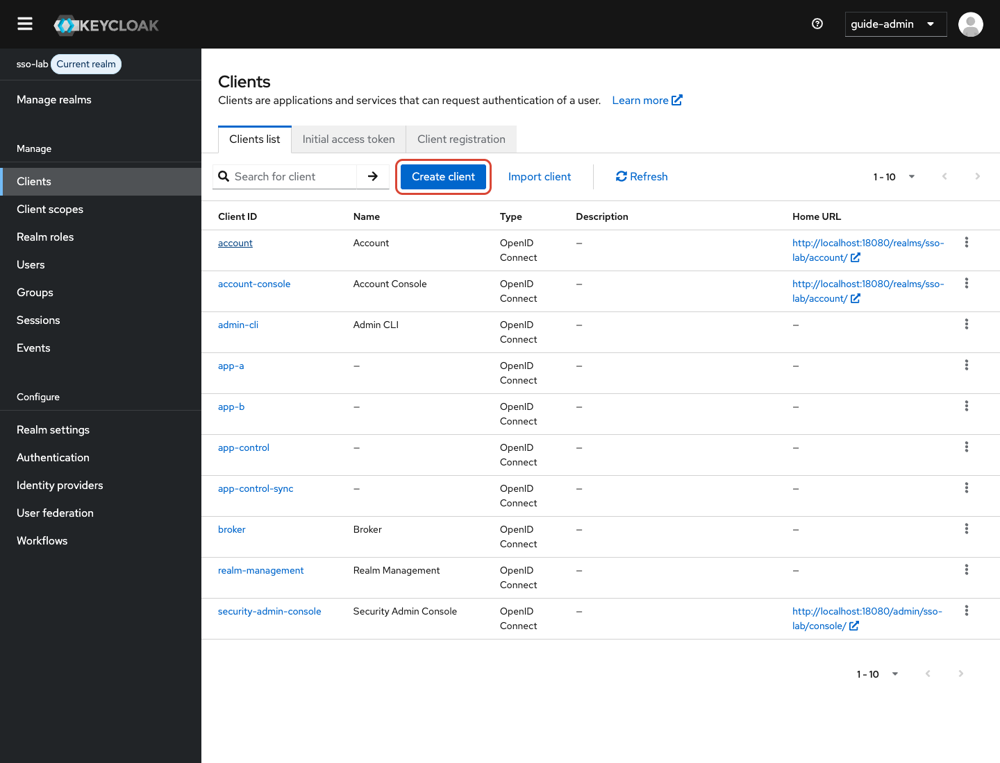

สร้าง 3 client โดยทำซ้ำ: app-a, app-b และ app-control

### 4.1 General settings

| Field       | ค่า                                     |
| ----------- | --------------------------------------- |
| Client type | OpenID Connect                          |
| Client ID   | app-a หรือ app-b หรือ app-control       |
| Name        | ตั้งชื่ออ่านง่ายได้ ไม่ใช้แทน Client ID |

ชื่อ Client type = OpenID Connect เป็นรูปแบบ protocol ของ token ไม่ได้แปลว่าเราต้องเปิด browser code flow

### 4.2 Capability config

**UI:** Clients → เลือก client → Settings → Capability config

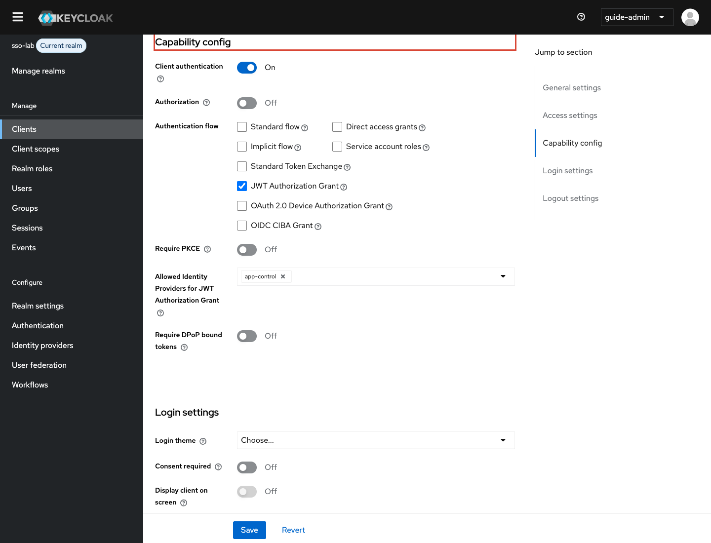

| Capability                                             | ค่า                  | เหตุผล                                                       |
| ------------------------------------------------------ | -------------------- | ------------------------------------------------------------ |
| Client authentication                                  | On                   | backend ต้องใช้ client secret ยืนยันตัวแอป                   |
| Authorization                                          | Off                  | ไม่ใช้ Keycloak Authorization Services ใน PoC นี้            |
| Standard flow                                          | Off                  | ไม่ใช้ browser authorization-code ผ่าน Keycloak              |
| Direct access grants                                   | Off                  | ไม่ส่ง password ผู้ใช้ไป Keycloak                            |
| Implicit flow                                          | Off                  | ไม่ใช้ implicit token ใน browser                             |
| Service accounts roles                                 | Off                  | 3 client นี้ขอ token ของ user; service account แยกอีก client |
| JWT Authorization Grant                                | On                   | อนุญาตรับ assertion จาก C                                    |
| Allowed Identity Providers for JWT Authorization Grant | app-control เท่านั้น | จำกัด trust source ตามโค้ด                                   |
| Standard Token Exchange / Device / CIBA หากแสดง        | Off                  | ไม่ใช้ใน flow ปัจจุบัน                                       |

หาก wizard ยังไม่แสดง field ทั้งหมด ให้ Save ก่อน แล้วกลับ Settings เพื่อแก้ค่าที่เหลือ

Access settings เช่น Valid redirect URIs และ Web origins เว้นว่างได้สำหรับ JWT grant นี้ เพราะ A/B callback เป็น browser POST ที่ C ส่งเอง ไม่ใช่ redirect ที่ Keycloak authorization endpoint ตรวจ อย่าใส่ wildcard เพื่อให้ผ่านปัญหาคนละสาเหตุ

Login/Logout settings: ไม่ต้องใส่ Backchannel logout URL เพราะเราใช้ signed C notification ไป /logout/control และลบ /logout/backchannel ไปแล้ว

### 4.3 เก็บ Client Secret

**UI:** Clients → เลือก client → Credentials → Client Secret


Client Authenticator ใช้ Client Id and Secret และ Allowed authentication method ใช้ Any ตามค่าแล็บที่ทดสอบ (C ส่ง client_secret ใน form body)

เปิดแท็บ Credentials ได้เมื่อ Client authentication = On เก็บ secret ไว้ใน .env ฝั่ง server ตามตารางขั้น 10 ไม่ copy ลงเอกสารหรือ commit Git

หากกด Regenerate ต้องอัปเดต secret ใน environment ของ backend ที่ใช้ client นั้นทั้งหมด โดยเฉพาะ A/B secret ซึ่ง C ใช้ขอ token และ A/B ใช้ introspection

## 5. สร้าง client roles ของ A/B

**UI:** Clients → app-a → Roles → Create role ทำซ้ำใน app-b

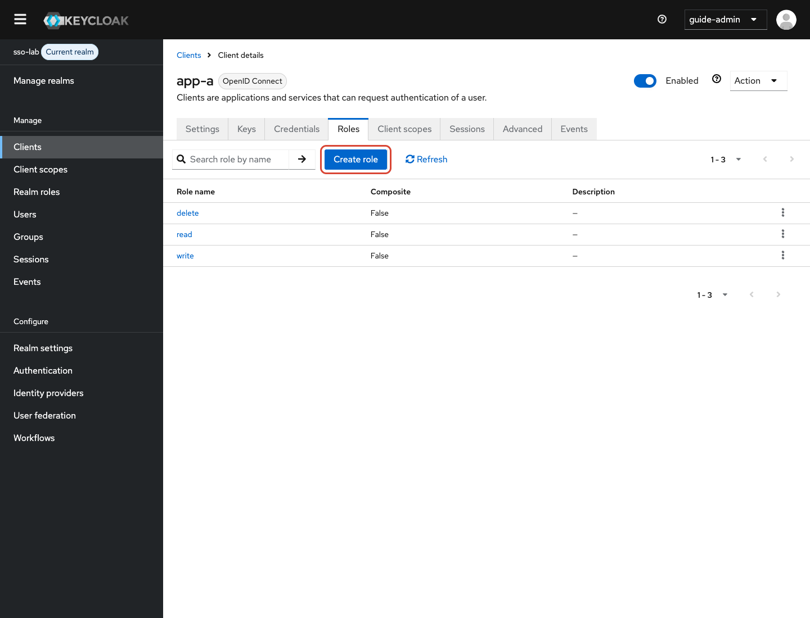

สร้าง read, write, delete อย่างละ 1 role ในทั้งสอง client รวม 6 definitions ไม่ต้องสร้าง role สำหรับ app-control ใน PoC นี้

| Role   | การใช้งานจริง                                            |
| ------ | -------------------------------------------------------- |
| read   | A/B ตรวจสิทธิ์นี้เพื่อเข้าแอป                            |
| write  | ส่งตามสิทธิ์ที่กำหนดใน C; ยังไม่มี CRUD ครบทุกกรณีใน PoC |
| delete | เช่นเดียวกับ write                                       |

อย่า assign ให้เป็น default role ของผู้ใช้ทุกคน และอย่ารวมเป็น composite ให้อัตโนมัติ เพราะต้องให้ C เป็นผู้ตัดสินสิทธิ์แต่ละ user

## 6. จำกัด Role scope และตรวจ default client scopes

**UI:** Clients → app-a → Client scopes → app-a-dedicated

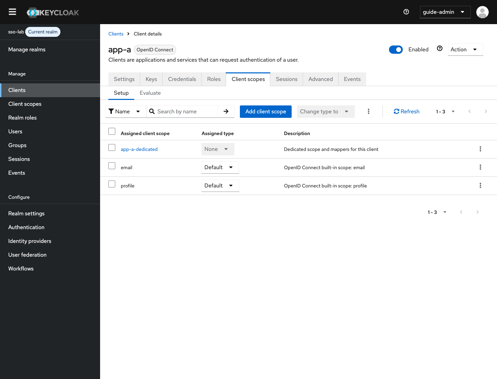

Dedicated scope ไม่ใช่ client ใหม่ เป็นพื้นที่ config เฉพาะของ client นั้น เปิดแล้วมีแท็บ Mappers กับ Scope

**UI:** app-a-dedicated → Scope → Full scope allowed = Off → Assign role

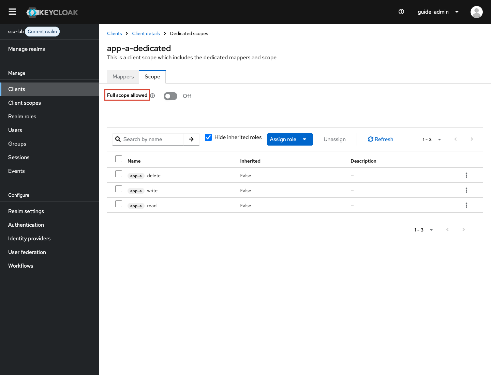

- กด Assign role → Client roles แล้วเลือก app-a/read, app-a/write, app-a/delete จาก client app-a หาก dialog มี filter ให้ค้นชื่อ app-a
- ทำซ้ำ app-b โดยเลือกเฉพาะ roles ของ app-b
- app-control ตั้ง Full scope allowed = Off และไม่ต้องเพิ่ม application roles
- ไม่ใส่ roles ของ B ใน scope ของ A และกลับกัน

**เหตุผล:** จำกัดข้อมูลสิทธิ์ที่ client รับได้ ไม่ได้เป็นการมอบสิทธิ์ให้ทุก user การให้ user จริงต้องทำใน C หรือ role mapping ภายหลัง

ในหน้า Client scopes ของแต่ละ client ให้มี profile, email และ roles เป็น Assigned type = Default หากไม่ได้ติดมาตามค่าเริ่มต้น ให้ Add client scope แล้วเลือก Default

- email ทำให้ access token มี email ที่ A/B ใช้หา local account
- profile ให้ข้อมูล profile ตาม scope ที่ C ส่งไป
- roles สำคัญกับ service-account token ให้มี resource_access สำหรับ Admin API

## 7. ตั้ง Protocol Mappers

**UI:** Clients → app-a → Client scopes → app-a-dedicated → Mappers

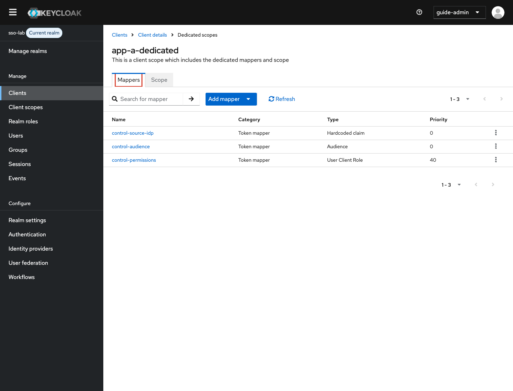

ถ้ายังไม่มี mapper ให้ Add mapper → By configuration หรือ Configure a new mapper ตามปุ่มที่แสดง เลือก mapper type ตามหัวข้อด้านล่าง

### 7.1 Audience mapper

เลือก type Audience ชื่อ control-audience

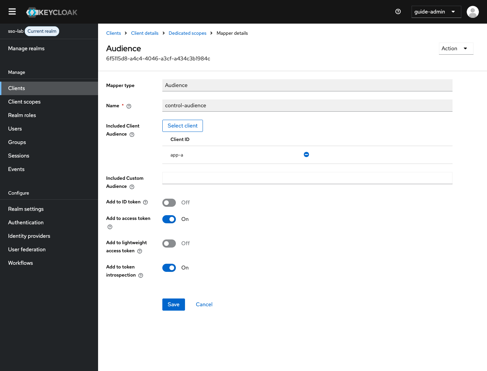

| Field                            | app-a | app-b | app-control |
| -------------------------------- | ----- | ----- | ----------- |
| Included Client Audience         | app-a | app-b | app-control |
| Included Custom Audience         | ว่าง  | ว่าง  | ว่าง        |
| Add to access token              | On    | On    | On          |
| Add to ID token                  | Off   | Off   | Off         |
| Add to token introspection หากมี | On    | On    | On          |

**เหตุผล:** A/B/C ตรวจ audience ของ token ที่ได้รับ หากไม่มี client ของตัวเองใน aud จะปฏิเสธ แม้ลายเซ็นถูกต้อง

### 7.2 IdP claim mapper

เลือก type Hardcoded claim ชื่อ control-source-idp ทำเหมือนกันทั้ง 3 client

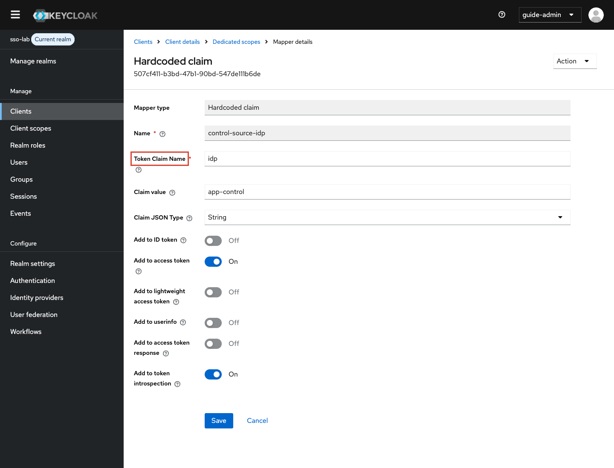

| Field                      | ค่า         |
| -------------------------- | ----------- |
| Token Claim Name           | idp         |
| Claim value                | app-control |
| Claim JSON Type            | String      |
| Add to access token        | On          |
| Add to ID token / userinfo | Off         |
| Add to token introspection | On          |

**เหตุผล:** โค้ดตรวจ idp เท่ากับ app-control และ client allowlist รับเฉพาะ C อยู่แล้ว ไม่ต้องอาศัย browser broker session note ที่ไม่มีใน grant นี้

### 7.3 Permission mapper

เลือก type User Client Role ชื่อ control-permissions เฉพาะ app-a และ app-b ไม่ต้องเพิ่มใน app-control

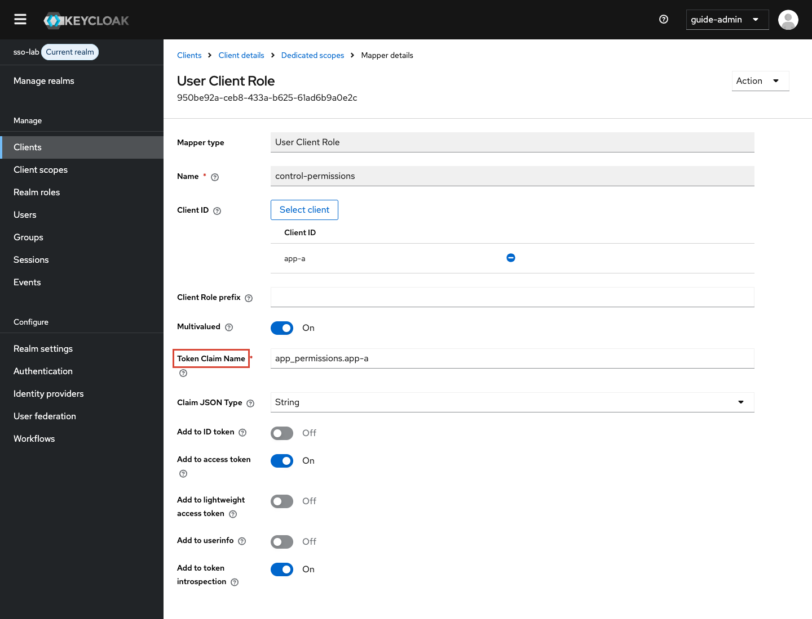

| Field                      | app-a                 | app-b                 |
| -------------------------- | --------------------- | --------------------- |
| Client ID                  | app-a                 | app-b                 |
| Client Role prefix         | ว่าง                  | ว่าง                  |
| Token Claim Name           | app_permissions.app-a | app_permissions.app-b |
| Claim JSON Type            | String                | String                |
| Multivalued                | On                    | On                    |
| Add to access token        | On                    | On                    |
| Add to ID token / userinfo | Off                   | Off                   |
| Add to token introspection | On                    | On                    |

**เหตุผล:** จุดในชื่อ claim สร้าง object ซ้อน Multivalued สร้าง array ของชื่อ roles แม้ผู้ใช้มี role เดียว จึงตรงกับ includes("read") ที่โค้ดใช้

ผลตัวอย่างที่ต้องได้เมื่อ user มี read/write ใน A:

```json
{
  "aud": "app-a",
  "idp": "app-control",
  "email": "learner@example.test",
  "app_permissions": { "app-a": ["read", "write"] }
}
```

JWT จริงมี sub, iss, exp, iat, jti และ claims อื่นเพิ่มด้วย หาก roles ออกมาเป็นข้อความ JSON string แทน array หรือ key ชื่อ app_permissions.app-a แบบไม่ซ้อน ให้ตรวจชนิด mapper และ field ตามภาพ

## 8. สร้าง service-account client สำหรับ C sync

**UI:** Clients → Create client → Client ID = app-control-sync, Client type = OpenID Connect

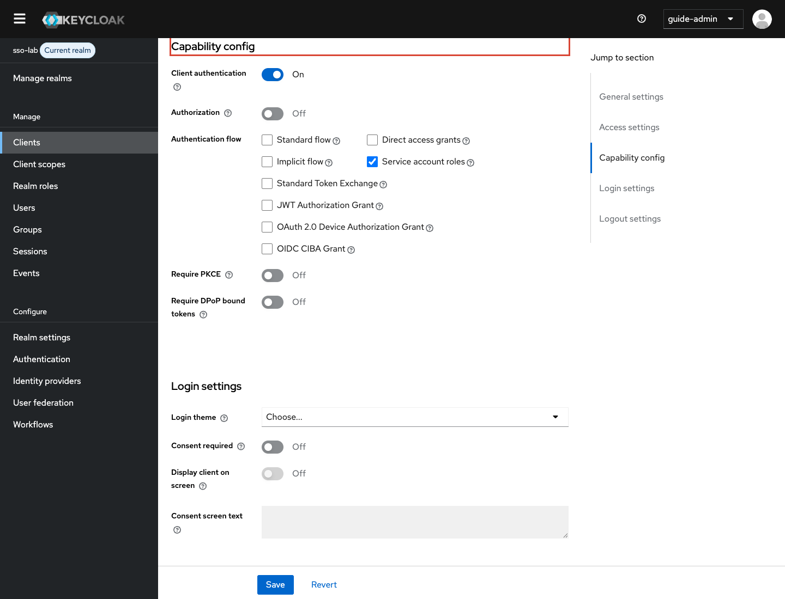

ตั้ง Client authentication = On, Service accounts roles = On และปิด Standard, Direct access grants, Implicit, JWT Authorization Grant และ capability อื่นที่ไม่ใช้ แล้ว Save

**เหตุผล:** C ต้องขอ token ของโปรแกรมด้วย client_credentials เพื่อเรียก Admin API ไม่ใช่ token ของผู้ใช้ และไม่ควรใช้บัญชี admin ของคนแทน

### 8.1 Assign roles ให้ service-account user

**UI:** Clients → app-control-sync → Service account roles → Assign role


กด Assign role → Client roles แล้วค้นหา roles จาก client realm-management จากนั้น assign:

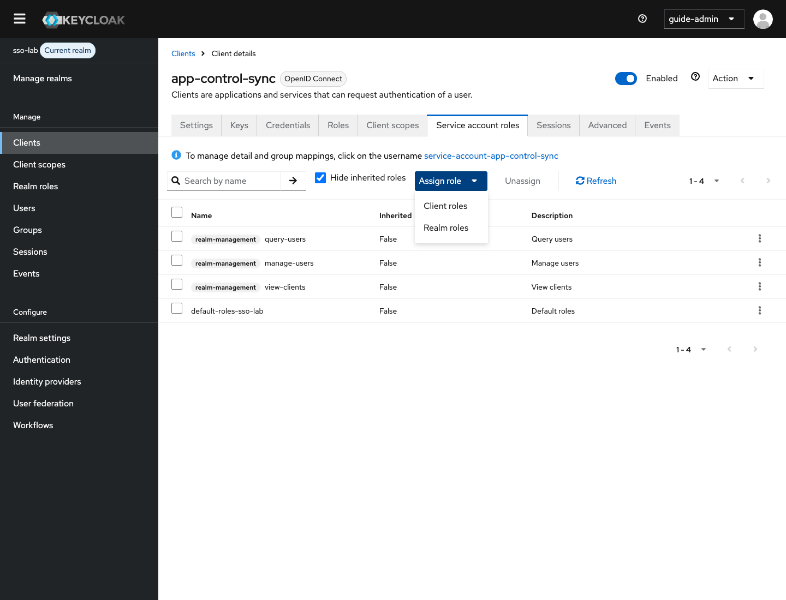

- query-users
- manage-users
- view-clients

หากไม่เห็นรายการ ให้เลือก Client roles ในเมนู Assign role แทน Realm roles ก่อน ไม่ต้องสร้าง role ชื่อเดียวกันใน realm เอง

### 8.2 อนุญาต roles เหล่านั้นใน scope ของ sync client ด้วย

**UI:** app-control-sync → Client scopes → app-control-sync-dedicated → Scope

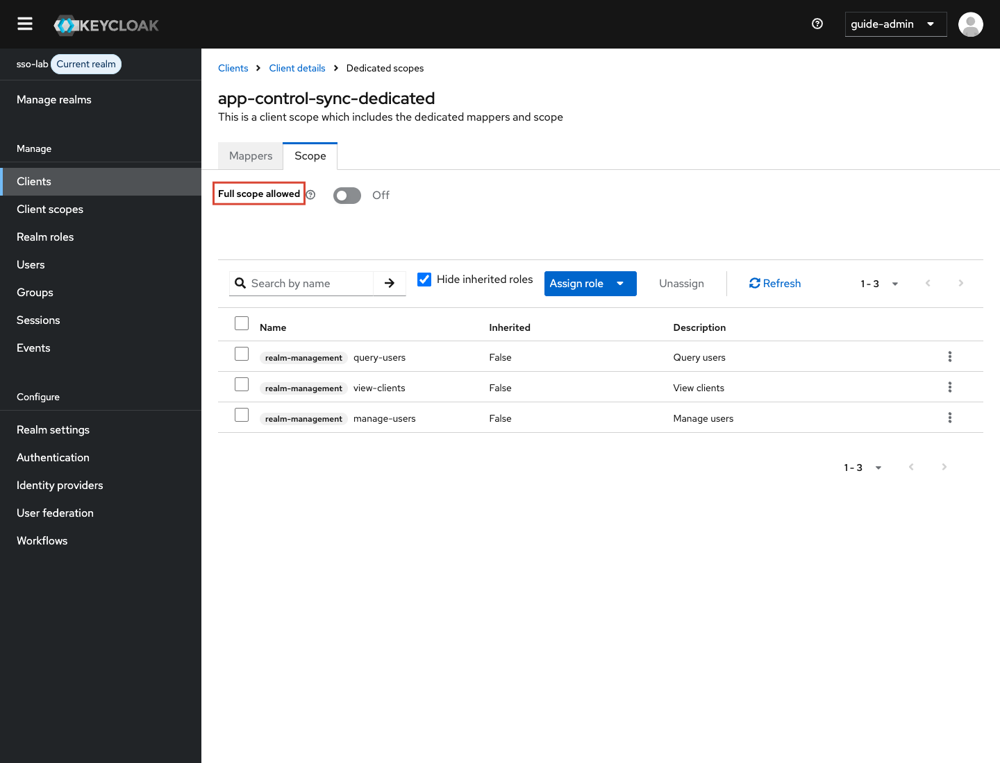

Full scope allowed = Off แล้ว Assign role สามรายการเดิมจาก realm-management ตรวจ default client scopes ว่ามี roles อยู่ด้วย

**เหตุผล:** service-account roles ที่ได้ใน token คือ roles ที่ assign ให้บัญชีตัดกับ roles ที่ scope อนุญาต ถ้า assign แล้วแต่ token ไม่มี roles Admin API จะ 403 ส่วน realm-admin และ manage-clients ไม่ต้องให้ เพราะโค้ด sync ไม่สร้างหรือแก้ client

## 9. ตรวจว่ามี clients ครบและ capabilities ถูกชุด

| Client           | Client auth | JWT grant | Allowed IdP | Service account | Role scope                 |
| ---------------- | ----------- | --------- | ----------- | --------------- | -------------------------- |
| app-a            | On          | On        | app-control | Off             | app-a/read, write, delete  |
| app-b            | On          | On        | app-control | Off             | app-b/read, write, delete  |
| app-control      | On          | On        | app-control | Off             | ไม่มี app roles            |
| app-control-sync | On          | Off       | ไม่ใช้      | On              | realm-management สาม roles |

ทุก client ปิด Standard flow, Direct access grants และ Implicit flow ใน flow นี้ Clients มาตรฐาน เช่น account, broker, realm-management ไม่ต้องลบหรือแก้ตามชื่อ client ของแอป

## 10. ใส่ secrets ให้ environment ตรงกัน

Credentials อยู่ในแท็บ Credentials ของแต่ละ client ไม่ใช่ secret ของ IdP และไม่ใช่ password ของ user

| Secret จาก client | ตัวแปรใน .env              | ใครใช้ใน Compose                            |
| ----------------- | -------------------------- | ------------------------------------------- |
| app-a             | APP_A_KC_CLIENT_SECRET     | A introspection และ C token/revoke สำหรับ A |
| app-b             | APP_B_KC_CLIENT_SECRET     | B introspection และ C token/revoke สำหรับ B |
| app-control       | CONTROL_KC_CLIENT_SECRET   | C bootstrap token ของตัวเอง                 |
| app-control-sync  | CONTROL_SYNC_CLIENT_SECRET | C เรียก Admin API                           |

เก็บ client IDs, KC_ISSUER, KC_INTERNAL_URL ตาม .env.example แล้วรัน:

```sh
docker compose up -d --force-recreate app-a app-b app-control
```

ไม่ต้อง down -v เพราะจะลบข้อมูลที่คุณกำลังศึกษา หลังล้าง Keycloak Client Secrets จะเป็นชุดใหม่ แม้ชื่อ client เหมือนเดิม การใช้ secret เก่าคือสาเหตุ invalid_client ที่พบบ่อย

## 11. Sync user จาก C แล้วตรวจใน Keycloak

1. เปิด C Login ด้วยบัญชีผู้ดูแล
2. ไป Users กำหนด read/write/delete ของ A/B แล้ว Save หรือกด Sync อีกครั้ง
3. ต้องเห็นสถานะ sync สำเร็จ หาก error ให้ดูข้อความก่อนทดสอบ Login
4. ใน Keycloak ไป Users ค้นหา email เดียวกัน

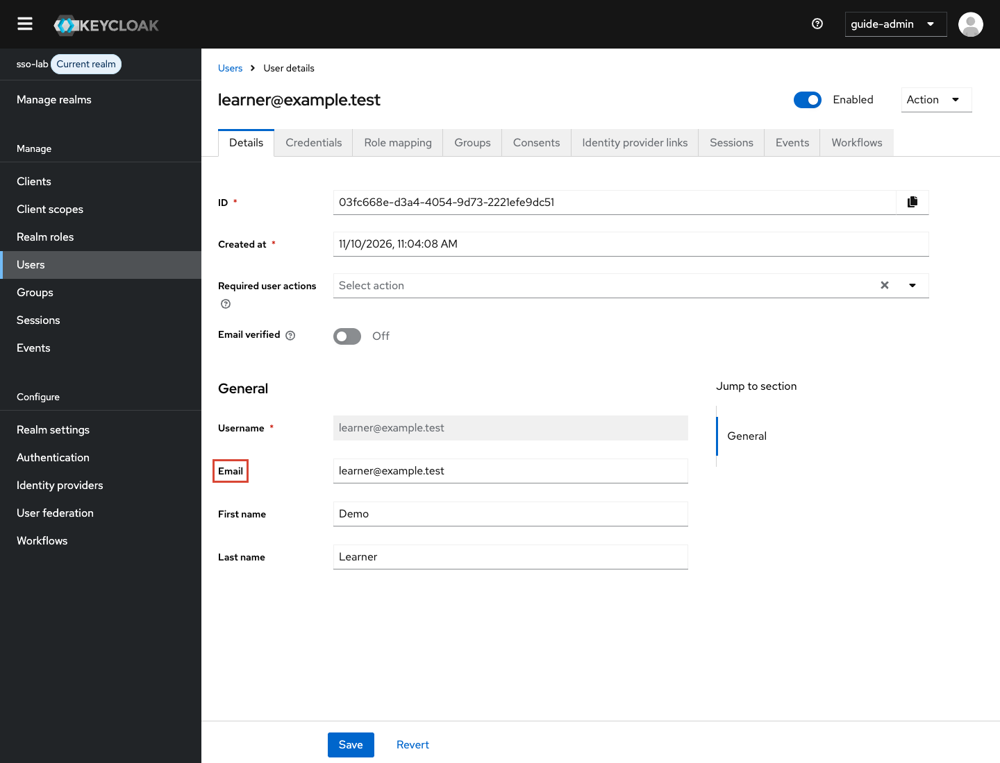

**UI:** Users → เลือก user → Identity provider links

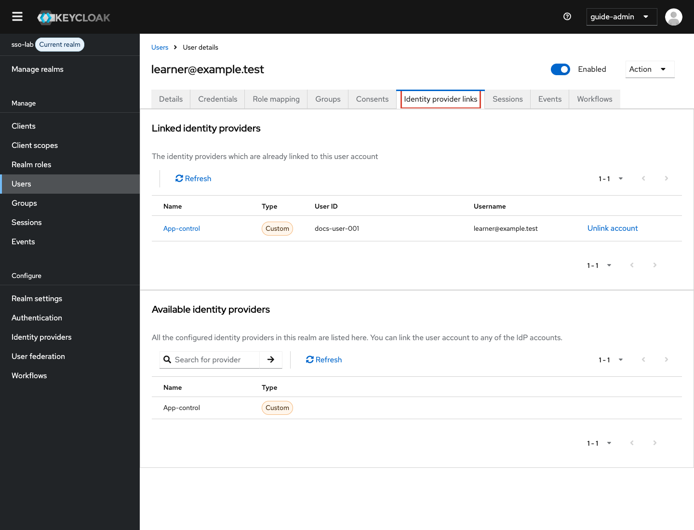

ต้องมี alias app-control และ external user ID ตรงกับ users.id ของ C ที่แปลงเป็น string ไม่ใช่ email และไม่ใช่ UUID ของ Keycloak ภาพใช้ docs-user-001 เป็น ID สมมติของบัญชีสำหรับทดสอบคู่มือ ไม่ให้นำค่านี้ไปกรอกแทน ID จริงของ C

**UI:** Users → เลือก user → Role mapping

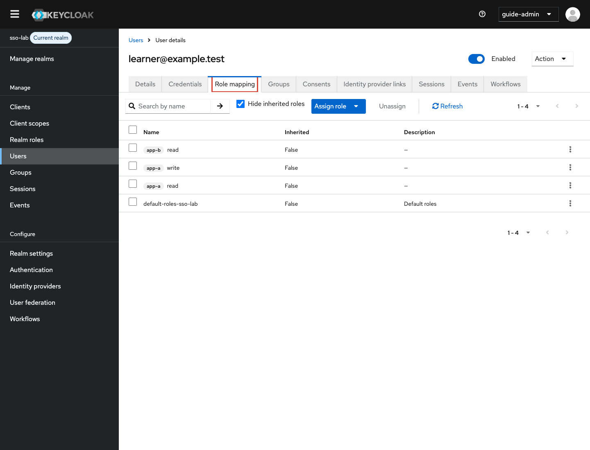

ตรวจว่าได้ client roles ตรงกับ C ตัวอย่างภาพ learner มี A read/write และ B read ไม่ต้องตั้ง password ในแท็บ Credentials ของผู้ใช้คนนี้ เพราะ Login ตรวจที่ C

A/B ยังต้องมี local account ที่ email ตรงกับ C ด้วย ดู CLI สร้างบัญชีใน README หลัก การ sync Keycloak ไม่ได้สร้าง local users ใน A/B

## 12. ทดสอบตามลำดับและอ่านผล

1. Login C โดยตรง: สถานะ SSO ต้องพร้อมหลังตรวจ readiness และขอ token
2. เปิด A จากลิงก์ C: ได้ app session โดยไม่กรอกรหัสผ่าน C ซ้ำ
3. เปิด B: ออก token สำหรับ B อีกใบและสร้าง B session แยกกัน
4. ถอน read ของ A ใน C และ sync: เริ่ม SSO ใหม่จากปุ่ม A แล้วต้องแจ้งไม่มีสิทธิ์ตาม policy; token เดิมยังมี claims เดิมจนหมดอายุหรือถูก revoke
5. ใช้ user ที่ไม่มี local account ใน A/B: ต้องแจ้งไม่มีผู้ใช้ที่ตรงกัน
6. Logout C: revoke tokens ที่ยังใช้ได้และแจ้ง A/B ให้ Logout
7. Local Login A/B ต้องยังใช้ได้โดยไม่พึ่ง token กลาง

ดู raw central token ได้ที่ browser DevTools → Network → POST /sso/callback → Payload; token อยู่ใน POST ไม่ใช่ URL สำหรับ introspection/revoke ดู [API catalog](../flows/API-CATALOG.md) ใช้ credentials ของ client ที่ออก token นั้นเท่านั้น

### ข้อผิดพลาดที่พบบ่อย

| อาการ                                        | ตรวจตรงไหนก่อน                                                                      |
| -------------------------------------------- | ----------------------------------------------------------------------------------- |
| invalid_client                               | realm, Client authentication On, client ID/secret และ recreate แอปหลังแก้ .env      |
| invalid_grant / assertion ไม่ผ่าน            | issuer, aud, signature/kid, JWKS URL, expiration, allowed IdP และ user link         |
| JWT grant ขอได้ แต่ A/B ปฏิเสธ               | aud, idp mapper, email, app_permissions, read และ local user                        |
| ไม่มี app_permissions หรือได้แอปอื่นปน       | User Client Role mapper, claim name, Full scope allowed และ role scope ของ client   |
| C sync 403                                   | service-account role assignment, role scope และ default roles client scope          |
| C sync บอกยังไม่มี Client/role               | สร้าง app-a/app-b และ read/write/delete ให้ครบก่อน sync                             |
| C sync พบสิทธิ์สืบทอดที่ไม่อนุญาต            | ตรวจ group/composite/default roles อย่า override การกำหนดจาก C โดยไม่ตั้งใจ         |
| Token หมดเร็วกว่าที่ตั้ง realm               | IdP Limit access token expiration หรือ client lifespan override                     |
| หน้า Sessions ไม่มี user แต่ token active    | JWT grant เป็น transient session; ตรวจ introspection แทน persistent browser session |
| เปิด C /oidc/auth หรือ /interaction แล้ว 404 | endpoint เหล่านี้ถูกลบโดยตั้งใจ ใช้ JWT grant ตามคู่มือนี้                          |

## หลักฐานการตรวจคู่มือ

ชุดภาพใช้ Keycloak image เดียวกับ Compose (26.8.1) ใน instance ชั่วคราว และทดสอบจริงว่า app-a/app-b/app-control ขอ JWT grant ได้, audience/idp ตรง, permissions แยกตาม client, introspection active ก่อน revoke และ inactive หลัง revoke รวมถึง service account สร้าง/ปรับผู้ใช้ ผูก/ถอน identity links และเพิ่ม/ถอน roles ได้ ครบทั้ง 12 Admin API templates ที่โค้ด C เรียก

การทดสอบนี้เป็นค่าคู่มือใน environment แยก ไม่ได้ตั้งค่า realm ของคุณและไม่แทนการทดสอบ A/B/C end-to-end หลังคุณตั้งค่าจริงครบ

อ่านเหตุผลเชิง feature เพิ่มใน [FEATURES.md](FEATURES.md) และอ้างอิง [JWT Authorization Grant](https://www.keycloak.org/securing-apps/jwt-authorization-grant), [Server Administration Guide](https://www.keycloak.org/docs/latest/server_admin/index.html)
