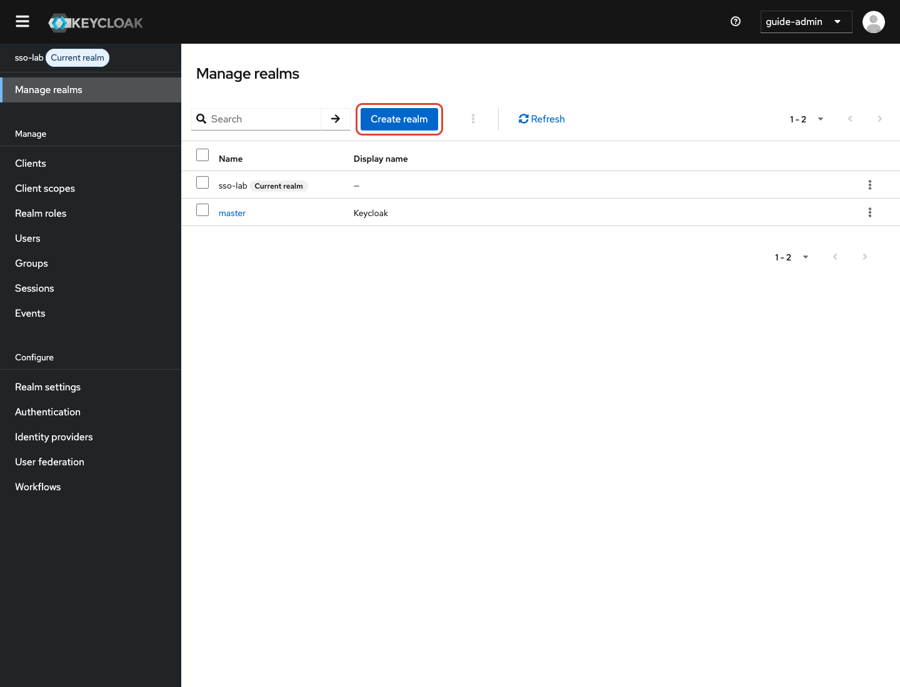
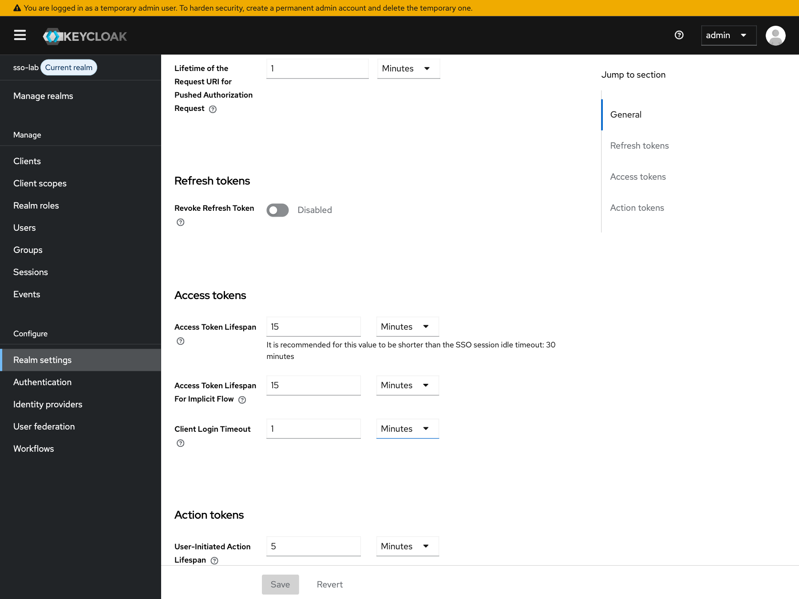
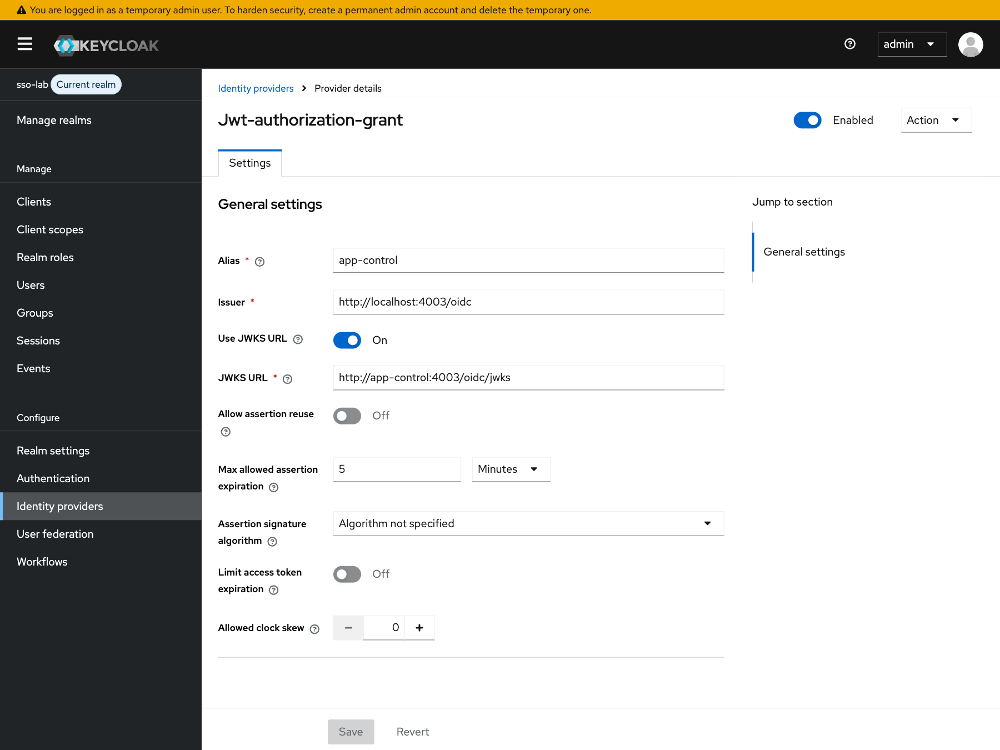
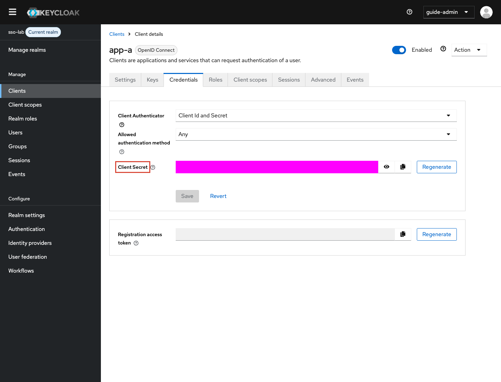
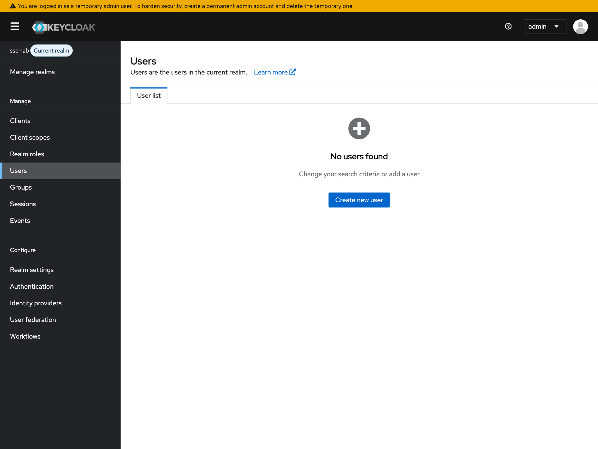
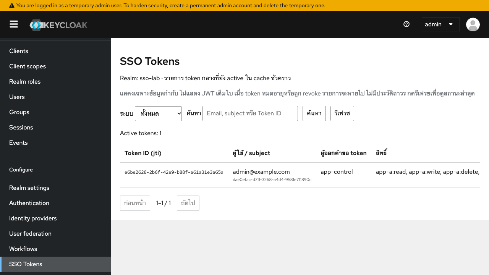
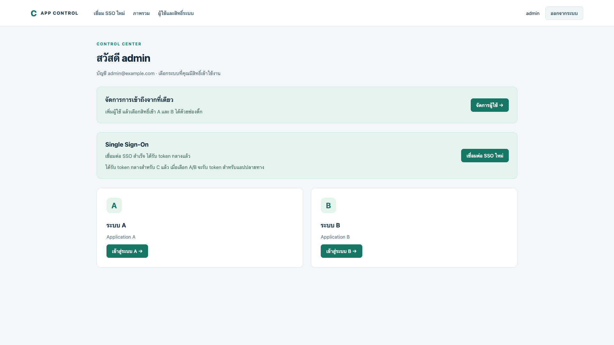
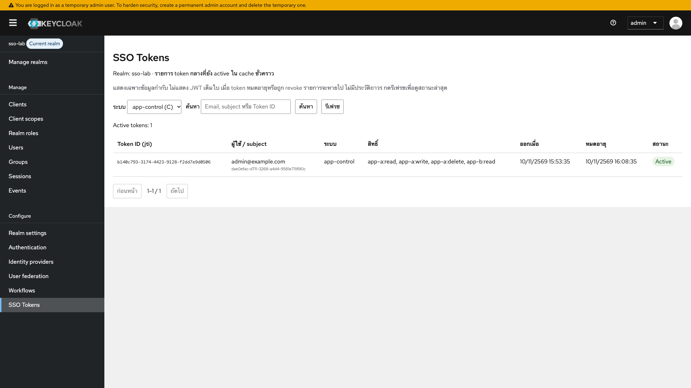

# เข้าใจและตั้งค่า Keycloak ของ PoC วิธีใหม่

คู่มือนี้ใช้กับ Compose และส่วนขยายใน `keycloak/` แล้ว ไม่ใช่ flow เดิมที่ sync user/roles หรือให้ C รับ token ของ A/B มาก่อน อ่าน [ภาพรวม](../../README.md) และ [flow ทั้ง 10 กรณี](../flows/LOGIN-AND-SESSION.md) ประกอบ

## 1. รู้จักส่วนที่ใช้ก่อนตั้งค่า

| Feature                 | คืออะไร                                                  | ใช้ใน PoC อย่างไร                                                                               |
| ----------------------- | -------------------------------------------------------- | ----------------------------------------------------------------------------------------------- |
| Realm                   | ขอบเขต config กุญแจ client และ issuer ของระบบยืนยันตัวตน | ใช้ `sso-lab` แยกจาก master ที่ใช้บริหาร Keycloak                                               |
| Client                  | ตัวตนของแอปปลายทางที่ขอใช้บริการ Keycloak                | `app-a`, `app-b` และ `app-control`; aud กลางระบุกลุ่ม SSO ส่วน app_permissions ระบุสิทธิ์แยกแอป |
| Identity Provider / IdP | แหล่งที่ยืนยันว่าผู้ใช้เป็นใคร                           | C ตรวจรหัสผ่านเอง แล้วลงลายเซ็น proof                                                           |
| IdP trust config        | issuer และ public key ที่ยอมรับ                          | เก็บใน IdP alias `app-control` ให้ extension อ่าน ไม่ได้เรียก native broker Login               |
| JWT / RS256             | token ที่มีข้อมูลและลายเซ็น RSA                          | Keycloak เซ็น token กลาง A/B ตรวจด้วย public key                                                |
| JWKS / kid              | ชุด public keys และรหัสระบุกุญแจ                         | Keycloak โหลด public key C; A/B โหลด public key Keycloak                                        |
| Issuer / Audience       | ใครออก token และออกให้ใคร                                | A/B ตรวจ iss ตรง realm และ aud ตรงกลุ่ม SSO ที่กำหนดใน KC_AUDIENCE                              |
| Realm Resource SPI      | จุดเพิ่ม REST endpoints ด้วย Java ใน Keycloak            | ส่วนขยายตรวจ proof ออก token และจัดการสถานะชั่วคราว                                             |
| SingleUseObjectProvider | cache มี TTL ที่ extension ใช้เก็บค่า/กัน replay         | เก็บตัวตน email สิทธิ์ และ index token ชั่วคราว ไม่สร้าง Users                                  |
| CSP / frame policy      | กำหนดว่าเปิดเฟรมและส่งฟอร์มไปไหนได้                      | อนุญาตเฉพาะ C และ callback A/B ในแล็บ                                                           |

**ไม่ใช้** protocol mapper, client role mapping, service-account sync หรือ native JWT grant เพื่อออก token ใน flow นี้ สิทธิ์มากับ proof ที่ C เซ็น และ extension ใส่ `app_permissions` ลง token โดยตรง

Session C, token กลาง และ session A/B เป็นคนละส่วน การใช้ SSO เข้าอีกแอปโดยไม่ถามรหัสผ่านอาศัย session C; Keycloak ในวิธีนี้ไม่มี native browser session หรือ refresh token

## 2. สิ่งที่ต้องติดตั้งก่อนเปิด UI

```sh
npm ci
npm --prefix app ci
npm --prefix app-control ci
npm run keys:generate
npm run lab:prepare
docker compose up -d --build
```

หากเริ่มเครื่องใหม่ให้คัดลอก `.env.example` เป็น `.env` และตั้งรหัสฐานข้อมูล/session secrets ก่อน ดู [README](../../README.md) Compose build Java 21 extension แล้วใส่ JAR ใน `/opt/keycloak/providers/` ของ image 26.8.1 ไม่ต้องติดตั้ง Java บนเครื่อง host

UI อย่างเดียวสร้าง endpoint ใหม่ไม่ได้ ต้องใช้ image ที่มี extension ก่อน Private key ของ C อยู่ในไฟล์ local ที่ mount read-only; ไม่เอาไปกรอกใน Keycloak ใช้เฉพาะ public JWKS

## 3. ตั้งค่าแบบรันซ้ำได้ แล้วเปิด UI ไล่ดู

```sh
npm run lab:configure
```

สคริปต์นี้สร้าง/ปรับ config ตามตารางด้านล่าง ไม่สร้างผู้ใช้หรือสิทธิ์ถาวร ค่า secrets อ่าน `.env` และไม่พิมพ์ออกจอ หากเปลี่ยน client secret ให้ recreate A/B เพื่อโหลด env ใหม่

เข้าสู่ http://localhost:8080/admin ด้วย admin / admin-local-demo ซึ่งเป็นบัญชีตัวอย่าง localhost ของแล็บ จากนั้นเลือก realm `sso-lab`

| จุด                   | ค่า                      | เหตุผล                                                        |
| --------------------- | ------------------------ | ------------------------------------------------------------- |
| Realm name            | sso-lab                  | ใช้สร้าง issuer ที่ทุกแอปต้องตรวจตรงกัน                       |
| Realm enabled         | On                       | เปิดรับคำขอของ realm                                          |
| Require SSL           | None เฉพาะ localhost PoC | browser และ Docker ภายในแล็บใช้ HTTP; ไม่ใช่ค่าแนะนำระบบจริง  |
| Access Token Lifespan | 15 minutes               | token กลางมีอายุ 900 วินาที; extension จำกัดสูงสุด 900 วินาที |
| Realm key             | RSA / RS256              | extension ใช้กุญแจ realm เซ็น token; A/B ตรวจผ่าน JWKS        |

### ตำแหน่ง UI ของ Realm

มุมซ้ายบน **Manage realms** → เลือกหรือ Create realm `sso-lab`; **Realm settings → Tokens** ดู Access Token Lifespan; **Realm settings → Keys** ดูกุญแจและ kid





ภาพ Tokens และ trust C ถ่ายจาก PoC ที่รันวิธีใหม่ ส่วนภาพสร้าง Realm และตำแหน่ง Credentials เป็นภาพอ้างอิงเมนูเดิมที่ไม่มี secret ให้ยึดค่าตามตารางในคู่มือนี้

## 4. Trust C — แหล่งตัวตนเดียว

ไป **Identity providers** → provider `app-control`

| ค่า           | ค่าของแล็บ                        |
| ------------- | --------------------------------- |
| Alias         | app-control                       |
| Provider type | JWT Authorization Grant           |
| Enabled       | On                                |
| Issuer        | http://localhost:4003/oidc        |
| JWKS URL      | http://app-control:4003/oidc/jwks |

Provider type นี้ใช้เป็นที่เก็บ config trust ที่ extension อ่าน **ไม่ได้ใช้ native JWT grant หรือสร้าง federated user link** ตรวจ source `IdentityAssertionVerifier` ใน extension จะเห็นการโหลด JWKS ตรวจ RS256, issuer, audience, exp, jti และ token_use

ช่อง assertion algorithm/expiration อื่นในหน้า provider เป็นค่าของ native grant ที่ extension ไม่ใช้ ส่วนขยายบังคับ RS256, อายุ proof ไม่เกิน 60 วินาที และการกันใช้ซ้ำใน Java โดยตรง

`localhost:4003` คือ issuer ที่ใช้ระบุ C ส่วน `app-control:4003` เป็น DNS ของ container ที่ Keycloak ใช้เรียก JWKS ภายใน Docker ไม่ควรเปลี่ยน issuer เป็น internal URL เพราะจะตรวจลายเซ็น/issuer ไม่ตรงกัน



## 5. Client A/B

ไป **Clients → app-a หรือ app-b**

| ค่า                             | app-a                              | app-b                              | เหตุผล                                                  |
| ------------------------------- | ---------------------------------- | ---------------------------------- | ------------------------------------------------------- |
| Client authentication           | On                                 | On                                 | ใช้ secret ตอน introspect/revoke จาก backend            |
| Standard flow                   | Off                                | Off                                | ไม่มี OIDC authorization code exchange ในวิธีนี้        |
| Direct access grants            | Off                                | Off                                | A/B ไม่ส่ง password ให้ Keycloak                        |
| Service accounts                | Off                                | Off                                | ไม่ sync user ผ่าน Admin API                            |
| Full scope allowed              | Off                                | Off                                | ไม่อาศัย realm/client roles เพื่อกระจายสิทธิ์           |
| Valid redirect URIs             | http://localhost:4001/sso/callback | http://localhost:4002/sso/callback | exact match ไม่ใช้ wildcard                             |
| Attribute temporary.sso.enabled | true                               | true                               | extension อนุญาตออก token เฉพาะ client ที่เปิดใช้งานนี้ |
| Default/optional client scopes  | ว่าง                               | ว่าง                               | custom token ไม่ใช้ mappers/scopes เดิม                 |

`temporary.sso.enabled` เป็น custom attribute สคริปต์ตั้งผ่าน Admin API หน้าจอ Admin Console อาจไม่มีช่องแก้ attribute นี้โดยตรง จึงไม่ควรหาปุ่มที่ไม่มีใน UI ใช้ `lab:configure` หรือ Admin API ตรวจ/ตั้งค่า

Client Secret อยู่ที่ **Clients → เลือก client → Credentials** ต้องตรงกับ `.env` ของแอปเจ้าของ client นั้น C ใช้ CONTROL_KC_CLIENT_SECRET ของตัวเอง ไม่ใช้ secrets ของ A/B และไม่ส่ง secret เข้า browser



ต้องมี client app-control สำหรับ token กลาง C แต่ไม่ต้องสร้าง app-control-sync ไม่ต้องสร้าง role read/write/delete ใน Keycloak และไม่ต้องตั้ง audience/idp/permission mapper ส่วนขยายสร้าง claims เหล่านี้จากข้อมูลที่ตรวจแล้ว

### Client app-control สำหรับ Login C

สร้าง client `app-control` เพิ่มใน realm sso-lab โดยเปิด Client authentication และ attribute `temporary.sso.enabled=true` เช่น A/B แต่ปิด Standard flow, Direct grants, Service accounts และไม่ต้องกำหนด redirect URI เพราะ C ขอ token ผ่าน backend `POST /temporary-sso-poc/bootstrap` ไม่ใช่ browser callback

`CONTROL_KC_CLIENT_SECRET` ใน .env ต้องตรง Credentials ของ client นี้ Compose ส่งเข้า C เป็น KC_CLIENT_SECRET ส่วน A/B ใช้ secret ของตัวเองเช่นเดิม

IdP alias app-control และ Client ID app-control เป็นคนละรายการ: IdP ใช้เชื่อถือ issuer/JWKS ของ C ส่วน Client ระบุปลายทาง token กลางของ C ไม่มีการสร้าง user/role ถาวร

Token กลางมี `aud=sso-apps` และ app_permissions รวมตามข้อมูล C เมื่อเข้า A/B ใช้ JWT ใบเดิม โดย Keycloak แนบ handoff ผูกคำขอส่งตรงถึงแอป ไม่ mint access token เพิ่ม

## 6. Headers และเฟรมส่งต่อ

ที่ **Realm settings → Security defenses → Headers** realm ต้องอนุญาตหน้าส่งต่อ C เปิด Keycloak ในเฟรม และ Keycloak ส่งฟอร์มไป A/B ได้ `lab:configure` ตั้งค่าไว้ดังนี้:

```text
Content-Security-Policy:
frame-src 'self';
frame-ancestors 'self' http://localhost:4003;
object-src 'none';
script-src 'self';
form-action http://localhost:4001 http://localhost:4002

X-Frame-Options: ว่าง (ใช้ CSP frame-ancestors เป็นตัวกำหนด)
Referrer-Policy: origin
```

หาก X-Frame-Options ยังเป็น SAMEORIGIN browser บางตัวอาจไม่ยอมเปิดเฟรม ขณะที่ `Referrer-Policy: no-referrer` อาจทำให้ form POST มี Origin เป็น null; callback ของ A/B ต้องตรวจ Origin เป็น http://localhost:8080 จึงตั้ง origin และไม่มี token ใน URL

ฝั่ง C ตั้ง `frame-src` เฉพาะ C/Keycloak/A/B และ form-action ที่จำเป็น ฝั่ง A/B อนุญาต frame-ancestors เฉพาะตัวเองกับ C ผ่าน Helmet ของแอป ไม่ใช่ settings Keycloak

เมื่อ callback สำเร็จ A/B สร้าง session แล้วส่ง postMessage มีเพียง `{ type: "sso-complete" }` ไม่มี token กลับ C หน้าส่งต่อเช็ค origin และ source ก่อนเปิด A/B หากไม่สำเร็จใน 12 วินาทีจะแจ้ง connection modal ที่ Login A/B

## 7. จัดการผู้ใช้และสิทธิ์

เปิด C `/users` ด้วย admin บันทึก email และติ๊ก read/write/delete แยก A/B

- read คือสิทธิ์เข้าใช้แอป ต้องมีบัญชี local ในแอปนั้นด้วย
- write/delete เป็น claims ที่หน้าแอปแสดงเพื่อทดสอบ ยังไม่มีธุรกิจ CRUD ให้ใช้งานแต่ละสิทธิ์
- สร้างใหม่บันทึกใน C เท่านั้น ไม่สร้าง user ใน Keycloak
- แก้ user เดิมจะยกเลิก token เก่าและแจ้ง A/B ให้เริ่ม SSO ใหม่
- ถ้าเพิกถอน/แจ้งแอปไม่สำเร็จจะตอบ error แม้บันทึกข้อมูล C ไปแล้ว ต้อง retry

ใน Keycloak **Users ต้องยังไม่มี user ของ C** และ **Clients → A/B → Roles** ไม่มี read/write/delete ที่โปรแกรมสร้าง บัญชี admin ของ master realm เป็นข้อมูลบริหารแยกจาก users ของ sso-lab



### เมนู SSO Tokens ใน Admin Console

เปิด Keycloak Admin Console → เลือก realm `sso-lab` → เมนู **SSO Tokens** ใต้ Configure หากเปิด Console ค้างไว้ก่อนติดตั้ง ให้รีโหลดหน้าใหม่ด้วย Cmd/Ctrl + Shift + R เพื่อโหลด theme ใหม่



หน้านี้แสดง Token ID (jti), email/subject, แอปปลายทาง, read/write/delete, เวลาออก, เวลาหมดอายุ และสถานะ Active มีตัวกรองระบบที่อ่านจาก Keycloak clients ปัจจุบัน ช่องค้นหาและปุ่มรีเฟรช ใช้ข้อมูลเมื่อโหลดล่าสุด ไม่ polling อัตโนมัติ หากตารางกว้างกว่าจอสามารถเลื่อนแนวนอนได้

แสดงเฉพาะ token ที่ยัง active ใน cache ชั่วคราว เมื่อหมดอายุหรือ revoke จะไม่แสดงหลังรีเฟรช ไม่เก็บประวัติถาวร และไม่ส่ง JWT เต็มใบหรือ Client Secret ให้หน้าเมนู ต้องเป็น master admin หรือ realm-admin ของ realm นั้นจึงจะอ่านข้อมูลได้

การตั้งค่าเพิ่มเติมที่ใช้:

| ส่วน                               | ค่า                                              | เหตุผล                                                               |
| ---------------------------------- | ------------------------------------------------ | -------------------------------------------------------------------- |
| Keycloak feature                   | `declarative-ui`                                 | เปิด native UiPageProvider สำหรับเมนูใหม่                            |
| Admin theme ของ master และ sso-lab | `sso-admin`                                      | โหลดตาราง token ใน Admin Console เดิม; ไม่เปลี่ยน login theme ของแอป |
| Native UI page provider            | `SSO Tokens`                                     | ลงทะเบียนเมนู ไม่สร้าง component/user ถาวรตาม token                  |
| Admin REST endpoint                | `GET /admin/realms/{realm}/temporary-sso-tokens` | ตรวจ native Admin bearer และบังคับ realm-admin ก่อนคืน metadata      |

Compose เปิด feature และ image ติดตั้ง theme ไว้แล้ว `npm run lab:configure` ตั้ง adminTheme ให้ทั้งสอง realm API ใหม่เป็น read-only ไม่เพิ่มปุ่ม revoke หรือเปลี่ยน session ของแอป การยกเลิก token ยังใช้ flow เดิม

Theme นี้ปรับเฉพาะหน้ารายการ custom page สำหรับ provider SSO Tokens โดยใช้ context/auth ของ Admin Console เดิม หน้าอื่นส่งต่อให้ component เดิม ไม่มีการดัก Authorization header หรือสร้าง OAuth client เพิ่ม

ส่วน UI ผูกกับ assets ของ Keycloak **26.8.1** ใน Dockerfile หากเปลี่ยนเวอร์ชันต้องตรวจ module และทดสอบ theme ใหม่ ไม่ใช่ปลั๊กอิน UI ที่รับประกันใช้ได้ทุกเวอร์ชัน

ทดสอบเมนูด้วย `npm run test:token-menu` ใช้ browser กับ A/B/C จริง ตรวจสิทธิ์, ค้นหา/กรอง, ไม่มี JWT เต็มใบ, Logout และ expiry โดยคืนอายุ token เมื่อจบ ผลอยู่ใน [TOKEN-MENU-TEST-RESULTS.json](TOKEN-MENU-TEST-RESULTS.json)

### สถานะ Login C

Login C สำเร็จแล้วเริ่ม bootstrap ทันที ไม่ขึ้น success จาก healthcheck สถานะ success หมายถึงได้รับ JWT และตรวจ RS256, issuer, audience ตาม KC_AUDIENCE, exp, sub, email และ generation ของคำขอแล้ว เก็บ C token ฝั่ง server ใน central_sso_status ไม่ส่ง JWT ใน /sso/status

ถ้า Keycloak ออก token ไม่ได้ จะ retry การออก token จริงสูงสุด 3 ครั้ง โดยใช้ proof ใหม่ทุกครั้ง เมื่อครบแล้วยังไม่สำเร็จแสดง failed และ modal แต่ C local login ยังใช้งานได้ กด retry เพื่อขอใหม่ได้ หลัง token หมดอายุสถานะจะไม่คง success

เมื่อ Login C ผ่านคำขอจาก A/B จะรอ bootstrap C สำเร็จก่อนส่งต่อ token สำหรับ A/B ไม่มีการ retry ซ้ำอีกรอบ 3 ครั้งในคำขอเดียวหาก bootstrap ล้มเหลว





## 8. ทดลองเองทีละกรณี

1. เปิด C `/login` แล้วดูสถานะ token สำเร็จและแถว app-control ในเมนู SSO Tokens ก่อนเลือก A/B
2. เปิด A `/login` กดเข้าสู่ระบบด้วย App C → Login C → เข้า A
3. เปิด B `/sso` ใน browser เดียวกัน → เข้า B ไม่ถาม password C ซ้ำ
4. เปิด C dashboard → Login C ยังอยู่ และกดลิงก์ A/B ได้
5. Logout C → แท็บ SSO ของ A/B กลับ Login; local Login ของอีก browser คงอยู่
6. สร้าง user C ที่ไม่มี read A → กด SSO A ได้ modal ไม่มีสิทธิ์
7. ให้ read แต่ไม่มีบัญชี local A → ได้ modal ไม่มีผู้ใช้ตรงกัน
8. หยุดเฉพาะ Keycloak แล้วกดปุ่ม SSO A/B → ตรวจพร้อม 3 ครั้งและ modal อยู่หน้าเดิม
9. กลับมา start Keycloak; ถ้า cache หาย token เดิมอาจ inactive ต้องเริ่ม SSO ใหม่

```sh
docker compose stop keycloak
docker compose start keycloak
npm run test:integration
```

Integration test ตั้ง token 3 วินาทีและเร่ง heartbeat ด้วยการแทรก script จาก test เท่านั้น เมื่อจบคืน lifespan เดิม/เริ่ม Keycloak กลับและลบบัญชี fixture สองบัญชีที่สร้างขึ้น ไม่รอหนึ่งชั่วโมงจริง รายละเอียดผลอยู่ใน [TEST-RESULTS.json](../flows/TEST-RESULTS.json)

### ดู token โดยไม่เพิ่มโค้ด

เปิด DevTools → Network ก่อนกด SSO แล้วหา POST `/sso/callback` ของ A/B ดู Form Data ช่อง `access_token` เพื่อ decode payload ในเครื่อง ฝั่ง C ส่ง `assertion` ซึ่งเป็น signed proof ไม่ใช่ token กลาง ไม่ควรนำ token จริงไปวางในเว็บอื่น

## 9. แก้ปัญหาตามอาการ

| อาการ                                | จุดตรวจ                                                                                          |
| ------------------------------------ | ------------------------------------------------------------------------------------------------ |
| Invalid SSO origin                   | Referrer-Policy ของ realm/response และ issuer origin; ไม่ควรเปิดรับ Origin ทุกค่า                |
| กลับ connection modal หลัง 12 วินาที | ดู frame CSP, extension, callback และ Keycloak/C JWKS; token ไม่ถูกสร้างหรือ callback ไม่ผ่าน    |
| มีบัญชี C แต่เข้า A ไม่ได้           | read ของ A และ local account email ตรงกัน                                                        |
| introspect invalid_client            | secret ของ A/B ใน .env ตรงกับ Credentials; recreate container หลังแก้ env                        |
| JWT ไม่ผ่านหลัง restart              | cache/กุญแจอาจเปลี่ยน; เริ่ม SSO ใหม่ ตรวจ issuer/JWKS                                           |
| PostgreSQL ใหม่ไม่มีฐานข้อมูล A/B/C  | init scripts ทำงานเฉพาะ volume ใหม่; image postgres ของแล็บ COPY ไฟล์และตั้งสิทธิ์ให้ source ได้ |

## 10. ขอบเขตที่ยังเป็น PoC

รัน Keycloak node เดียวและ HTTP localhost ไม่รับรอง HA, concurrent logout/issuance ข้ามหลาย node หรือ durable notification retry Native Keycloak sessions, token refresh, OIDC End Session และ native back-channel logout ไม่ได้ใช้ custom cache ไม่ใช่ user database และ native introspection ไม่รู้จัก lifecycle ที่ extension สร้าง

อ่าน source [extension](../../keycloak/src/main/java/lab/sso/web/CentralSsoResource.java), [C](../../app-control/src/sso/api-sso.js), [A/B](../../app/src/sso/keycloak.js) และ [จำนวน API](../flows/API-CATALOG.md)

## Token ใบเดียวร่วมกันและค่ากำหนดของส่วนขยาย

C ขอ token ที่ bootstrap เพียงครั้งเดียวต่อ session C จากนั้น A/B รับ JWT ใบเดิม `jti`, `iat`, `exp` และเนื้อหาตรงกันทั้งหมด ไม่ต่ออายุเมื่อเข้าแอปอื่น จำนวนแถว token จึงไม่เพิ่มเมื่อเปิด A/B (ผู้ใช้ Login C ใหม่อีก session ยังมี token ของ session ใหม่นั้นได้)

- `.env` `KC_AUDIENCE=sso-apps` ตรงกับ Realm attribute `temporary.sso.audience` ระบุกลุ่มผู้รับ token ไม่ใช่สิทธิ์เข้าแอป
- `KC_AUTHORITY_CLIENT=app-control` ตรงกับ `temporary.sso.authority-client` ระบุ client ที่ออกคำขอ bootstrap/revoke ได้
- `KC_IDP_ALIAS=app-control` ตรงกับ `temporary.sso.idp` ระบุ IdP trust ที่ใช้ตรวจ proof C
- Clients → เลือก client → Advanced → Attributes: C มี `temporary.sso.enabled=true`, `temporary.sso.role=authority`; A/B มี role `application` และ `temporary.sso.system-id` เป็น key ของแอปใน app_permissions
- `npm run lab:configure` ตั้งค่าเหล่านี้จาก config โดยไม่สร้าง users/roles รายชื่อระบบในเมนู SSO Tokens อ่านจาก clients ที่เปิดใช้งานจริง ไม่มีรายการ app-a/app-b/app-control ฝังใน UI

A/B ตรวจ signature/issuer/audience/expiry ของ token กลาง และ read จาก app_permissions ของตัวเอง แล้วตรวจบัญชีในฐานข้อมูลแอป หลักฐาน handoff ตรวจลายเซ็น Keycloak, audience client ตัวเอง, state/challenge, sub, central_jti, token_hash และอายุไม่เกิน 60 วินาที ใช้แทน access token ไม่ได้และไม่เพิ่มรายการใน SSO Tokens Token กลางไม่ใส่ state/challenge ใหม่เพราะต้องคง JWT เดิม

Logout A/B ล้างเฉพาะ session แอป; C เท่านั้นที่ revoke token กลางได้ Logout C จะ revoke แล้วแจ้ง A/B ล้าง SSO sessions เช่นเดิม การเพิ่มสิทธิ์ต้องเริ่ม SSO ใหม่เพราะ JWT ที่เซ็นแล้วแก้เนื้อหาไม่ได้ แต่ละแอปที่รับ token ใบนี้มองเห็น permission JSON ทั้งชุดตามรูปแบบที่ตกลงกัน

### ใช้ custom workflow ของ Keycloak ได้หรือไม่

Authentication → Flows ใช้จัดลำดับขั้นตอน Login มาตรฐานได้ แต่ endpoint custom REST ใน PoC นี้ไม่ได้วิ่งผ่าน authentication flow จึงลากขั้นตอนใน UI แล้วเปลี่ยน REST flow นี้โดยตรงไม่ได้ หากต้องการย้าย ต้องเชื่อม protocol มาตรฐานหรือเขียน Authenticator SPI สำหรับหลักฐาน C เพิ่ม เป็นงานเปลี่ยน flow อีกชุดหนึ่ง รอบนี้ยังยึด REST flow ปัจจุบัน

Feature ชื่อ Workflows ของ Keycloak เป็นงานอัตโนมัติตามเหตุการณ์วงจรผู้ใช้ ไม่ใช่ตัวแทน Authentication Flows ดู [คู่มือ Keycloak 26.8.1](https://www.keycloak.org/docs/26.8.1/server_admin/) และ [Authentication SPI](https://www.keycloak.org/docs/latest/server_development/#_auth_spi)
