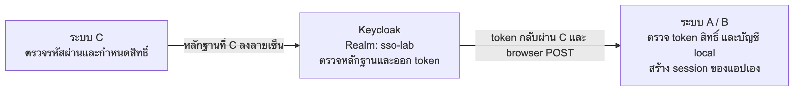
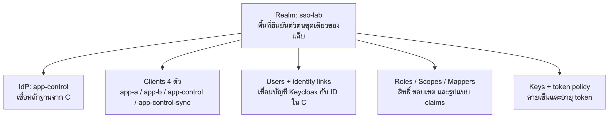

# เข้าใจ SSO แล้วตั้งค่า Keycloak ทีละขั้น

คู่มือภาษาไทยเล่มเดียวสำหรับ PoC นี้ อ่านจากบนลงล่างได้ ไม่ต้องเปิดเอกสาร feature แยกก่อน ชื่อภาษาอังกฤษในวงเล็บเป็นคำที่พบในหน้าจอจริงของ Keycloak

## แผนการอ่าน

1. เข้าใจหน้าที่ของ A/B, C และ Keycloak
2. รู้ว่า Realm, IdP, Client, Role, Scope และ Mapper เชื่อมกันอย่างไร
3. ตามตัวอย่างผู้ใช้หนึ่งคนจนได้ token
4. ตั้งค่าใน UI พร้อมภาพและเหตุผล
5. ตรวจ Login, สิทธิ์, การเชื่อมต่อขัดข้อง และ Logout

## ก่อนตั้งค่า: ระบบเรากำลังทำอะไร

สมมติผู้ใช้ชื่อเมย์ต้องเข้าแอป A และ B โดยกรอกรหัสผ่านที่ C เพียงครั้งเดียว:

| ส่วน     | ทำหน้าที่อะไร                                                        | เก็บอะไร                                                          |
| -------- | -------------------------------------------------------------------- | ----------------------------------------------------------------- |
| ระบบ C   | ตรวจชื่อผู้ใช้/รหัสผ่าน และให้ผู้ดูแลกำหนดสิทธิ์                     | บัญชี รหัสผ่านที่แฮชแล้ว สิทธิ์ต้นทาง และ session ของ C           |
| Keycloak | เชื่อหลักฐานที่ตรวจลายเซ็นจาก C แล้วออก token กลางสำหรับแต่ละแอป     | บัญชีที่ผูกกับ C, สิทธิ์ที่ sync มา, clients, กุญแจและกฎออก token |
| ระบบ A/B | ตรวจ token กลาง ตรวจสิทธิ์และบัญชี local แล้วสร้าง session ของตัวเอง | บัญชีและ session แยกของแอปนั้น                                    |



ภาพนี้เป็นความสัมพันธ์ของหน้าที่ ไม่ใช่จำนวน HTTP request: Keycloak ส่ง token กลับ C แล้ว C ส่งต่อให้ A/B ผ่าน browser POST ไม่ได้เรียก A/B เพื่อเปิด session ให้เอง

**C ตรวจรหัสผ่าน; Keycloak ออก token; A/B ตัดสินใจให้เข้าแอปและสร้าง session ของตัวเอง** ส่วน Login local ของ A/B ยังตรวจ DB ของตัวเองโดยไม่ผ่าน C หรือ Keycloak

## Token, JWT และ session ต่างกันอย่างไร

Token เป็นข้อมูลที่ใช้ยืนยันผลการ Login ส่วน JWT เป็นรูปแบบ token ที่เก็บ claims และลายเซ็น ตัวอย่าง claim คือใครออกให้ ผู้ใช้คนใด ใช้กับแอปไหน มีสิทธิ์อะไร และหมดอายุเมื่อไร JWT ที่เซ็นแล้วไม่ได้แปลว่าเนื้อหาถูกเข้ารหัสเป็นความลับ ใครมี token จึงควรเก็บอย่างระมัดระวัง

| สิ่งที่มีในแล็บ                      | ใครสร้าง                | เอาไปใช้ที่ไหน                                                      |
| ------------------------------------ | ----------------------- | ------------------------------------------------------------------- |
| Assertion อายุ 60 วินาที             | C                       | ยื่นให้ Keycloak ตรวจ ไม่ใช่ token สำหรับเข้า A/B                   |
| Central access token อายุ 300 วินาที | Keycloak                | ให้ A/B ตรวจตัวตนและสิทธิ์ของ client ปลายทาง                        |
| App token                            | A, B หรือ C เอง         | ยืนยัน session ภายในแอปตัวเอง                                       |
| Session                              | แต่ละแอปเก็บฝั่ง server | จำว่า browser นี้ Login เป็นใคร โดย browser ถือ cookie ระบุ session |

**มี C session ไม่ได้แปลว่ามี A/B session แล้ว** แต่ช่วยให้ C ยืนยันผู้ใช้และขอ token ของแอปปลายทางได้โดยไม่ถามรหัสผ่านซ้ำ

## Feature ที่ใช้ เชื่อมกันอย่างไร

### 1. Realm คือพื้นที่ของ SSO ชุดหนึ่ง

Realm เป็นขอบเขตที่รวมบัญชี แอป สิทธิ์ IdP และกฎ token ไว้ด้วยกัน เราตั้งชื่อว่า **sso-lab** โดย A/B/C ใช้ realm เดียวกัน ไม่ต้องสร้าง realm แยกต่อแอป



ตัวอย่าง issuer ของ realm คือ `http://localhost:8080/realms/sso-lab` คำท้าย URL เป็นชื่อ realm ไม่ใช่ชื่อแอป A หรือ B ถ้าสร้าง client ใน master แต่แอปขอ token จาก sso-lab จะหา client ไม่พบ แม้ใช้ชื่อเดียวกัน

Realm **ไม่ใช่ฐานข้อมูลของแอป** และไม่ใช่ Docker container ส่วน master เป็น realm สำหรับดูแล Keycloak ให้คงไว้

### 2. Identity Provider หรือ IdP คือผู้ที่ยืนยันว่าคนนี้เป็นใคร

ใน PoC นี้ **C เป็น IdP ตัวเดียว** Keycloak ลงทะเบียนความเชื่อถือในชื่อ alias `app-control`

เมื่อเมย์ Login C สำเร็จ C สร้างหลักฐานที่ลงลายเซ็นว่า “ฉันตรวจผู้ใช้คนนี้แล้ว” Keycloak ตรวจลายเซ็นนั้นก่อนเชื่อ ไม่ได้รับ password ของเมย์ไปตรวจซ้ำ

**Feature ที่ใช้จริงคือ JWT Authorization Grant:** C ส่งหลักฐานแบบ JWT ให้ Keycloak แลกเป็น token กลาง เราจึงเลือก provider ชนิด JWT Authorization Grant ใน UI ไม่ใช้หน้า Login/consent แบบ OIDC ของ C ซึ่งถูกลบออกจากโค้ดแล้ว

### 3. Client คือตัวตนของโปรแกรมที่ติดต่อ Keycloak

IdP บอกว่า **ใครยืนยันผู้ใช้** ส่วน Client บอกว่า **โปรแกรมใดกำลังขอ token** เป็นคนละหน้าที่ แม้ C จะมีชื่อ app-control อยู่ทั้งสองส่วน

| Client ID        | ขอ token ไปทำอะไร                                          |
| ---------------- | ---------------------------------------------------------- |
| app-a            | เข้า A; A ตรวจว่า token ออกให้ app-a                       |
| app-b            | เข้า B; B ตรวจว่า token ออกให้ app-b                       |
| app-control      | C ขอ token หลัง Login เพื่อยืนยันสถานะ SSO ตามโค้ดปัจจุบัน |
| app-control-sync | C ขอ token ของโปรแกรมเพื่อ sync users/roles ผ่าน Admin API |

ทั้งสี่เป็น confidential clients คือ backend ต้องใช้ Client Secret ยืนยันตัวโปรแกรม Client Secret ไม่ใช่รหัสผ่านผู้ใช้และไม่ควรส่งให้ browser

**ทำไมยังมี client ของ C:** เพราะโค้ด C ยังขอ token หลัง Login ถ้าจะตัด client นี้ต้องแก้ flow ไม่ใช่แค่ลบ settings ส่วน app-control-sync แยกออกมาเพราะใช้สิทธิ์จัดการข้อมูล ไม่ใช่ token สำหรับเข้าแอปของผู้ใช้

### 4. Role คือชื่อสิทธิ์; Role mapping คือใครได้รับสิทธิ์นั้น

สร้าง read, write, delete ใต้ app-a และ app-b แยกกัน จากนั้น C กำหนดว่าเมย์ได้รับ role ใดบ้าง

```text
เมย์
  app-a → read, write
  app-b → read
```

app-a/read กับ app-b/read เป็นคนละสิทธิ์กัน ใน PoC นี้ read ใช้ตัดสินว่าเข้าแอปได้ ส่วน write/delete ออกมาใน token ได้ แต่ยังไม่มี CRUD ให้ทดสอบครบทุกสิทธิ์

ผู้ดูแลติ๊กสิทธิ์ใน C → C เรียก Admin API ไปปรับ role mappings ใน Keycloak → Keycloak ใช้ข้อมูลนั้นออก token ดังนั้นตอน Login ไม่ได้ถาม API ของ A/B ทีละแอปว่าผู้ใช้มีสิทธิ์อะไร

### 5. Scope คือขอบเขตข้อมูลหรือสิทธิ์ที่ client รับได้

ต้องแยกสองคำถาม:

- **User ได้ role อะไร?** ดู role mapping
- **Client รับ role อะไรใน token ได้?** ดู role scope

เมย์มี A/read และ B/read แต่ scope ของ client A รับเฉพาะ roles ของ A จึงไม่ควรได้สิทธิ์ B ปนใน token ของ A เราปิด Full scope allowed และกำหนด scope ให้แต่ละ client อย่างชัดเจน

อีกหน้าหนึ่งเรียก Client scopes เช่น profile, email, roles เป็นชุด mapper/ข้อมูลมาตรฐานที่นำมาใช้กับ client ได้ ในแล็บนี้ A/B/C ใช้ profile กับ email ตามคำขอในโค้ด ส่วน sync client ใช้ roles เพื่อใส่สิทธิ์ Admin API ใน service token

**Dedicated scope** คือพื้นที่ตั้ง mapper และ role scope เฉพาะ client เช่น app-a-dedicated ไม่ใช่ client ใหม่และไม่ต้องสร้างแอปเพิ่ม

### 6. Mapper คือผู้จัดรูปแบบข้อมูลใน token

Role mapping เก็บสิทธิ์ แต่ Mapper แปลงสิทธิ์/ข้อมูลเหล่านั้นเป็นช่องใน JWT ซึ่งเรียกว่า claim:

| Mapper                         | Claim ที่สร้าง                       | ทำไมแอปต้องใช้                    |
| ------------------------------ | ------------------------------------ | --------------------------------- |
| Audience                       | aud มี app-a หรือ app-b ตามปลายทาง   | กันการเอา token ของ A ไปใช้กับ B  |
| Hardcoded claim                | idp = app-control                    | โค้ดยอมรับเฉพาะตัวตนจาก C         |
| User Client Role               | app_permissions ของแอปนั้นเป็น array | โค้ดตรวจว่ามี read หรือไม่        |
| Email จาก client scope มาตรฐาน | email                                | หา local account ใน A/B ที่ตรงกัน |

Mapper ไม่ได้สร้างสิทธิ์ให้ผู้ใช้ขึ้นเองและไม่ได้ตรวจรหัสผ่าน มันนำข้อมูลที่ผ่านการกำหนดไว้มาใส่ใน token

### 7. กุญแจ, ลายเซ็น, JWKS และ issuer คือการตรวจต้นทาง

- **Private key:** กุญแจลับของผู้ออกลายเซ็น เก็บบน server
- **Public key:** กุญแจสำหรับตรวจลายเซ็น แจกให้ตัวตรวจได้
- **JWKS:** URL ที่อ่านชุด public keys ได้
- **kid:** รหัสกุญแจ เพื่อเลือก public key ให้ตรงกับ token
- **Issuer หรือ iss:** ตัวระบุว่าใครออกหลักฐาน/token ต้องตรงกับค่าที่ตัวตรวจเชื่อถือ

มีสองทิศทางที่ต่างกัน:

```text
C เซ็น assertion → Keycloak ตรวจด้วย public key ของ C
Keycloak เซ็น central token → A/B ตรวจด้วย public key ของ Keycloak
```

C ยังใช้กุญแจของตัวเองเซ็นผลส่ง token กลับ A/B และข้อความ Logout ด้วย อย่าเอา private key ของ C ไปตั้งเป็น realm key ของ Keycloak เพราะเป็นกุญแจคนละชุดและคนละหน้าที่

### 8. Service account และ Admin API คือช่องทางจัดการข้อมูล

ตอนผู้ดูแลบันทึกสิทธิ์ใน C โปรแกรมต้องสร้าง/ปรับบัญชีและ role mappings ใน Keycloak จึงใช้ service account ของ client app-control-sync ขอ token ด้วย client_credentials

ให้สิทธิ์ที่ต้อง assign เพียง manage-users กับ view-clients และกำหนดสอง roles นี้ใน scope ของ sync client ด้วย ทดสอบบน 26.8.1 แล้วผ่าน Admin API ทั้ง 12 เส้นที่โค้ดใช้ ไม่ต้องเพิ่ม query-users หรือ realm-admin

นี่ต่างจาก JWT grant สำหรับผู้ใช้: **service account ใช้จัดการข้อมูล ส่วน JWT grant ใช้ออก token กลางหลัง C ยืนยันผู้ใช้แล้ว**

## ตามเมย์หนึ่งคนให้ครบก่อนลงมือตั้งค่า

1. ผู้ดูแลสร้างเมย์ใน C และให้ A/read, A/write, B/read
2. C ใช้ service account สร้างบัญชี metadata ใน Keycloak ผูกกับ C user ID และกำหนด roles
3. เมย์กรอกรหัสผ่านที่ C; C ตรวจ DB ของตัวเองแล้วสร้าง C session
4. เมื่อเข้า A C ส่ง assertion ไปขอ token สำหรับ client app-a
5. Keycloak ใช้ IdP ตรวจหลักฐาน ใช้ federated identity link หาบัญชี แล้วใช้ roles/scopes/mappers สร้าง token
6. C ส่ง token ผ่าน browser POST กลับ A; A ตรวจ JWT และ read แล้วหา local email ที่ตรงกัน จึงสร้าง A session
7. เมื่อเข้า B ใช้ C session เดิม ไม่ถาม password ซ้ำ แต่ขอ token สำหรับ B อีกใบและสร้าง B session แยก

ตัวอย่างเฉพาะ claims สำคัญของ token A:

```json
{
  "iss": "http://localhost:8080/realms/sso-lab",
  "sub": "UUID ของผู้ใช้ใน Keycloak",
  "aud": "app-a",
  "idp": "app-control",
  "email": "may@example.test",
  "app_permissions": { "app-a": ["read", "write"] }
}
```

**Federated identity link** เชื่อม C user ID กับ Keycloak user UUID; assertion sub เป็น C user ID แต่ central token sub เป็น Keycloak UUID ส่วน email ใช้จับคู่บัญชี local ในแอปตามโค้ดปัจจุบัน ไม่ใช่ตัวแทนของลายเซ็นหรือหลักฐาน Login

เมย์ต้องมี local account ใน A ด้วย การมี user/role ใน Keycloak ไม่ได้สร้างบัญชี A ให้อัตโนมัติ และการมีชื่อบัญชีอย่างเดียวก็ใช้ Login ไม่ได้

## เริ่มตั้งค่าใน UI

ต่อไปนี้เป็นขั้นตอนของโค้ดปัจจุบัน ลำดับคือ **Realm → IdP → Clients → Roles/Scopes/Mappers → Service account → Secrets → Sync user → ทดสอบ**

ภาพ UI จริงใช้ Keycloak 26.8.1 ใน instance ชั่วคราว port 18080 มีเฉพาะบัญชีสมมติและปิดบัง secret ค่าที่ต้องใช้จริงในตารางเป็น port 8080 ไม่ใช่ 18080 ภาพไม่ได้หมายความว่า realm ของคุณถูกตั้งค่าให้อัตโนมัติ

## 0. เตรียมข้อมูลและแยก URL ให้ถูก

เปิด [Keycloak Admin](http://localhost:8080/admin/) และ Login ด้วยบัญชี admin ของแล็บ ปัจจุบันค่าเริ่มต้นใน Compose คือ admin / admin-local-demo

| รายการ                   | ค่าของแล็บจริง                              | ใครใช้                                 |
| ------------------------ | ------------------------------------------- | -------------------------------------- |
| Realm                    | sso-lab                                     | ทุกส่วนของ SSO                         |
| Keycloak issuer          | http://localhost:8080/realms/sso-lab        | ค่า iss ที่ A/B/C ตรวจ                 |
| Keycloak internal URL    | http://keycloak:8080/realms/sso-lab         | backend ใน Docker                      |
| C assertion issuer       | http://localhost:4003/oidc                  | Keycloak ตรวจ iss จาก assertion        |
| C JWKS ภายใน Docker      | http://app-control:4003/oidc/jwks           | Keycloak และ A/B อ่าน public key ของ C |
| C JWKS ที่เปิดจากเครื่อง | http://localhost:4003/oidc/jwks             | ผู้พัฒนาตรวจผ่าน browser               |
| Client IDs               | app-a, app-b, app-control, app-control-sync | ต้องตรงกับโค้ด/Compose                 |

**ทำไม localhost กับชื่อ service ต่างกัน:** localhost ภายใน container หมายถึง container นั้น ไม่ใช่เครื่องของคุณ Keycloak จึงต้องอ่าน C ผ่านชื่อ app-control ส่วน issuer เป็นตัวระบุที่ต้องตรงกับ JWT แม้ไม่ได้เรียก URL นั้นทาง HTTP

ถ้ายังไม่มี key ของ C ให้ทำจาก root โปรเจกต์:

```sh
npm ci
npm run keys:generate
docker compose up -d --build
```

คำสั่งสร้าง key ปฏิเสธการเขียนทับไฟล์เดิม หาก C มี key อยู่แล้วให้ใช้ไฟล์นั้น เปิด C /oidc/jwks แล้วต้องเห็น keys array ที่มี kty, n, e, kid, alg, use แต่ไม่มี d/p/q/private key fields

## 1. เลือกหรือสร้าง realm sso-lab

**UI:** realm selector มุมซ้ายบน → Manage realms → Create realm


- หากมี sso-lab จากการ reset แล้ว ให้เลือก realm นี้ ไม่ต้องสร้างซ้ำ
- หากยังไม่มี: Realm name = sso-lab, Enabled = On แล้ว Create
- ดู realm selector ก่อนทำทุกขั้นตอน: ต้องเป็น sso-lab ไม่ใช่ master

**เหตุผล:** realm กำหนด issuer, users, clients และ keys คนละชุดกัน ชื่อ client ถูกต้องแต่อยู่ผิด realm ก็ใช้ไม่ได้ เก็บ master ไว้สำหรับดูแล Keycloak

ตัวเลือก Login ด้านล่างเป็นข้อมูลอ้างอิง ใช้ค่าเริ่มต้นได้ ไม่ใช่ขั้นตอนที่ต้องแก้สำหรับ JWT grant

**UI:** Realm settings → Login


| ตัวเลือก          | ค่า                  | เหตุผล                                                       |
| ----------------- | -------------------- | ------------------------------------------------------------ |
| User registration | Off                  | จัดการบัญชีต้นทางที่ C ไม่เปิดสมัครบัญชีผ่าน Keycloak        |
| Duplicate emails  | Off                  | โค้ด C ค้นหา email แบบ exact และปฏิเสธเมื่อพบมากกว่า 1 บัญชี |
| Login with email  | On ได้ตามค่าเริ่มต้น | เป็นการ Login ของ Keycloak เอง ไม่ใช่ตัวควบคุม Login C       |
| Email as username | ไม่จำเป็นต้องเปิด    | C sync ตั้ง username=email ให้เองตอนสร้าง Keycloak user      |

ไม่ต้องปรับ browser authentication flow หรือสร้าง IdP redirector สำหรับ JWT grant นี้

## 2. ตั้งอายุ central access token และตรวจ realm key

**UI:** Realm settings → Tokens → Access Token Lifespan


| ค่า                         | ตั้งเป็น                | ทำไม                                             |
| --------------------------- | ----------------------- | ------------------------------------------------ |
| Default Signature Algorithm | RS256                   | โค้ดตรวจรับเฉพาะ RS256                           |
| Access Token Lifespan       | 5 Minutes / 300 seconds | ให้ตรงค่าตั้งต้น PoC ปัจจุบันและทดสอบ expiry ได้ |

กด Save หลังแก้ค่า หาก client มี override อายุ token ใน Advanced ให้ล้าง override เพื่อรับค่าจาก realm

**5 นาทีไม่ใช่ 1 ชั่วโมง:** heartbeat 1 ชั่วโมงอยู่ใน JavaScript ของแอป ไม่ใช่ Keycloak และไม่ได้ต่ออายุ JWT สำหรับ token หมดอายุแอปจะ Logout เมื่อมี protected request หรือถึงรอบ heartbeat ถ้า requirement จะใช้ 15 นาที ให้ตั้ง 900 วินาทีโดยรู้ว่าเปลี่ยนจากค่าคู่มือนี้

**UI:** Realm settings → Keys → Keys list


ตรวจว่ามี active RS256/SIG ของ rsa-generated ใช้กุญแจที่ Keycloak สร้างให้ได้ ไม่ต้อง upload private key ของ C เข้า realm นี้ เพราะ C key ใช้ตรวจ assertion ส่วน realm key ใช้เซ็น central token เป็นคนละหน้าที่

## 3. สร้าง IdP ตัวเดียว: app-control

**UI:** Identity providers → Add provider → JWT Authorization Grant


เลือกชนิด **JWT Authorization Grant** ไม่ใช่ OpenID Connect v1.0 สำหรับคู่มือใหม่ เพราะ C ไม่มี /oidc/auth หรือ /oidc/token ให้ Keycloak เรียกแล้ว และไม่ต้องตั้ง URL ที่ไม่ได้ใช้


| Field                            | ค่า                               | เหตุผล/ผลเมื่อผิด                                                                       |
| -------------------------------- | --------------------------------- | --------------------------------------------------------------------------------------- |
| Alias                            | app-control                       | โค้ด sync federated identity และ client allowlist ใช้ชื่อนี้; เปลี่ยนเองจะหา link ไม่พบ |
| Enabled                          | On                                | อนุญาตให้ใช้ trust relationship นี้                                                     |
| Issuer                           | http://localhost:4003/oidc        | ต้องตรง assertion iss ที่ C ลงลายเซ็น                                                   |
| Use JWKS URL                     | On                                | อ่าน public key จาก C อัตโนมัติ ไม่ต้อง copy key ด้วยมือ                                |
| JWKS URL                         | http://app-control:4003/oidc/jwks | Keycloak ใน Docker เชื่อมต่อถึง C ได้                                                   |
| Allow assertion reuse            | Off                               | assertion มี jti และใช้ได้ครั้งเดียว                                                    |
| Max allowed assertion expiration | 1 Minute หรือ 60 Seconds          | C สร้าง assertion อายุ 60 วินาที; UI อาจแสดงเป็น 1 Minutes                              |
| Assertion signature algorithm    | RS256                             | ตรงกับ private key และ signing code ของ C                                               |
| Limit access token expiration    | Off                               | ไม่บีบอายุ central token 5 นาทีให้เหลือไม่เกิน assertion 60 วินาที                      |
| Allowed clock skew               | 0                                 | ค่าแล็บใช้เวลาเครื่องเดียวกัน ไม่เพิ่มช่วงยอมรับโดยไม่จำเป็น                            |

กด Add/Save ตามสถานะหน้าจอ

**Provider ชนิดนี้เปิด JWT grant ในตัว:** ไม่ต้องหา JWT Authorization Grant On/Off ในหน้า IdP เหมือน OIDC provider อีก แต่ client ในขั้นถัดไปยังต้องเปิด JWT Authorization Grant และเลือก IdP ให้ถูก

## 4. สร้าง clients ของ A/B/C

**UI:** Clients → Create client


สร้าง 3 client โดยทำซ้ำ: app-a, app-b และ app-control

### 4.1 General settings

| Field       | ค่า                                     |
| ----------- | --------------------------------------- |
| Client type | OpenID Connect                          |
| Client ID   | app-a หรือ app-b หรือ app-control       |
| Name        | ตั้งชื่ออ่านง่ายได้ ไม่ใช้แทน Client ID |

ชื่อ Client type = OpenID Connect เป็นรูปแบบ protocol ของ token ไม่ได้แปลว่าเราต้องเปิด browser code flow

### 4.2 Capability config

**UI:** Clients → เลือก client → Settings → Capability config


| Capability                                             | ค่า                  | เหตุผล                                                       |
| ------------------------------------------------------ | -------------------- | ------------------------------------------------------------ |
| Client authentication                                  | On                   | backend ต้องใช้ client secret ยืนยันตัวแอป                   |
| Authorization                                          | Off                  | ไม่ใช้ Keycloak Authorization Services ใน PoC นี้            |
| Standard flow                                          | Off                  | ไม่ใช้ browser authorization-code ผ่าน Keycloak              |
| Direct access grants                                   | Off                  | ไม่ส่ง password ผู้ใช้ไป Keycloak                            |
| Implicit flow                                          | Off                  | ไม่ใช้ implicit token ใน browser                             |
| Service accounts roles                                 | Off                  | 3 client นี้ขอ token ของ user; service account แยกอีก client |
| JWT Authorization Grant                                | On                   | อนุญาตรับ assertion จาก C                                    |
| Allowed Identity Providers for JWT Authorization Grant | app-control เท่านั้น | จำกัด trust source ตามโค้ด                                   |
| Standard Token Exchange / Device / CIBA หากแสดง        | Off                  | ไม่ใช้ใน flow ปัจจุบัน                                       |

หาก wizard ยังไม่แสดง field ทั้งหมด ให้ Save ก่อน แล้วกลับ Settings เพื่อแก้ค่าที่เหลือ

Access settings เช่น Valid redirect URIs และ Web origins เว้นว่างได้สำหรับ JWT grant นี้ เพราะ A/B callback เป็น browser POST ที่ C ส่งเอง ไม่ใช่ redirect ที่ Keycloak authorization endpoint ตรวจ อย่าใส่ wildcard เพื่อให้ผ่านปัญหาคนละสาเหตุ

Login/Logout settings: ไม่ต้องใส่ Backchannel logout URL เพราะเราใช้ signed C notification ไป /logout/control และลบ /logout/backchannel ไปแล้ว

### 4.3 เก็บ Client Secret

**UI:** Clients → เลือก client → Credentials → Client Secret


Client Authenticator ใช้ Client Id and Secret และ Allowed authentication method ใช้ Any ตามค่าแล็บที่ทดสอบ (C ส่ง client_secret ใน form body)

เปิดแท็บ Credentials ได้เมื่อ Client authentication = On เก็บ secret ไว้ใน .env ฝั่ง server ตามตารางขั้น 10 ไม่ copy ลงเอกสารหรือ commit Git

หากกด Regenerate ต้องอัปเดต secret ใน environment ของ backend ที่ใช้ client นั้นทั้งหมด โดยเฉพาะ A/B secret ซึ่ง C ใช้ขอ token และ A/B ใช้ introspection

## 5. สร้าง client roles ของ A/B

**UI:** Clients → app-a → Roles → Create role ทำซ้ำใน app-b


สร้าง read, write, delete อย่างละ 1 role ในทั้งสอง client รวม 6 definitions ไม่ต้องสร้าง role สำหรับ app-control ใน PoC นี้

| Role   | การใช้งานจริง                                            |
| ------ | -------------------------------------------------------- |
| read   | A/B ตรวจสิทธิ์นี้เพื่อเข้าแอป                            |
| write  | ส่งตามสิทธิ์ที่กำหนดใน C; ยังไม่มี CRUD ครบทุกกรณีใน PoC |
| delete | เช่นเดียวกับ write                                       |

อย่า assign ให้เป็น default role ของผู้ใช้ทุกคน และอย่ารวมเป็น composite ให้อัตโนมัติ เพราะต้องให้ C เป็นผู้ตัดสินสิทธิ์แต่ละ user

## 6. จำกัด Role scope และตรวจ default client scopes

**UI:** Clients → app-a → Client scopes → app-a-dedicated


Dedicated scope ไม่ใช่ client ใหม่ เป็นพื้นที่ config เฉพาะของ client นั้น เปิดแล้วมีแท็บ Mappers กับ Scope

**UI:** app-a-dedicated → Scope → Full scope allowed = Off → Assign role


- กด Assign role → Client roles แล้วเลือก app-a/read, app-a/write, app-a/delete จาก client app-a หาก dialog มี filter ให้ค้นชื่อ app-a
- ทำซ้ำ app-b โดยเลือกเฉพาะ roles ของ app-b
- app-control ตั้ง Full scope allowed = Off และไม่ต้องเพิ่ม application roles
- ไม่ใส่ roles ของ B ใน scope ของ A และกลับกัน

**เหตุผล:** จำกัดข้อมูลสิทธิ์ที่ client รับได้ ไม่ได้เป็นการมอบสิทธิ์ให้ทุก user การให้ user จริงต้องทำใน C หรือ role mapping ภายหลัง

ในหน้า Client scopes ของแต่ละ client สำหรับ app-a/app-b/app-control ให้มี profile และ email เป็น Assigned type = Default; ลบ roles ออกจาก Assigned scopes ของสาม client นี้ หากมีติดมา เพราะใช้ dedicated mappers อยู่แล้ว สำหรับ app-control-sync ให้ใช้เฉพาะ roles เป็น Default หากไม่ได้ติดมาตามค่าเริ่มต้น ให้ Add client scope แล้วเลือก Default

- email ทำให้ access token มี email ที่ A/B ใช้หา local account
- profile ให้ข้อมูล profile ตาม scope ที่ C ส่งไป
- roles ใช้เฉพาะ app-control-sync เพื่อให้ service-account token มี resource_access สำหรับ Admin API

## 7. ตั้ง Protocol Mappers

**UI:** Clients → app-a → Client scopes → app-a-dedicated → Mappers


ถ้ายังไม่มี mapper ให้ Add mapper → By configuration หรือ Configure a new mapper ตามปุ่มที่แสดง เลือก mapper type ตามหัวข้อด้านล่าง

### 7.1 Audience mapper

เลือก type Audience ชื่อ control-audience


| Field                            | app-a | app-b | app-control |
| -------------------------------- | ----- | ----- | ----------- |
| Included Client Audience         | app-a | app-b | app-control |
| Included Custom Audience         | ว่าง  | ว่าง  | ว่าง        |
| Add to access token              | On    | On    | On          |
| Add to ID token                  | Off   | Off   | Off         |
| Add to token introspection หากมี | On    | On    | On          |

**เหตุผล:** A/B/C ตรวจ audience ของ token ที่ได้รับ หากไม่มี client ของตัวเองใน aud จะปฏิเสธ แม้ลายเซ็นถูกต้อง

### 7.2 IdP claim mapper

เลือก type Hardcoded claim ชื่อ control-source-idp ทำเหมือนกันทั้ง 3 client


| Field                      | ค่า         |
| -------------------------- | ----------- |
| Token Claim Name           | idp         |
| Claim value                | app-control |
| Claim JSON Type            | String      |
| Add to access token        | On          |
| Add to ID token / userinfo | Off         |
| Add to token introspection | On          |

**เหตุผล:** โค้ดตรวจ idp เท่ากับ app-control และ client allowlist รับเฉพาะ C อยู่แล้ว ไม่ต้องอาศัย browser broker session note ที่ไม่มีใน grant นี้

### 7.3 Permission mapper

เลือก type User Client Role ชื่อ control-permissions เฉพาะ app-a และ app-b ไม่ต้องเพิ่มใน app-control


| Field                      | app-a                 | app-b                 |
| -------------------------- | --------------------- | --------------------- |
| Client ID                  | app-a                 | app-b                 |
| Client Role prefix         | ว่าง                  | ว่าง                  |
| Token Claim Name           | app_permissions.app-a | app_permissions.app-b |
| Claim JSON Type            | String                | String                |
| Multivalued                | On                    | On                    |
| Add to access token        | On                    | On                    |
| Add to ID token / userinfo | Off                   | Off                   |
| Add to token introspection | On                    | On                    |

**เหตุผล:** จุดในชื่อ claim สร้าง object ซ้อน Multivalued สร้าง array ของชื่อ roles แม้ผู้ใช้มี role เดียว จึงตรงกับ includes("read") ที่โค้ดใช้

ผลตัวอย่างที่ต้องได้เมื่อ user มี read/write ใน A:

```json
{
  "aud": "app-a",
  "idp": "app-control",
  "email": "learner@example.test",
  "app_permissions": { "app-a": ["read", "write"] }
}
```

JWT จริงมี sub, iss, exp, iat, jti และ claims อื่นเพิ่มด้วย หาก roles ออกมาเป็นข้อความ JSON string แทน array หรือ key ชื่อ app_permissions.app-a แบบไม่ซ้อน ให้ตรวจชนิด mapper และ field ตามภาพ

## 8. สร้าง service-account client สำหรับ C sync

**UI:** Clients → Create client → Client ID = app-control-sync, Client type = OpenID Connect


ตั้ง Client authentication = On, Service accounts roles = On และปิด Standard, Direct access grants, Implicit, JWT Authorization Grant และ capability อื่นที่ไม่ใช้ แล้ว Save

**เหตุผล:** C ต้องขอ token ของโปรแกรมด้วย client_credentials เพื่อเรียก Admin API ไม่ใช่ token ของผู้ใช้ และไม่ควรใช้บัญชี admin ของคนแทน

### 8.1 Assign roles ให้ service-account user

**UI:** Clients → app-control-sync → Service account roles → Assign role


กด Assign role → Client roles แล้วค้นหา roles จาก client realm-management จากนั้น assign:


- manage-users
- view-clients

หากไม่เห็นรายการ ให้เลือก Client roles ในเมนู Assign role แทน Realm roles ก่อน ไม่ต้องสร้าง role ชื่อเดียวกันใน realm เอง query-users ไม่ต้อง assign เพิ่ม: ทดสอบใน 26.8.1 แล้ว manage-users ครอบคลุมการค้นหาที่โค้ดใช้

### 8.2 อนุญาต roles เหล่านั้นใน scope ของ sync client ด้วย

**UI:** app-control-sync → Client scopes → app-control-sync-dedicated → Scope


Full scope allowed = Off แล้ว Assign role สองรายการเดิมจาก realm-management ตั้ง default client scopes เป็น roles เท่านั้น ไม่ต้องมี profile/email ใน sync client

**เหตุผล:** service-account roles ที่ได้ใน token คือ roles ที่ assign ให้บัญชีตัดกับ roles ที่ scope อนุญาต ถ้า assign แล้วแต่ token ไม่มี roles Admin API จะ 403 ส่วน realm-admin และ manage-clients ไม่ต้องให้ เพราะโค้ด sync ไม่สร้างหรือแก้ client

## 9. ตรวจว่ามี clients ครบและ capabilities ถูกชุด

| Client           | Client auth | JWT grant | Allowed IdP | Service account | Role scope                 |
| ---------------- | ----------- | --------- | ----------- | --------------- | -------------------------- |
| app-a            | On          | On        | app-control | Off             | app-a/read, write, delete  |
| app-b            | On          | On        | app-control | Off             | app-b/read, write, delete  |
| app-control      | On          | On        | app-control | Off             | ไม่มี app roles            |
| app-control-sync | On          | Off       | ไม่ใช้      | On              | realm-management สอง roles |

ทุก client ปิด Standard flow, Direct access grants และ Implicit flow ใน flow นี้ Clients มาตรฐาน เช่น account, broker, realm-management ไม่ต้องลบหรือแก้ตามชื่อ client ของแอป

## 10. ใส่ secrets ให้ environment ตรงกัน

Credentials อยู่ในแท็บ Credentials ของแต่ละ client ไม่ใช่ secret ของ IdP และไม่ใช่ password ของ user

| Secret จาก client | ตัวแปรใน .env              | ใครใช้ใน Compose                            |
| ----------------- | -------------------------- | ------------------------------------------- |
| app-a             | APP_A_KC_CLIENT_SECRET     | A introspection และ C token/revoke สำหรับ A |
| app-b             | APP_B_KC_CLIENT_SECRET     | B introspection และ C token/revoke สำหรับ B |
| app-control       | CONTROL_KC_CLIENT_SECRET   | C bootstrap token ของตัวเอง                 |
| app-control-sync  | CONTROL_SYNC_CLIENT_SECRET | C เรียก Admin API                           |

เก็บ client IDs, KC_ISSUER, KC_INTERNAL_URL ตาม .env.example แล้วรัน:

```sh
docker compose up -d --force-recreate app-a app-b app-control
```

ไม่ต้อง down -v เพราะจะลบข้อมูลที่คุณกำลังศึกษา หลังล้าง Keycloak Client Secrets จะเป็นชุดใหม่ แม้ชื่อ client เหมือนเดิม การใช้ secret เก่าคือสาเหตุ invalid_client ที่พบบ่อย

## 11. Sync user จาก C แล้วตรวจใน Keycloak

1. เปิด C Login ด้วยบัญชีผู้ดูแล
2. ไป Users กำหนด read/write/delete ของ A/B แล้ว Save หรือกด Sync อีกครั้ง
3. ต้องเห็นสถานะ sync สำเร็จ หาก error ให้ดูข้อความก่อนทดสอบ Login
4. ใน Keycloak ไป Users ค้นหา email เดียวกัน


**UI:** Users → เลือก user → Identity provider links


ต้องมี alias app-control และ external user ID ตรงกับ users.id ของ C ที่แปลงเป็น string ไม่ใช่ email และไม่ใช่ UUID ของ Keycloak ภาพใช้ docs-user-001 เป็น ID สมมติของบัญชีสำหรับทดสอบคู่มือ ไม่ให้นำค่านี้ไปกรอกแทน ID จริงของ C

**UI:** Users → เลือก user → Role mapping


ตรวจว่าได้ client roles ตรงกับ C ตัวอย่างภาพ learner มี A read/write และ B read ไม่ต้องตั้ง password ในแท็บ Credentials ของผู้ใช้คนนี้ เพราะ Login ตรวจที่ C

A/B ยังต้องมี local account ที่ email ตรงกับ C ด้วย ดู CLI สร้างบัญชีใน README หลัก การ sync Keycloak ไม่ได้สร้าง local users ใน A/B

## 12. ทดสอบตามลำดับและอ่านผล

1. Login C โดยตรง: สถานะ SSO ต้องพร้อมหลังตรวจ readiness และขอ token
2. เปิด A จากลิงก์ C: ได้ app session โดยไม่กรอกรหัสผ่าน C ซ้ำ
3. เปิด B: ออก token สำหรับ B อีกใบและสร้าง B session แยกกัน
4. ถอน read ของ A ใน C และ sync: เริ่ม SSO ใหม่จากปุ่ม A แล้วต้องแจ้งไม่มีสิทธิ์ตาม policy; token เดิมยังมี claims เดิมจนหมดอายุหรือถูก revoke
5. ใช้ user ที่ไม่มี local account ใน A/B: ต้องแจ้งไม่มีผู้ใช้ที่ตรงกัน
6. Logout C: revoke tokens ที่ยังใช้ได้และแจ้ง A/B ให้ Logout
7. Local Login A/B ต้องยังใช้ได้โดยไม่พึ่ง token กลาง

ดู raw central token ได้ที่ browser DevTools → Network → POST /sso/callback → Payload; token อยู่ใน POST ไม่ใช่ URL สำหรับ introspection/revoke ดู [API catalog](../flows/API-CATALOG.md) ใช้ credentials ของ client ที่ออก token นั้นเท่านั้น

### ข้อผิดพลาดที่พบบ่อย

| อาการ                                        | ตรวจตรงไหนก่อน                                                                      |
| -------------------------------------------- | ----------------------------------------------------------------------------------- |
| invalid_client                               | realm, Client authentication On, client ID/secret และ recreate แอปหลังแก้ .env      |
| invalid_grant / assertion ไม่ผ่าน            | issuer, aud, signature/kid, JWKS URL, expiration, allowed IdP และ user link         |
| JWT grant ขอได้ แต่ A/B ปฏิเสธ               | aud, idp mapper, email, app_permissions, read และ local user                        |
| ไม่มี app_permissions หรือได้แอปอื่นปน       | User Client Role mapper, claim name, Full scope allowed และ role scope ของ client   |
| C sync 403                                   | service-account role assignment, role scope และ default roles client scope          |
| C sync บอกยังไม่มี Client/role               | สร้าง app-a/app-b และ read/write/delete ให้ครบก่อน sync                             |
| C sync พบสิทธิ์สืบทอดที่ไม่อนุญาต            | ตรวจ group/composite/default roles อย่า override การกำหนดจาก C โดยไม่ตั้งใจ         |
| Token หมดเร็วกว่าที่ตั้ง realm               | IdP Limit access token expiration หรือ client lifespan override                     |
| หน้า Sessions ไม่มี user แต่ token active    | JWT grant เป็น transient session; ตรวจ introspection แทน persistent browser session |
| เปิด C /oidc/auth หรือ /interaction แล้ว 404 | endpoint เหล่านี้ถูกลบโดยตั้งใจ ใช้ JWT grant ตามคู่มือนี้                          |

## เมื่อเชื่อมต่อขัดข้อง: preflight และ retry คืออะไร

**Preflight ในแล็บนี้หมายถึงการตรวจความพร้อมของ Keycloak ไม่ใช่ CORS OPTIONS request** Backend เรียก discovery endpoint และตรวจ issuer ก่อนให้ browser เดินทางไป C การเชื่อมต่อได้ยังไม่ได้ยืนยันว่าผู้ใช้มีสิทธิ์หรือขอ token สำเร็จ

| จุดเริ่ม                           | ตรวจอะไร                                          | เมื่อไม่พร้อม                                                 |
| ---------------------------------- | ------------------------------------------------- | ------------------------------------------------------------- |
| A/B ลอง SSO อัตโนมัติตอนเปิด Login | ตรวจ discovery 1 ครั้ง                            | อยู่หน้า Login แสดงสถานะ SSO ไม่พร้อม ไม่เปิด modal อัตโนมัติ |
| ผู้ใช้กด Login ด้วย C ใน A/B       | POST /sso/preflight ตรวจ discovery สูงสุด 3 ครั้ง | modal เชื่อมต่อไม่ได้ โดย local Login ยังใช้ได้               |
| เปิด /sso โดยตรงจากลิงก์           | backend ตรวจพร้อมเช่นกัน                          | กลับ Login ของแอปพร้อมข้อความ                                 |
| Login C โดยตรง                     | C session สำเร็จก่อน แล้วตรวจพร้อมสูงสุด 3 ครั้ง  | C ยังใช้ได้ แต่สถานะ SSO failed                               |

แต่ละครั้ง timeout 3 วินาที เว้นช่วง 2 และ 5 วินาที เฉพาะ timeout/network, 429 และ 5xx ที่ retry; issuer ผิด, JSON ไม่ถูกต้อง และ 4xx อื่นหยุดทันที

ถ้าพร้อม A/B สร้าง state และ challenge แล้วให้ browser ไป **C /sso/authorize** ไม่ได้ส่งไปหน้า authorization ของ Keycloak และไม่มี nonce/OIDC code exchange ในช่วงนี้ หน้า A/B อ่าน /sso/connectivity เพื่อแสดงจำนวนครั้งที่ตรวจ; endpoint นี้ไม่ได้ขอ token

**POST token ยังไม่ retry 3 ครั้งในโค้ดปัจจุบัน** การ retry ข้างบนเป็น readiness checks หาก Keycloak ล่มหลังตรวจพร้อม C จะแจ้ง temporarily_unavailable กลับ A/B ผ่าน callback ไม่ให้ browser ไปหน้า Keycloak

## สถานะ SSO บน C หมายถึงอะไร

| สถานะในโค้ด | ความหมาย                                                                            |
| ----------- | ----------------------------------------------------------------------------------- |
| idle        | session นี้ยังไม่มีผลตรวจ SSO                                                       |
| checking    | backend กำลังตรวจความพร้อม                                                          |
| ready       | ติดต่อได้แล้ว รอหน้า C ส่ง POST /sso/continue                                       |
| redirecting | ชื่อสถานะเดิม แต่ตอนนี้หมายถึงกำลังขอ token ผ่าน backend ไม่ใช่ browser ไป Keycloak |
| success     | C ตรวจ token ที่ได้รับและบันทึกสำเร็จ                                               |
| failed      | การตรวจ/ขอ token ล้มเหลว หรือผลเดิมหมดอายุ                                          |

หน้า C อ่าน /sso/status ทุกประมาณ 1 วินาทีตอนรอ และ 10 วินาทีเมื่อไม่ pending เมื่อ ready จะส่งฟอร์ม POST /sso/continue ที่ตรวจ CSRF แล้ว backend ขอ token สำหรับ app-control จากนั้นกลับ dashboard

สถานะนี้คือผลล่าสุดที่ C ตรวจ ไม่ใช่การรับประกันว่า Keycloak ยังออนไลน์หรือทุกแอปมีสิทธิ์ตลอดเวลา A/B ต้องตรวจ token และ local account ของตัวเอง

ลิงก์ /connect/app-a และ /connect/app-b ใน C ตรวจสิทธิ์, sync status และ SSO status ก่อนส่งไป /sso ของแอป การสร้าง token ไม่สำเร็จไม่ลบ C local session ส่วนคำขอที่ pending ค้างเกิน 2 นาทีจะถูกทำเครื่องหมาย failed

## อายุ token, heartbeat และ Logout เชื่อมกันอย่างไร

| สิ่งที่พูดถึง                 | อายุ/วิธีตรวจในแล็บ                                        |
| ----------------------------- | ---------------------------------------------------------- |
| assertion จาก C               | 60 วินาที ใช้ยื่นขอ token; jti ใช้ซ้ำไม่ได้                |
| central access token          | 300 วินาที ตาม realm; ไม่มี refresh token จาก JWT grant    |
| local app session             | แต่ละแอปจัดการเอง อายุ 1 ชั่วโมง                           |
| app token เมื่อ Login แบบ SSO | อายุไม่เกิน central token                                  |
| heartbeat ของ A/B             | browser เรียก /session/heartbeat ของแอปตัวเองทุก 1 ชั่วโมง |

Heartbeat ไม่ได้ต่ออายุ token และไม่ได้แปลว่า token มีอายุ 1 ชั่วโมง หากเปิดหน้าค้าง แอปตรวจในรอบ heartbeat แต่ protected requests ที่ผู้ใช้เรียกก่อนถึงรอบก็ตรวจ exp ด้วย

A/B ตรวจ JWT ภายในตอน Login โดยไม่ introspect รอบแรก เมื่อ heartbeat ทำงาน ถ้า token หมดอายุแล้วจะตอบ 401 และกลับ Login โดยไม่ต้องเรียก Keycloak หากยังไม่หมดอายุจึง introspect: active=false ให้ออก ถ้าเชื่อมต่อไม่ได้ตอบ 503 และรอรอบถัดไป ไม่มี focus check หรือ expiry timer เพิ่ม

JWT grant ใช้ transient session จึงอาจไม่เห็น persistent browser session ในหน้า Sessions ของ Keycloak การไม่เห็นรายการไม่ได้แปลว่าไม่เคยออก token ให้ตรวจ introspection แทน การไม่ถามรหัสผ่านซ้ำอาศัย C session ไม่ใช่ Keycloak cookie

- **Logout A/B:** ล้างเฉพาะ app session ของแอปที่กด
- **Logout C:** revoke token กลางที่ยังไม่หมดอายุ แล้วส่ง signed notification ไป A/B ที่ /logout/control ให้ล้าง SSO sessions และแจ้ง browser ผ่าน SSE; local sessions ของ A/B คงอยู่
- การ revoke token ไม่ได้ลบ cookie ของ A/B ให้เอง จึงต้องมี notification และแอปตรวจลายเซ็นก่อนรับ

## ขอบเขตและจุดที่โค้ดปัจจุบันยังมีข้อจำกัด

คู่มือนี้อธิบายสิ่งที่โค้ดทำจริง ไม่ใช่ flow ที่ลด request แล้ว:

- กรณี A/B ยังไม่มี C session ยังผ่าน /login และ /sso/resume ตาม diagram ปัจจุบัน ส่วนที่เสนอให้รวมยังไม่ได้แก้โค้ด
- Direct Login C ยังใช้ browser polling และ POST continue; ยังไม่ได้รวมเป็นงาน backend ขั้นเดียว
- C รวม sync ไม่สำเร็จกับ access_denied ในบางเส้นทาง ทำให้ modal ไม่มีสิทธิ์อาจไม่แยกสาเหตุได้
- ลิงก์ใน C ยังอาศัยสถานะ SSO success ที่ผูกกับอายุ token ขณะที่เริ่ม SSO จาก A/B สามารถใช้ C session ที่ยังอยู่ขอ token ใหม่ได้
- คำสั่งล้าง C sessions ตอนเปลี่ยนรหัสผ่าน/ลบผู้ใช้ยังอ่าน userId ผิดระดับตามที่ตรวจพบ จึงไม่ควรอ้างว่าล้าง session เดิมได้ครบแล้ว

สิ่งเหล่านี้ต้องแก้ flow/โค้ด ไม่ใช่เพิ่ม setting ของ Keycloak ให้มากขึ้น

## วิธีตรวจแล็บหลังตั้งค่าครบ

```sh
npm test
python3 scripts/test-local-smoke.py
python3 scripts/test-api-mode.py
python3 scripts/test-post-sso.py
python3 scripts/test-explicit-denial.py
python3 scripts/test-hourly-sso.py
```

npm test ตรวจ readiness/retry และ public JWKS โดยไม่ตั้งค่า realm ส่วน browser integration tests ต้องตั้งค่าแล็บและ secrets ให้ครบก่อน สร้างบัญชีชั่วคราวแล้วลบเมื่อจบ การทดสอบ hourly เปลี่ยนอายุ token ชั่วคราวแล้วคืนค่า

ค่าตั้งคู่มือนี้ผ่านการทดสอบใน Keycloak 26.8.1 ชั่วคราวแยกจาก realm จริง: JWT grant ของ A/B/C, claims ที่แยกตามแอป, อายุ 300 วินาที, ปฏิเสธ assertion ซ้ำ, introspection/revoke และ Admin API ทั้ง 12 เส้นด้วย manage-users + view-clients โดยไม่มี query-users ไม่ใช่หลักฐานว่าแล็บจริงถูกตั้งค่าให้อัตโนมัติ

## อ่านโค้ดตรงไหนเมื่ออยากรู้เพิ่ม

| เรื่อง                              | ไฟล์                                                                |
| ----------------------------------- | ------------------------------------------------------------------- |
| C ขอ token และส่ง form POST ให้ A/B | [api-sso.js](../../app-control/src/sso/api-sso.js)                  |
| C sync บัญชี/สิทธิ์                 | [keycloak-sync.js](../../app-control/src/services/keycloak-sync.js) |
| A/B ตรวจ token และสร้าง session     | [keycloak.js](../../app/src/sso/keycloak.js)                        |
| การนับ API และ diagram รายกรณี      | [เอกสาร Flow](../flows/README.md)                                   |

เอกสารทางการสำหรับค้นต่อ: [JWT Authorization Grant](https://www.keycloak.org/securing-apps/jwt-authorization-grant), [คู่มือผู้ดูแล Keycloak](https://www.keycloak.org/docs/latest/server_admin/index.html) ไม่จำเป็นต้องอ่านก่อนลงมือตามคู่มือเล่มนี้
